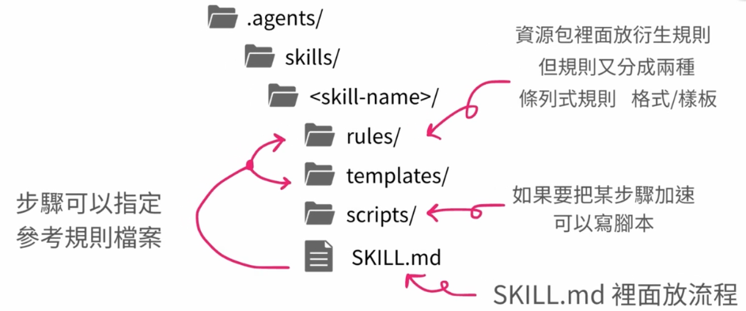

# s-aixbdd

水球軟體學院《AI x BDD》學員的 Skill 作品集，給想看 Agent Skill 怎麼寫、怎麼用 String Calculator 與一個小型 Java Web 框架驗證的人。

[](https://github.com/AI-x-BDD/s-aixbdd/actions/workflows/ci.yml)



Skill 的目錄結構：`SKILL.md` 放流程，`rules/`、`templates/`、`scripts/` 由步驟指定、按需載入。

## Quick Start

需要 Java 21 與 Maven。

```bash
git clone https://github.com/AI-x-BDD/s-aixbdd.git
cd s-aixbdd
mvn test
mvn test -f java-web-framework/pom.xml
```

第一個指令跑 String Calculator（`src/`）的測試，第二個跑 `java-web-framework/` 的測試。CI（`.github/workflows/ci.yml`）在 push 或 PR 到 `main` 時以 Java 21 執行同樣兩組測試，並用 `scripts/sync-skills.sh --check` 確認兩邊 Skill 一致。

## Features

| 作業 | Skill | 用途 | 相關紀錄 |
| ---- | ----- | ---- | -------- |
| ch1 | `double-diamond` | 依雙鑽石原則釐清需求、定義問題、比較解法 | [docs/ch1.md](docs/ch1.md) |
| ch1 | `trunk-based-development` | 依主幹式開發規劃 PR 拆分、branch 策略與整合方式 | [docs/ch1.md](docs/ch1.md) |
| ch1 | `conventional-commits` | 撰寫符合 Conventional Commits 的提交訊息 | [docs/ch1.md](docs/ch1.md) |
| 第二份作業 | `skill-engineering` | 建立新 Skill，或依不滿意的結果做根因分析並優化既有 Skill，編排下列兩組 Skill 施工 | [specs/skill-engineering/](specs/skill-engineering/) |
| 第二份作業 | `skill-form-*`（description、sop、rule、template、script） | 撰寫 Skill 的單一部位 | [specs/skill-engineering/](specs/skill-engineering/) |
| 第二份作業 | `skill-derive-*`（rule、template、script） | 為指定的 SOP 步驟抽出規則、樣板或腳本，並掛上載入步驟 | [specs/skill-engineering/](specs/skill-engineering/) |
| 第二份作業 | `plan-with-class-diagram` | 實作前先提出 Mermaid 類別圖，取得確認後再依類別圖實作 | [specs/plan/](specs/plan/)、[java-web-framework/](java-web-framework/) |
| 外部 | `skill-creator` | 來自 [anthropics/skills](https://github.com/anthropics/skills)，保持原樣，來源與雜湊記在 `skills-lock.json` | — |

同目錄還有 `typesafe-ai`（TypeSafe 使用指引）與 `video-production`（把章節素材做成有旁白與字幕的影片；使用者實際驗證：未驗證）。

## Why

- **ch1**：以 [Coding Dojo](https://codingdojo.org/) 的 String Calculator（Java 21、Maven、JUnit 5）實際驗證三支 Skill，說明與驗證見 [docs/ch1.md](docs/ch1.md)，各步驟過程見 `docs/過程/CH1/`。
- **第二份作業**：用 `plan-with-class-diagram` 先畫類別圖規劃，再實作 [java-web-framework/](java-web-framework/)（Java 17、Maven、JUnit 5）；類別圖提案在 `specs/plan/`，Skill 建立與優化的藍圖和根因報告在 `specs/skill-engineering/`。
- **ch2**：用 `skill-engineering` 改寫 ch1 的三支 Skill，前後比較在 `docs/過程/CH2/`。

### ch2：用 Skill Engineering 改寫三支 Skill

Skill Engineering 負責準備測試案例、保存修改前的回答並分析根因。根因與修改方案經確認後，再由 `skill-form-sop`、`skill-derive-rule` 與 `skill-form-rule` 整理主流程、抽出規則並補上正反例，最後重跑案例，確認原本可用的情境仍能完成。

三支 Skill 原本把流程與規則混在主檔，這次將主檔整理為 SOP，判斷規則放到獨立檔案，由主流程指定何時讀取、如何使用與檢查。

| Skill | 改了什麼 | 前後實跑的觀察 |
| ---- | ---- | ---- |
| `double-diamond` | 分開雙鑽石判準、任務分流與需求分析規則，釐清小修正、事故及輸出格式的適用範圍。 | 原八題前後核心判準皆通過，這次主要整理結構與規則適用範圍。[前後比較](docs/過程/CH2/double-diamond/前後比較.md) |
| `trunk-based-development` | 分開 TBD 判準、變更規劃與工作流程評估，讓規劃與審查都能讀取需要的規則。 | 修改後回答補上原本漏列的 Feature Flag 與舊實作清理步驟。[前後比較](docs/過程/CH2/trunk-based-development/前後比較.md) |
| `conventional-commits` | 分開變更分類、提交訊息與歷史處理規則，補齊 breaking change 標示並修正文句衝突。 | 原版誤判合法的 `BREAKING-CHANGE:`，修改後以同一題重測，能正確接受。[前後比較](docs/過程/CH2/conventional-commits/前後比較.md) |

## 用法範例

用 Claude Code，或用會讀 `.agents/skills/` 的 agent，在這個 repo 裡直接說要做的事。下面的句子可以整段複製。

| 貼上這段 | Skill | 回覆裡會有 |
| --- | --- | --- |
| 老闆說報表匯出太慢，叫我們加 Excel 匯出。先別開工，幫我看這到底在解什麼。 | `double-diamond` | 這是問題還是已經指定的解法、卡在哪個階段、Problem Statement（誰、遇到什麼問題、為什麼重要、什麼叫成功、限制；不足標待驗證）、下一步 |
| 我們要把 Vuex 換成 Pinia，而且每天都要能合回 main。幫我拆 PR。 | `trunk-based-development` | 可每天合回 main 的 PR 拆法，以及哪些步驟要用 Feature Flag、Branch by Abstraction 或新舊並存 |
| 看現在的 git diff，寫 commit message。先不要 commit。 | `conventional-commits` | 一則 `<type>[optional scope][!]: <description>`。破壞相容時用 `!`，或 `BREAKING CHANGE:`／`BREAKING-CHANGE:` footer。只給文字，不改 git |
| 做會員搜尋前先畫類別圖，我確認之後再寫程式。 | `plan-with-class-diagram` | `specs/plan/<NN>-<名稱>/class-diagram-proposal.md`。明確確認前不改程式 |
| 這個 Skill 上次的結果不對，幫我查原因再改。 | `skill-engineering` | 先寫驗收條件。要優化時先給根因分析，確認後才改，並用 `skill-form-*`、`skill-derive-*` 施工 |

只改一個部位時，直接點名：

- 改 description、SOP，或某一份 rule、template、script：`用 skill-form-description`（或 `skill-form-sop`、`skill-form-rule`、`skill-form-template`、`skill-form-script`）。
- 為某一個 SOP 步驟抽出 rule、template 或 script：`用 skill-derive-rule`（或 `skill-derive-template`、`skill-derive-script`）。

`video-production` 尚未實際驗證，先不要拿它當可複製的用法。`typesafe-ai` 與 `skill-creator` 依各自上游的說明使用。

## Installation / Usage

### 專案內的 Skill

- Skill 放在 `.claude/skills/`（Claude Code）與 `.agents/skills/`（Codex 等讀 `.agents` 的 agent），兩邊是實體複製，不是 symlink；在本 repo 開啟 agent 即可使用，只在本專案生效。
- 改了其中一邊，從改的那一邊同步，再確認一致：

```bash
scripts/sync-skills.sh --from claude   # 或 --from agents
scripts/sync-skills.sh --check
```

### 個人跨專案工具

`skills/`、`upstreams/`、`scripts/install.sh`、`scripts/sync-upstreams.sh` 來自 [stevecyj/skills](https://github.com/stevecyj/skills)（第二份作業原本的 repo，以保留雙方 Git 歷史的 merge 整合進來），是個人跨專案使用的 Skill 與安裝工具，和課程平台讀取的 `.claude/skills/`、`.agents/skills/` 分開。`install.sh` 會在家目錄建立 symlink，跑本專案的測試或使用專案內的 Skill 都不需要執行它；安裝方式以 stevecyj/skills 的 README 為準（clone 網址是 `https://github.com/stevecyj/skills.git`，不是本 repo）。

`upstreams/` 以 Git submodule 記錄的第三方 Skill：

| Skill | Source |
| --- | --- |
| `asd-ste100-skill` | [`danyuchn/asd-ste100-skill`](https://github.com/danyuchn/asd-ste100-skill) (MIT) |
| `no-ai-slop` | [`petergyang/no-ai-slop`](https://github.com/petergyang/no-ai-slop) (MIT) |
| `shuorenhua` | [`MrGeDiao/shuorenhua`](https://github.com/MrGeDiao/shuorenhua) (MIT) |

## Contributing

使用上的問題或改進建議，歡迎開 [issue](https://github.com/AI-x-BDD/s-aixbdd/issues)。改 Skill、跑測試，以及哪些檔案不要動，見 [CONTRIBUTING.md](CONTRIBUTING.md)。

## 授權

完整範圍以 [LICENSE](LICENSE) 為準，摘要如下：

- **MIT**：我擁有權利的自建程式與 Skill，包括第一份作業的 `src/`、`pom.xml`、`scripts/sync-skills.sh` 與 `conventional-commits`、`double-diamond`、`trunk-based-development`，以及第二份作業的 `skill-engineering`、`skill-form-*`、`skill-derive-*`、`plan-with-class-diagram`。
- **沿用原狀**：原 stevecyj/skills 的其他內容（`skills/`、`java-web-framework/`、`specs/`、`assets/`、`scripts/install.sh`、`scripts/sync-upstreams.sh`、`skills-lock.json`）維持該 repo 原本的授權狀態。
- **第三方與課程內容，保留各自授權**：
  - `skill-creator`：來自 [anthropics/skills](https://github.com/anthropics/skills)，Apache License 2.0，見 `skill-creator/LICENSE.txt`
  - `upstreams/` 的 submodule：依各自 repo 的授權
  - 水球軟體學院課程官方文字及素材：文末官方區塊、`CLAUDE.md`／`AGENTS.md` 的「課程產出規範」、兩個 `skills/README.md`、`VERSION`
- **保留所有權利**：docs/ 下的筆記與過程紀錄供個人推進作業使用，保留所有權利，不適用 MIT 授權。

## Acknowledgments

- [水球軟體學院《AI x BDD》](https://waterballs.tw/Ghl6O)與[官方 Template](https://github.com/AI-x-BDD/aixbdd-skill-homework-template)。
- [Coding Dojo](https://codingdojo.org/) 的 String Calculator，用作 ch1 的驗證題。
- [Design Council 的 Double Diamond](https://www.designcouncil.org.uk/resources/the-double-diamond/)。
- [Trunk Based Development](https://trunkbaseddevelopment.com/)（Paul Hammant 等人維護）與 [Google DORA](https://dora.dev/) 的研究。
- [Conventional Commits 1.0.0](https://www.conventionalcommits.org/en/v1.0.0/)。
- [`skill-creator`](https://github.com/anthropics/skills)，Apache License 2.0。
- 第二份作業整合自 [stevecyj/skills](https://github.com/stevecyj/skills)。`upstreams/` 的第三方 Skill 見上方表格。

---

## 官方宣告（以下區塊請保留）

本 repo 為[水球軟體學院](https://world.waterballsa.tw)《AI x
BDD：規格驅動全自動化開發術》課程的學員產出，用於公告課程中道館作業的展示，並依[官方 Template](https://github.com/AI-x-BDD/aixbdd-skill-homework-template)
建立。

《AI x BDD：規格驅動全自動化開發術》課程四大特色：

1. **【軟工方法論＋結果導向】** 只談 AI
   coding 不談軟工方法論，是不學無術！課程中強調結果導向的開發方法：只要訂好驗收標準，就可以 One-Shot 開發到位！
2. **【最完整的 SDD 概念與實作】**
   市面上最完整的 SDD 課程，一次教你 Skills、SDD、TDD、BDD 的知識與實踐，輕鬆實踐高效可靠全自動開發。
3. **【企業級實戰導入】** 用企業級實踐導入高規格，不只學會工具，更知道如何舉一反三完全客製化企業專案需求。
4. **【課程教學方式與物超所值】**
   這是一堂理論、實務跟實戰三者兼具的 SDD 線上課程，用工作坊級別的學習體驗，不是只是教概念，而是直接帶著做！

[了解更多課程內容說明](https://waterballs.tw/Ghl6O)

## 開源專案：AI x BDD

水球老師把這套 AI x BDD 的方法論做成開源 pipeline skill：把產品迭代寫成 Gherkin，再一路帶到 RED → GREEN → REFACTOR。

覺得有幫助，歡迎給它一顆 Star：

[](https://github.com/Waterball-Software-Academy/aixbdd)

## 相關問題洽詢管道

1. [水球軟體學院 LINE 官方帳號](https://lin.ee/STIsOLZ)
2. 客服信箱：[support@waterballsa.tw](mailto:support@waterballsa.tw)
3. [水球軟體學院（社群）Discord](https://discord.gg/Ymjz7NmZXn)

---

© 2026 水球球特務有限公司版權所有，侵害必究。
