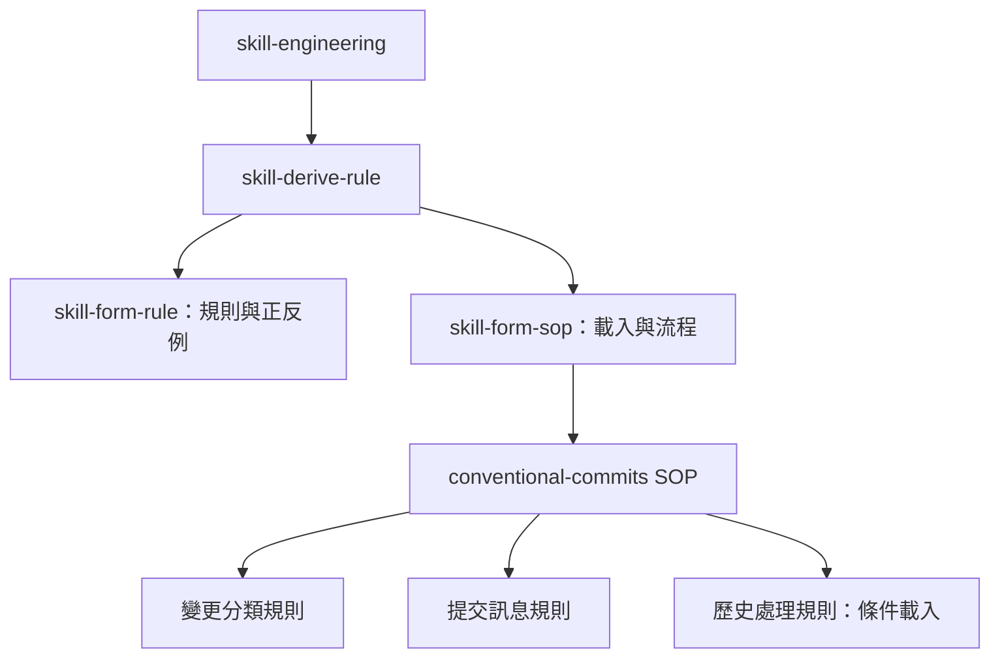

# 模組化補正藍圖與驗收

日期：2026-10-17。狀態：M1–M7 全部完成，模組化版本驗收通過；與證據共同封存為優化 commit。

## 1. 問題與授權

觀察：使用者提供作業要求「三支 skill 都改寫成 skill-engineering 模組化的格式」，指出只整理 SOP 而未抽出規則。中間版本的 SKILL.md 有 121 行，rules 目錄不存在，references/cases.md 仍是一般參考文件。這是已確認的結構遺漏，不是原先三項修正的回歸失敗。

根因 R4：工程藍圖「保留 references、所有規則仍放主檔」的設計未滿足模組化要求。缺陷類型：流程缺陷（驗收範圍漏核對）。第一個偏離點在原工程藍圖從預期推導 To-Be，不能以 audit 零錯誤補成作業已完成。影響僅本支兩側 Skill 與本次紀錄，沒有其他 Skill 呼叫者。

反事實：驗收條件納入主檔只留流程、規則檔有正反例、SOP 按需載入並逐條檢查，便不能以原中間版本結案。排除「尚未同步」假設，因兩側已一致但都未模組化；排除「缺少字面 # SOP」假設，因中間版已有該標題。

使用者已指示「那就照還缺的這 4 點開始執行調整吧」，授權模組化、重測、更新前後比較、正式 commit。沿用確認的三項語意修正，不更動 Skill Engineering 本身。原工程藍圖保留為中間版本歷史，本文件接替其最終結案狀態。

## 2. 驗收條件

沿用 E1–E6；新增此次明確確認的通用 E7：SKILL.md 只保留流程，規則集中於單一主題 RuleFile，每條有正反例；READ 在首次依賴前載入並命名檢查清單；只在歷史或工具情境載入相應規則，交付前逐條核對。

個案 E8：比較紀錄須區分原版、中間版、最終模組版，指出 primitives 的實際分工；本輪修改與證據一起建立 commit。

## 3. To-Be SOP 與關係



完整 To-Be SKILL.md：

````markdown
---
name: conventional-commits
description: 依 Conventional Commits 1.0.0 判斷 commit type、scope 與 breaking change，並撰寫或審查 commit message。用在：根據 git diff 寫 commit message、判斷該用 feat／fix／refactor／chore 等哪個 type、檢查既有 commit message 是否合規、處理一個 commit 混了多種修改要不要拆、dependency／CSS／revert 等容易誤判的情境，以及設計團隊的 type／scope 規則。
---

# SOP

## Phase 1 -- 分析變更與適用規則

1. `READ` 使用者需求與提供的變更摘要或待審查訊息；依 repository 產生訊息時，讀取 `git status`、`git diff --staged`，沒有 staged 時讀取 `git diff`，建立「本次輸入」。
2. `READ` 有專案環境時，讀取適用的 CONTRIBUTING、commitlint 與 release 設定及 `git log --oneline -30`，建立「專案慣例」；沒有專案環境時記錄為無額外規則。
3. `READ` 分析變更時，讀取 `rules/變更分類-格式規範.md` 的所有 Rule，建立「變更分類檢查清單」。
4. `THINK` 依「本次輸入」、「專案慣例」與「變更分類檢查清單」，決定修改目的、是否分拆與各訊息的 type。
5. `READ` 決定或審查訊息內容時，讀取 `rules/提交訊息-格式規範.md` 的所有 Rule，建立「提交訊息檢查清單」。
6. `THINK` 依「提交訊息檢查清單」與「專案慣例」，決定 scope、相容性影響及訊息組成。
7. `READ` 涉及 revert、既有 commit 修正、squash merge 或 release 工具行為時，讀取 `rules/歷史處理-格式規範.md` 的所有 Rule，建立「歷史處理檢查清單」。
8. `THINK` 已載入「歷史處理檢查清單」時，依其判斷本次的歷史處理或工具限制；其餘情境直接進入 Phase 2。

完成條件：各項變更的目的、type、scope、相容性影響與是否分拆已有依據，適用的檢查清單均已載入。

## Phase 2 -- 產生訊息與交付

1. `WRITE` 依「變更分類檢查清單」、「提交訊息檢查清單」、「專案慣例」及已載入的「歷史處理檢查清單」，產生訊息或審查結果，指出採用的規則來源。
2. `CHECK` 逐條核對所有已載入的檢查清單與使用者要求；未通過時修正後重新檢查。
3. `DELEGATE` 使用者明確要求 commit 時才使用 Git 建立 commit，執行前重新核對 status、diff 與本次提交範圍；只要求訊息或審查時交付文字，不變更 index 或檔案。

完成條件：訊息或審查結果通過所有適用檢查清單，Git 操作符合使用者授權。
````

## 4. 差異、淨增減與約束分配

| 元素 | 動作與理由 | 追溯與存放位置 |
| ---- | ---- | ---- |
| frontmatter | 保留；用途與觸發不變 | E1–E4，概述用途 |
| 主檔格式、type、scope、例子、檢查問題 | 移出主檔，不在流程重述判準 | E1–E3、E6、E7；下列 C1–C7 |
| references/cases.md | 刪除兩側原檔，內容完整併入主題規則，避免多重來源 | E1、E4、E7；C2、C3、C8–C11 |
| 原 11 步與一個 Phase | 重組兩個 Phase，保留輸入、決策、輸出、驗證與授權目的 | E1–E4、E7；C12 |
| 新增歷史條件分支 | 只在相關情境載入歷史規則 | E7；C12 |

| 項目 | 原版 | 中間版 | 最終模組版 |
| ---- | ---- | ---- | ---- |
| 正式 Phase | 0 | 1 | 2 |
| 主流程步驟 | 9 | 11 | 11 |
| RuleFile／Rule | 0／0 | 0／0 | 3／11 |
| references | 1 | 1 | 0 |
| 樣板組／腳本 | 0／0 | 0／0 | 0／0 |

新增 3 個主題規則檔是將持續適用、需要語意判斷與正反例的約束抽出；無法以確定性腳本取代判斷，亦不是整份產物骨架，不需新樣板或腳本。增加一個 Phase 用於分開分析與交付，不增加使用者確認閘門。主檔全量判準移出，引用不複製內容。

| 約束 | 存放位置 | 對應目的 |
| ---- | ---- | ---- |
| C1 規則來源分類 | 變更分類 Rule 1 | E2 |
| C2 type、CSS、dependency、重構與效能 | 變更分類 Rule 2 | E1、E6 |
| C3 單一目的與拆分 | 變更分類 Rule 3 | E1 |
| C4 必要格式、type 大小寫、scope 語法 | 提交訊息 Rule 1 | E3 |
| C5 scope 與語言優先順序、具體描述 | 提交訊息 Rule 2 | E2、E6 |
| C6 body 與 footer 分隔 | 提交訊息 Rule 3 | E3 |
| C7 breaking 標示、同義 token、SemVer | 提交訊息 Rule 4 | E3 |
| C8 revert | 歷史處理 Rule 1 | 既有用途 |
| C9 誤用 type、公開歷史授權 | 歷史處理 Rule 2 | E4、既有用途 |
| C10 squash | 歷史處理 Rule 3 | 既有用途 |
| C11 工具設定與不擅自安裝 | 歷史處理 Rule 4 | E2、E4、既有用途 |
| C12 輸入取得、載入時機、具名清單、驗證與 commit 授權 | 各 SOP 控制步驟 | E4、E7 |

## 5. 工作項與 primitives 實際分工

以下工作項屬已授權四點的具體化；由主代理載入技能逐項執行，未另開施工子代理。不是聲稱每支 primitive 都在本輪執行。

| 順序 | 工作項 | 執行者 | 內容 | 狀態 |
| ---- | ---- | ---- | ---- | ---- |
| 1 | M1 | skill-engineering | 保存中間版、移除被取代的 references/cases.md 與引用 | 已完成 |
| 2 | M2 | skill-form-sop | 以中間版作胖 SOP，既有判準不變 | 已完成 |
| 3 | M3 | skill-derive-rule → skill-form-rule、skill-form-sop | 從流程尾端的歷史處理決策抽出 C8–C11，建立歷史規則與條件 READ | 已完成 |
| 4 | M4 | skill-derive-rule → skill-form-rule、skill-form-sop | 從 scope／相容性與訊息寫入抽出 C4–C7，建立訊息規則與 READ | 已完成 |
| 5 | M5 | skill-derive-rule → skill-form-rule、skill-form-sop | 從 type／拆分決策抽出 C1–C3，建立分類規則與 READ | 已完成 |
| 6 | M6 | skill-form-sop | 對齊第 3 節完整流程，移除主檔所有已遷移判準 | 已完成 |
| 7 | M7 | skill-engineering | 結構與同步檢查、隔離重測、比較紀錄與 Git commit | 已完成 |

未使用 skill-form-description（frontmatter 不變），未使用樣板／腳本 primitives（本次無此需要）。

### 工作項完整內容

M1 刪除的原 references 只在目標 Skill 兩側刪除；原版與中間版證據仍保留。
M2 保留已修正的中間版判準作抽取基準，先將原 cases 中歷史判準放入末端決策胖步驟，不提前引用不存在的新檔。
M3–M5 的 Rule 清單與完整內容如下；按歷史→訊息→分類的順序建立三份 RuleFile，全部存在後由 skill-form-sop 一次接入相應 READ 與具名清單消費步驟；沒有引用尚未建立的部位。M6 移除已轉移的主檔文字，對齊 To-Be，且 Phase 不增加確認閘門。

### 變更分類-格式規範.md

````markdown
# Rule 1 - 判斷必須區分來源

- 回答必須區分官方規定（CC 1.0.0 的 MUST）、官方建議（FAQ）、業界慣例與團隊規則。
- 判斷必須依修改目的，不得只根據檔案副檔名或新增程式碼行數。
- 官方未定義的 type 慣例必須優先遵守專案明文規則；不得把團隊慣例說成官方要求。
- 官方依據：[Conventional Commits 1.0.0](https://www.conventionalcommits.org/en/v1.0.0/)。

## Good Example

- 相同 CSS 檔依目的判斷，且交代來源。

情境：修復按鈕不符合既定規格的顏色。

```text
fix(checkout): 修正按鈕顏色
```

說明：目的為修錯，fix 是官方語意；style 用於程式格式是採用的業界慣例。

## Bad Example

- 只因副檔名就分類，並誤稱官方規定。

```text
style(checkout): 修正按鈕顏色
```

說明：因為改 CSS，所以官方規定必須用 style。

# Rule 2 - type 必須依修改目的分類

- 新增能力必須用 feat；修正原本應正常卻出錯的行為必須用 fix。兩者為官方定義。
- 區分 feat 與 fix 時，必須判斷該能力原本是否已被要求提供，不得以新增程式碼就認定 feat。
- 沒有專案另定慣例時，其他目的應採用下表的業界慣例；不得把功能不變的效能改善擋在 perf 分類之外。

| 目的 | type |
| ---- | ---- |
| 功能不變、改善效能 | perf |
| 不修 bug、不加功能、整理內部結構 | refactor |
| 只改文件 | docs |
| 只改測試 | test |
| 只改格式、空白、分號 | style |
| build 系統或依賴維護 | build 或專案既有的 chore(deps) |
| CI 設定 | ci |
| 其他維護雜務 | chore |

- Dependency 升級必須依升級目的分類：純維護採專案的 build／chore 慣例，修實際 bug 用 fix，提供新產品能力用 feat。
- 產品 UI 或 CSS 修改必須按目的判 feat／fix；只有程式格式調整才用 style。
- Options API 改 Composition API 等遷移，UI 與行為完全相同且不以效能為目的時，應用 refactor。

## Good Example

- 不因內部實作改變就誤認新增功能。

情境：快取重複計算，公開輸入輸出不變，目的為降低延遲。

```text
perf(price): 快取重複計算結果
```

## Bad Example

- 同一情境以新增快取程式碼為由選 feat。

```text
feat(price): 快取重複計算結果
```

# Rule 3 - 無關目的應拆分

- 同一次 diff 含多個無關目的時，應依官方 FAQ 建議提出拆分方式與各自訊息。
- 同一功能所需的實作、測試與文件可以是同一 logical change，不得只因檔案種類不同就要求分拆。
- staged 內容混合時，可以建議 git add -p 分批 stage；建議本身不代表操作授權。

## Good Example

- 無關功能與修錯分成兩個提交建議。

```text
feat(search): 新增條件篩選
fix(date): 修正日期偏移
```

## Bad Example

- 將無關目的包在同一訊息。

```text
feat: 新增條件篩選並修正日期偏移
```

````

### 提交訊息-格式規範.md

````markdown
# Rule 1 - 訊息必須符合官方基本格式

- 訊息必須包含 type、冒號、一個空格與具體 description；scope、body、footer 可以省略。
- 使用 scope 時，必須以括號包住描述 codebase 區域的名詞。
- type 的大小寫可以依團隊慣例；不得把所有 type 小寫說成官方強制要求。
- 官方依據：[CC 1.0.0 規格第 1、4、5、15 條](https://www.conventionalcommits.org/en/v1.0.0/#specification)。

```text
<type>[optional scope][!]: <description>

[optional body]

[optional footer(s)]
```

## Good Example

- type 後有必要分隔符與具體描述。

```text
fix(auth): 阻止過期 token 重複使用
```

## Bad Example

- 缺少冒號與空格。

```text
fix(auth)阻止過期 token 重複使用
```

# Rule 2 - scope 與 description 必須符合專案慣例

- scope 必須優先遵守專案明文規則；沒有規則時應沿用既有慣例，再以功能、模組、package 或 domain 為預設建議。
- 檔名能代表影響區域時，可以用作 scope；不得把檔名全面判成官方禁止。
- description 必須用具體、祈使的措辭說明修改，不得只寫 fix bug、update 或 misc changes。
- 訊息語言必須優先遵守專案明文規則；沒有規則時應沿用 git log 的語言慣例。

## Good Example

- 團隊明訂 engine.py scope 時，遵守團隊規則。

```text
perf(engine.py): 減少中間 list 配置
```

## Bad Example

- 同一情境擅自以模組建議蓋過團隊明文規則。

```text
perf(engine): update
```

# Rule 3 - body 與 footer 必須保留必要分隔

- 需要解釋動機、先前行為或解法取捨時，可以提供 body；小改動可以只給標題。
- 提供 body 時，必須與 description 空一行。
- 提供 footer 時，必須與前面的 body 空一行；沒有 body 時必須與標題空一行。
- footer 必須由 token、分隔符與值組成；分隔符可以是冒號加空格，或空格加 #。
- 一般 footer token 的空白必須改成連字號；breaking token 的例外與語意由下一條規範。

## Good Example

- 動機與參照各自分段。

```text
fix(search): 忽略過期回應

只套用最後一次查詢的結果，避免舊資料覆蓋新資料。

Refs: #42
```

## Bad Example

- body 緊接標題且 footer 沒有分段。

```text
fix(search): 忽略過期回應
只套用最後一次查詢的結果。
Refs: #42
```

# Rule 4 - breaking change 必須接受兩種官方同義 footer

- 變更破壞既有 API、設定、資料格式或公開使用方式時，必須在 type／scope 後的冒號前加 !，或提供 breaking footer；兩者可以並用。
- breaking footer 必須接受大寫的 BREAKING CHANGE 與 BREAKING-CHANGE，後接冒號、空格與說明；不得因連字號版未出現在範例就判其不合法。
- 小寫 breaking change 不得視為合法 breaking footer。
- 使用 ! 時，可以省略 breaking footer，但 description 必須說明破壞性變更。
- 任何 type 都可以包含 breaking change；不得因 type 是 refactor 而否定合法標示。
- 說明 SemVer 對應時，必須區分 fix 對應 PATCH、feat 對應 MINOR、breaking change 對應 MAJOR；其他 type 本身沒有官方隱含的版本影響。
- 官方依據：[CC 1.0.0 規格第 11～16 條與 Summary](https://www.conventionalcommits.org/en/v1.0.0/#specification)。

## Good Example

- 同一破壞性設定變更的兩種 footer 都合法。

```text
refactor(config): 移除舊的重試設定

BREAKING CHANGE: 請改用 retryLimit。
```

```text
refactor(config): 移除舊的重試設定

BREAKING-CHANGE: 請改用 retryLimit。
```

## Bad Example

- 同一變更使用小寫 breaking token，且沒有 ! 標示。

```text
refactor(config): 移除舊的重試設定

breaking change: 請改用 retryLimit。
```

````

### 歷史處理-格式規範.md

````markdown
# Rule 1 - revert 必須區分建議與工具行為

- 處理 revert 時，必須說明 CC 官方沒有完整規定其語意與版本影響。
- 沒有團隊另定慣例時，可以採官方 FAQ 建議的 revert type，並以 Refs footer 指出被撤回的 commit。
- 不得把所有 revert 都自動判成 PATCH；必須依專案 release 工具與實際影響判斷。
- 官方依據：[CC 1.0.0 FAQ](https://www.conventionalcommits.org/en/v1.0.0/#how-does-conventional-commits-handle-revert-commits)。

## Good Example

- 提供參照並保留工具決定版本的界線。

```text
revert: 撤回實驗通知功能

Refs: 123abcd
```

說明：版本影響依專案工具設定決定。

## Bad Example

- 同一情境虛構官方保證。

```text
revert: 撤回實驗通知功能
```

說明：官方規定所有 revert 一律發布 PATCH。

# Rule 2 - 修正既有 commit 必須保留歷史操作授權

- 尚未合併或發布時，可以建議以 git rebase -i 或最近一筆的 git commit --amend 修正誤用 type。
- 已正式發布或位於共用分支時，應依 release 流程處理，不得只為美化歷史而改寫。
- 改寫已 push 的歷史前，必須取得使用者明確同意；沒有授權時必須只提供建議。

## Good Example

- 已 push 到共用分支，只交付處理建議。

情境：訊息誤用 fix 描述新增能力。

- 指出應使用 feat。
- 說明應依 release 流程處理，未執行 amend、rebase 或 force push。

## Bad Example

- 同一情境未經同意就操作。

```text
git commit --amend -m 'feat: 新增能力'
git push --force
```

# Rule 3 - squash 合規範圍必須依團隊流程

- 團隊使用 squash merge 且沒有要求每筆合規時，可以容許 feature branch 中的 wip、review fix 等暫存訊息。
- 最後 squash 進主幹的訊息必須符合專案採用的 Conventional Commits 規則。
- 團隊明訂逐筆檢查時，必須遵守該規則，不得以 squash 為由略過。

## Good Example

- 團隊只檢查 squash 結果時，建議整理最終標題。

```text
feat(report): 新增報表下載
```

## Bad Example

- 同一流程無依據要求重寫每筆暫存 commit。

- 即使只檢查 squash 結果，也要求改寫已 push 的所有 wip 訊息。

# Rule 4 - 工具限制必須讀設定確認

- 專案使用 commitlint 時，必須從設定確認 type、scope、長度等限制，不得把套件預設當成專案現況。
- 專案使用 semantic-release 等工具時，必須依實際設定說明 release 影響，不得只憑檔案類型推定版本。
- 一次性 demo 或練習專案可以只採提交慣例，不得無需求就新增 commitlint、Husky 或 release pipeline。

## Good Example

- 只要求檢查訊息時，先讀現有工具設定，再說明檢查結果。

- 找到既有 commitlint 設定並核對 scope。
- 沒有新增 hook 或工具依賴。

## Bad Example

- 同一需求擅自擴大成工具安裝。

- 未讀專案設定就判定使用套件預設。
- 新增 Husky 與 release pipeline。

````

## 6. 驗收情境

S1–S5 沿用原測試輸入、S6–S7 沿用補充輸入，由新乾淨子代理依序執行；保留判準可見與共享題目上下文的既有限制。S8 revert、S9 已 push 訊息修正、S10 squash 加工具設定為新增回歸；另外檢查每條載入路徑、主題無循環與未載入歷史規則的普通分支。E7 的格式與引用採腳本診斷及逐條靜態檢查，行為仍須實跑。

## 7. 驗收結果與提交

- 結構診斷：0 error、0 warning；3 RuleFile、11 Rule，全部有正反例，無孤兒或失效引用。
- 逐條靜態檢查：To-Be 全文、主檔只留 SOP、frontmatter 保留、原 references 刪除、雙側實體一致、規則無循環、路徑只在 READ 提名、清單由後續步驟消費，均通過。
- 不帶本輪分析脈絡的新代理 /root/modular_validation 實跑 S1–S10 全數通過。普通七題未讀歷史檔，三題歷史／工具情境才載入，具名清單正確承接。
- S1 首次讀取命令 workdir 誤植，修正後成功；這是執行命令錯誤，沒有改 Skill 或 fixture 以配合結果。
- 測試前後 HEAD、index 對應的 staged diff、status、檔案 SHA-256 相同；未 stage 或建立測試 commit。
- sync --check 為「兩邊一致」、退出碼 0；同步時僅目標端存在而未刪除的 Skill：無。git diff --check 通過。
- 本輪新結果見「模組化後原始輸出.md」，不是把中間版通過結果搬過來。
- E8 比較紀錄已更新，列明原版／中間版／最終版與實際 primitives 分工；全套內容同筆提交，見「提交證據.md」。
- 保留每輪共享題目上下文、判準可見的限制；不能宣稱整體準確率、效率或跨模型穩定性提升。
