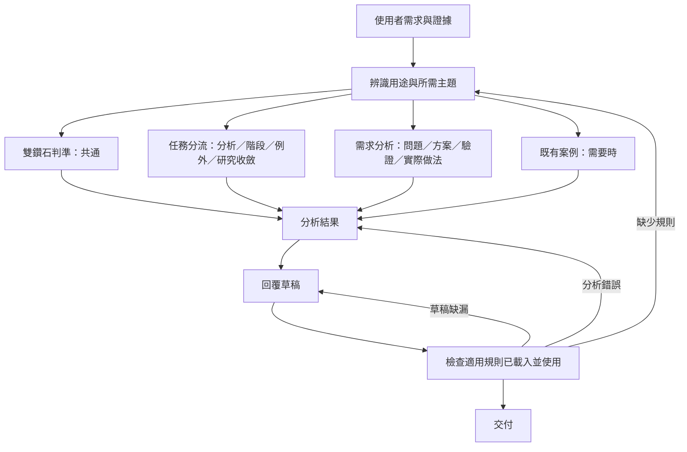

# 工程藍圖：double-diamond－保留行為的流程整理

- 模式：優化。
- 紀錄目錄：`docs/過程/CH2/double-diamond/`。
- 根因報告：[根因分析.md](根因分析.md)，R1 結構混合、R2 多方案要求與例外適用範圍。
- 確認紀錄：2026-10-17，使用者回覆「OK，執行」，已確認 E1–E12 與 R1、R2；本藍圖尚待確認。
- 正式 Skill 狀態：尚未修改。本文件的目標主檔為提案，不能當成已套用或已驗收。

## 1. 驗收條件

| 編號 | 可觀察結果 | 來源 | 適用範圍 | 情境 |
| ---- | ---- | ---- | ---- | ---- |
| E1 | 區分問題與指定解法、證據與假設；未知欄位標待驗證；問題未定義時不先列產品解法。 | 既有 | 通用 | S1 |
| E2 | 依最大未知判定四階段或壓縮路徑，說明具體下一步。 | 既有 | 通用 | S1–S7 |
| E3 | 問題明確且需比較解法時，Problem Statement 含對象、問題、影響、成功指標、限制；列至少三個不同方向及便宜驗證與對應風險。 | 既有 | 通用 | S2 |
| E4 | 已知問題、原因、解法與驗證的小修正直接修／壓縮，不要求完整探索。 | 既有 | 通用 | S3 |
| E5 | 事故先止血／修復／部署／驗證，事後再回顧原因；只給建議時沒有實際修改或部署。 | 既有 | 通用 | S4 |
| E6 | 已確認的法規義務不重新探索是否遵守，保留放置方式與摩擦的方案探索及驗證。 | 既有 | 通用 | S5 |
| E7 | 已有 prototype 但無成效證據時安排測試，不把設計師感覺或目標數字當成已證實成功。 | 既有 | 通用 | S6 |
| E8 | 研究充分性看決策未知而非固定訪談人數，收斂判斷標為實務判斷；Decision Gate 不說成官方強制。 | 既有 | 通用 | S7、S9靜態 |
| E9 | 保留兩次發散收斂、四原則、非線性、Develop／Deliver 正確意義及與 Design Thinking／Agile 關係，區分來源層級。 | 既有 | 通用 | S8、S9靜態 |
| E10 | 主檔為 SOP；領域規則按主題分檔，逐條有正反例；READ 有條件、具名清單、後續消費及 CHECK；不為檔案數硬加樣板腳本。 | 本次：比照前兩次模組化完成範圍 | 通用 | S9靜態、S1–S8載入紀錄 |
| E11 | frontmatter 原文、既有正確用途與約束可逐項追溯，兩側為一致實體副本，audit 無 error。 | 本次＋既有 | 通用 | S9靜態 |
| E12 | 同題前後輸入／判準不變、保存原始回答、版本快照、雜湊、差異、限制及影片素材；未測部分明寫未測。 | 本次 | 個案 | S9記錄核對 |

E10 為本次「跟前兩個優化過程一樣」的模組化驗收，不代表短提示詞本身逐字列出了所有結構要求。E12 為這次留存證據的要求，不寫入 double-diamond。沒有新增推定的領域行為要求。


本次沒有新增領域能力或使用者確認閘門。保留雙鑽石四階段及非線性；下面兩個 Phase 僅是代理的讀取／分析／產出流程。

## 2. To-Be SOP

### 從驗收推導流程

| 步驟 | 目的 | 追溯 |
| ---- | ---- | ---- |
| P1-1 | 取得分析輸入 | E1–E9；必要輸入 |
| P1-2 | 辨識用途與跨主題需求 | E2、E9、E10 |
| P1-3 | 載入模型、來源與方法關係的共通判準 | E8、E9、E10 |
| P1-4 | 分流、例外或研究收斂前取得規則 | E1、E2、E4–E8、E10 |
| P1-5 | 分析、比較方案或說明實際做法前取得規則 | E1、E3、E7–E10 |
| P1-6 | 按需取得既有案例 | E1–E9；必要參考 |
| P1-7 | 形成使用適用規則的分析結果 | E1–E10 |
| P2-1 | 依用途形成回覆草稿 | E1–E10 |
| P2-2 | 檢查載入、實際使用與回覆，分類回修 | E10；必要驗證 |
| P2-3 | 交付已核對回覆 | 必要交付 |



### 完整目標主檔

````markdown
---
name: double-diamond
description: 依雙鑽石原則（Double Diamond：Discover → Define → Develop → Deliver，兩次發散 → 收斂）釐清需求、定義問題與比較解法。用在：收到需求／ticket／老闆或 PM 指定的做法（例如「加 Excel 匯出」「換 Redis」「加 Google Login」「加 AI Chatbot」）時判斷它是問題還是已經是解法、拆解真正要解的問題、撰寫 Problem Statement／Design Brief／Success Criteria、判斷目前卡在哪個階段與下一步該做什麼、展開多個方案並挑選最便宜的驗證方式、判斷研究是否已經夠了、判斷某個變更需不需要跑完整流程（小修正、緊急事故、法規要求），以及說明 Double Diamond 與 Design Thinking、Agile 的關係。
---

# SOP

## Phase 1 -- 理解與分析

1. `READ` 使用者需求，以及使用者提供的情境、證據、方案或既有驗證結果，建立「需求輸入」。
2. `THINK` 依「需求輸入」辨識需求分析、階段判定、研究收斂、例外判斷、方法說明或方法比較等用途與所需規則主題，建立「任務範圍」；涉及多種用途或主題時保留所有適用項目。
3. `READ` 讀取 `rules/雙鑽石判準-格式規範.md` 的所有 Rule，建立「雙鑽石判準檢查清單」。
4. `READ` 「任務範圍」涉及需求分析、階段判定、研究收斂、例外判斷，或其他用途需要判斷不確定性及流程適用性時，讀取 `rules/任務分流-格式規範.md` 的所有 Rule，建立「任務分流檢查清單」。
5. `READ` 「任務範圍」涉及需求分析、Problem Statement／Design Brief／Success Criteria、方案發展與驗證、Decision Gate，或其他用途需要說明各階段實際做法時，讀取 `rules/需求分析-格式規範.md` 的所有 Rule，建立「需求分析檢查清單」。
6. `READ` 需要以案例輔助分析或說明時，讀取 `references/cases.md` 中與「任務範圍」相關的案例及參考資料，建立「案例參考」。
7. `THINK` 依「需求輸入」、「任務範圍」、「雙鑽石判準檢查清單」，以及本次已載入的「任務分流檢查清單」、「需求分析檢查清單」與「案例參考」，形成「分析結果」；發現需要尚未載入的規則主題時，返回步驟 2 更新任務範圍後載入。

完成條件：已辨識任務範圍，並依適用檢查清單形成對應需求的分析結果。

## Phase 2 -- 產出與檢查

1. `WRITE` 依「需求輸入」、「分析結果」、「雙鑽石判準檢查清單」，以及本次已載入的「任務分流檢查清單」與「需求分析檢查清單」，形成「回覆草稿」。
2. `CHECK` 核對「任務範圍」的適用規則均已載入並實際使用，再逐條驗證「回覆草稿」符合「需求輸入」及本次已載入的檢查清單；缺少適用規則時返回 Phase 1 步驟 2，分析有誤時返回 Phase 1 步驟 7，其餘未通過項返回步驟 1 修正。
3. `WRITE` 向使用者交付已通過檢查的回覆。

完成條件：回覆涵蓋本次需求，所有適用檢查清單均通過，且已交付使用者。
````

主檔只描述資料、載入、決策與檢查；領域規則不重述在 SOP。純模型說明可只需共通檔；任務同時涉及例外、研究停止或階段做法時須合併適用主題，不能只依任務名稱排除其他檔。

## 3. 差異表

### 刪除

**刪除原主檔中的舊章節載體與重複規範，不刪任何用途、正確判準、案例檔或來源連結。**

| 元素 | 位置 | 理由 |
| ---- | ---- | ---- |
| 常見錯誤中的第二份規範表達 | 原第 130–137 行 | 問題／研究停止／Define／方案／原型／非線性各集中到 C3、C9、C15、C22–C24，錯誤可作對應 Rule 的反例，不另立規則 |
| 無條件至少三方案的格式註記 | 原第 153 行 | R2：方案數量及適用性只由 C23 一處定義，輸出格式使用此定義 |
| 原說明章節與一般案例導覽句載體 | 原第 6–160 行 | 所有正確約束依第 5 節移位，主檔重組為正式 SOP；案例導覽改成 P1-6 |

沒有整個部位檔案需刪除；原本沒有 RuleFile、樣板組或腳本。案例中示例與規則重疊僅是展示，不當成第二份規範。

### 修改、合併、改換存放位置與新增

| 原元素 | 動作 | To-Be | 追溯 |
| ---- | ---- | ---- | ---- |
| 第 8–29 行核心、來源、原則 | 改換位置；非線性重複表達合併 | 共通判準 Rule 1–2 | C1–C5；E8、E9 |
| 第 31–45 行最大未知分流 | 改換位置 | 任務分流 Rule 1 | C8；E2 |
| 第 47–54 行四問、158 行證據假設 | 改換位置／合併 | 任務分流 Rule 1 | C9；E1、E7 |
| 第 58–78 行收到需求與 Discover | 改換位置；停止判斷分開 | 需求分析 Rule 1、任務分流 Rule 3 | C15–C18；E1、E2、E8 |
| 第 80–96 行 Define | 改換位置 | 需求分析 Rule 2，保留原五欄示例 | C19–C22；E1、E3 |
| 第 98–102 行 Develop | 改換位置、澄清三方案適用範圍 | 需求分析 Rule 3；不增加方案數或新增研究門檻 | C23–C24；R2；E3–E5 |
| 第 104–108 行 Deliver | 改換位置 | 需求分析 Rule 4 | C25–C26；E7、E9 |
| 第 110–117 行 Decision Gate | 改換位置，原四題保留 | 需求分析 Rule 5 | C27；E8、E9 |
| 第 119–128 行適用及例外 | 改換位置 | 任務分流 Rule 1–2 | C10–C14；E2、E4–E6 |
| 第 130–137 行常見錯誤 | 合併重複規範；例子改作相應反例 | 各主題 Rule，不新增第四份錯誤檔 | C3、C9、C15、C22–C24 |
| 第 139–142 行其他方法關係 | 改換位置 | 共通判準 Rule 3 | C6–C7；E9 |
| 第 144–158 行輸出格式 | 改換位置；三方案與假設要求各歸單一來源 | 需求分析 Rule 6 使用 Rule 2／3 的欄位內容判準 | C21、C23、C28–C29；R2 |
| 第 160 行案例連結 | 改寫入口 | P1-6 有條件讀取案例並命名 | C30 |
| 無正式 Phase／完成條件 | 新增執行結構 | 兩 Phase、10 步與可核對完成條件 | C31–C37；R1、E10 |

### 保留

| 元素 | 追溯 | 約束 |
| ---- | ---- | ---- |
| frontmatter 的 name／description 原文 | E11，所有用途與觸發不變 | 概述，不新增限制 |
| 所有語意未變且未重複的原規則文字 | E1–E9；追溯相同文字保留原文；調整只限固定規範強度、分組與 R2 範圍 | C1–C29 |
| 四問、四原則、Define 五欄示例、四題 Decision Gate、七項輸出欄位 | E1、E3、E8、E9，明確保持原內容 | C5、C9、C20、C27、C28 |
| references/cases.md 全文及所有參考連結 | E11、必要來源／案例；前後 SHA-256 必須相同 | 示範 C1–C29，不新增規範 |
| 原不存在的 Phase／完成條件、RuleFile／Rule、樣板組、腳本與確認閘門 | 明寫不存在，不假稱保留 | 數量見第 4 節 |

先考慮刪改再新增：只刪會遺失 E1–E9；僅改寫仍無按需載入邊界；因此規則優先改換位置、合併重複，再增加 R1 所需的執行結構。R2 僅改寫原多方案約束的適用範圍，不在後面加補償性檢查。不能以這次實跑已有正確例外解讀，宣稱 R2 有已證實的行為提升。

## 4. 淨增減

| 項目 | As-Is | To-Be | 增減 |
| ---- | ---- | ---- | ---- |
| 正式 Phase | 0 | 2 | +2 |
| 正式受控動詞步驟 | 0 | 10 | +10 |
| RuleFile | 0 | 3 | +3 |
| Rule | 0 | 12 | +12 |
| 樣板組 | 0 | 0 | 0 |
| 腳本 | 0 | 0 | 0 |
| 案例參考檔 | 1 | 1 | 0 |
| package 檔案 | 2 | 5 | +3 |

Phase／步驟增量是把原有敘述型流程轉為 R1 要求的正式執行結構；不是雙鑽石模型新增階段。12 條 Rule 是既有內容的三個按需主題與正反例；不按每階段硬拆、也不靠增加檔案數當成果。主檔會縮短，package 因正反例可能增加，完成時量測行數，不預告 token、速度或準確率收益。

## 5. 約束分配表

所有約束單一存放。領域 C1–C29 需情境語意與正反例：不是可程式判斷的工作，也不是某份產出檔的固定整體骨架，因此不選腳本或樣板組；對話格式只有需求分析用途適用，不新建文件樣板。流程 C30–C37 屬載入、分支與交付，保留 SOP。description／完成條件只概述用途與結果。

| 編號 | 約束 | 所屬步驟 | 存放位置 | 理由與追溯 |
| ---- | ---- | ---- | ---- | ---- |
| C1 | 兩次發散收斂、Problem Space／Solution Space 與四階段定義 | P1-7／P2-1～2 | `rules/雙鑽石判準-格式規範.md` Rule 1 | 語意判斷，非固定產出檔／可程式化工作；E9；原第 8–17 行 |
| C2 | Develop 不等於開始寫 code、Deliver 不等於 deploy | P1-7／P2-1～2 | `rules/雙鑽石判準-格式規範.md` Rule 1 | 語意判斷，非固定產出檔／可程式化工作；E9；原第 19 行 |
| C3 | 模型非固定逐步操作規格、非線性且可因學習回到前面 | P1-7／P2-1～2 | `rules/雙鑽石判準-格式規範.md` Rule 1 | 語意判斷，非固定產出檔／可程式化工作；E9；原第 27、137 行 |
| C4 | 區分 Design Council 官方、NN/g／IDEO 業界慣例與實務判斷 | P1-7／P2-1～2 | `rules/雙鑽石判準-格式規範.md` Rule 2 | 語意判斷，非固定產出檔／可程式化工作；E8、E9；原第 21–25 行 |
| C5 | 官方四個 Design Principles 全數保留 | P1-7／P2-1～2 | `rules/雙鑽石判準-格式規範.md` Rule 2 | 語意判斷，非固定產出檔／可程式化工作；E9；原第 29 行 |
| C6 | Design Thinking 與 Double Diamond 的定位、IDEO 發散收斂關係 | P1-7／P2-1～2 | `rules/雙鑽石判準-格式規範.md` Rule 3 | 語意判斷，非固定產出檔／可程式化工作；E9；原第 141 行 |
| C7 | Agile 關係及 Backlog／Sprint／Feedback 的實務接法 | P1-7／P2-1～2 | `rules/雙鑽石判準-格式規範.md` Rule 3 | 語意判斷，非固定產出檔／可程式化工作；E9；原第 142 行 |
| C8 | 先判最大未知，對應 Discover／Define／Develop／Deliver 或壓縮路徑 | P1-7／P2-1～2 | `rules/任務分流-格式規範.md` Rule 1 | 語意判斷，非固定產出檔／可程式化工作；E2；原第 31–45 行 |
| C9 | 日常 Problem／Evidence／Alternatives／Validation 四問，問題與解法、事實與假設分開 | P1-7／P2-1～2 | `rules/任務分流-格式規範.md` Rule 1 | 語意判斷，非固定產出檔／可程式化工作；E1、E7；原第 47–54、158 行 |
| C10 | 問題不明、多人利害關係、高成本與指定解法適合深入探索 | P1-7／P2-1～2 | `rules/任務分流-格式規範.md` Rule 1 | 語意判斷，非固定產出檔／可程式化工作；E2；原第 121 行 |
| C11 | 問題、原因、解法、驗證皆已知時直接修／壓縮 | P1-7／P2-1～2 | `rules/任務分流-格式規範.md` Rule 2 | 語意判斷，非固定產出檔／可程式化工作；E4；原第 125 行 |
| C12 | 緊急事故先 contain／patch／deploy／verify，事後才 incident review | P1-7／P2-1～2 | `rules/任務分流-格式規範.md` Rule 2 | 語意判斷，非固定產出檔／可程式化工作；E5；原第 126 行 |
| C13 | 已定法規義務可壓縮第一鑽石，呈現方式與摩擦仍可探索 | P1-7／P2-1～2 | `rules/任務分流-格式規範.md` Rule 2 | 語意判斷，非固定產出檔／可程式化工作；E6；原第 127 行 |
| C14 | 成熟問題及知識充足時壓縮，而非一律移除流程 | P1-7／P2-1～2 | `rules/任務分流-格式規範.md` Rule 2 | 語意判斷，非固定產出檔／可程式化工作；E2；原第 128 行 |
| C15 | 研究停止依最大未知與決策是否可能改變，不以固定訪談人數；屬實務判斷 | P1-7／P2-1～2 | `rules/任務分流-格式規範.md` Rule 3 | 語意判斷，非固定產出檔／可程式化工作；E8；原第 27、78、133 行 |
| C16 | 收到需求先列已知與未知，不直接按指定解法切 component | P1-7／P2-1～2 | `rules/需求分析-格式規範.md` Rule 1 | 語意判斷，非固定產出檔／可程式化工作；E1、E2；原第 58–65、132 行 |
| C17 | Discover 的使用者、行為、Business、Technology 四類資料及原工具例子 | P1-7／P2-1～2 | `rules/需求分析-格式規範.md` Rule 1 | 語意判斷，非固定產出檔／可程式化工作；E1；原第 67–74 行 |
| C18 | NN/g 三面向 Desirable／Viable／Feasible 為檢查視角 | P1-7／P2-1～2 | `rules/需求分析-格式規範.md` Rule 1 | 語意判斷，非固定產出檔／可程式化工作；E1、E9；原第 76 行 |
| C19 | Define 的 Evidence → Pattern → Insight → Problem → Priority | P1-7／P2-1～2 | `rules/需求分析-格式規範.md` Rule 2 | 語意判斷，非固定產出檔／可程式化工作；E3；原第 82 行 |
| C20 | Problem Statement 包含誰／問題／重要性／成功指標／限制 | P1-7／P2-1～2 | `rules/需求分析-格式規範.md` Rule 2 | 語意判斷，非固定產出檔／可程式化工作；E3；原第 84–94 行 |
| C21 | Problem Statement 證據不足欄位標待驗證 | P1-7／P2-1～2 | `rules/需求分析-格式規範.md` Rule 2 | 語意判斷，非固定產出檔／可程式化工作；E1；原第 152 行 |
| C22 | Define 要回答真正要解的問題，不能只整理便利貼 | P1-7／P2-1～2 | `rules/需求分析-格式規範.md` Rule 2 | 語意判斷，非固定產出檔／可程式化工作；E3；原第 96、134 行 |
| C23 | 需探索方案時列至少三個不同方向；問題未定義先不列；已知修正與事故依分流結果不強加多方案 | P1-7／P2-1～2 | `rules/需求分析-格式規範.md` Rule 3 | 語意判斷，非固定產出檔／可程式化工作；E3、E4、E5；R2；原第 100、125–126、135、153 行；僅澄清範圍 |
| C24 | 便宜原型對準最大風險，保留 wireframe／prototype／SQL query／spike／mock API／fake door／PoC 等工具，不做過完整原型 | P1-7／P2-1～2 | `rules/需求分析-格式規範.md` Rule 3 | 語意判斷，非固定產出檔／可程式化工作；E3；原第 100–102、136 行 |
| C25 | Deliver 以任務、改善幅度、錯誤率、效能、開發及維護成本測試淘汰與改善 | P1-7／P2-1～2 | `rules/需求分析-格式規範.md` Rule 4 | 語意判斷，非固定產出檔／可程式化工作；E7；原第 104–106 行 |
| C26 | Production 後 Measure／Learn，必要時再探索或比較 | P1-7／P2-1～2 | `rules/需求分析-格式規範.md` Rule 4 | 語意判斷，非固定產出檔／可程式化工作；E7、E9；原第 108 行 |
| C27 | 四個 Decision Gate 問題原文保留，定位為業界慣例非官方強制 | P1-7／P2-1～2 | `rules/需求分析-格式規範.md` Rule 5 | 語意判斷，非固定產出檔／可程式化工作；E8、E9；原第 110–117 行 |
| C28 | 需求分析的七項輸出欄位保留；Problem Statement 與方案欄使用本檔 Rule 2／3，不另立要求 | P1-7／P2-1～2 | `rules/需求分析-格式規範.md` Rule 6 | 語意判斷，非固定產出檔／可程式化工作；E1、E2、E3；原第 144–156 行 |
| C29 | 下一步為具體行動；方法說明／比較按需求回答，不無故套產品需求格式 | P1-7／P2-1～2 | `rules/需求分析-格式規範.md` Rule 6 | 語意判斷，非固定產出檔／可程式化工作；E2、E9；原第 146、155 行及 description；格式原本只用於分析需求 |
| C30 | 需要案例時讀取相關案例及資料，形成案例參考 | P1-6 | SOP P1-6 | 流程控制，不抽為 Rule；E1–E9；必要載入；原第 160 行連結改為條件載入 |
| C31 | 讀取使用者提供的需求與情境資料，形成需求輸入 | P1-1 | SOP P1-1 | 流程控制，不抽為 Rule；E1–E9；必要輸入；R1 重組流程 |
| C32 | 先辨識用途與規則主題，多用途保留全部適用項目 | P1-2 | SOP P1-2 | 流程控制，不抽為 Rule；E10；必要分支；R1 重組流程 |
| C33 | 規則在使用前按適用範圍載入並命名三份檢查清單 | P1-3～P1-5 | SOP P1-3～P1-5 | 流程控制，不抽為 Rule；E10；R1 重組流程 |
| C34 | 依已載入結果分析；新發現主題回任務判定後載入 | P1-7 | SOP P1-7 | 流程控制，不抽為 Rule；E10；必要迴圈；R1 重組流程 |
| C35 | 依分析結果與已載入清單建立回覆草稿 | P2-1 | SOP P2-1 | 流程控制，不抽為 Rule；E10；必要產出；R1 重組流程 |
| C36 | 交付前檢查載入及實際使用與草稿；依缺漏種類回對應步驟 | P2-2 | SOP P2-2 | 流程控制，不抽為 Rule；E10；必要驗證；R1 重組流程 |
| C37 | 交付通過檢查的回覆 | P2-3 | SOP P2-3 | 流程控制，不抽為 Rule；E10；必要交付；R1 重組流程 |

規則及約束分工：共通判準 Rule 1＝C1–C3、Rule 2＝C4–C5、Rule 3＝C6–C7；任務分流 Rule 1＝C8–C10、Rule 2＝C11–C14、Rule 3＝C15；需求分析 Rule 1＝C16–C18、Rule 2＝C19–C22、Rule 3＝C23–C24、Rule 4＝C25–C26、Rule 5＝C27、Rule 6＝C28–C29。每條 Rule 都有具體且同情境的正反例，不能使用 S1–S8 原題作新規則範例。

C23 唯一定義多方案適用性；Rule 6 的候選方案欄引用 Rule 3 的判斷，不重寫數量。來源層級由 C4 定義，其他 Rule 標示自身來源是使用該定義，不另設分類。四問中的問題是檢視提示；後面分析 Rule 只負責各自的產出判準，不重複整份四問。

## 6. 施工工作項

| 順序 | 工作項 | 執行者 | 目標 | 內容 | 約束 | 狀態 |
| ---- | ---- | ---- | ---- | ---- | ---- | ---- |
| 1 | W1 | skill-form-sop | SKILL.md | 先寫胖 SOP，保留 frontmatter，規則先放所屬動作內文 | C1–C37 | 待施工 |
| 2 | W2 | skill-derive-rule → skill-form-rule／skill-form-sop | 胖 SOP Phase 1 的 THINK「分析需求或說明各階段實際做法」 | 抽出需求分析六條，更新依賴與 CHECK | C16–C29 | 待施工 |
| 3 | W3 | skill-derive-rule → skill-form-rule／skill-form-sop | 胖 SOP Phase 1 的 THINK「判斷任務的不確定性與適用路徑」 | 抽出任務分流三條，更新依賴與 CHECK | C8–C15 | 待施工 |
| 4 | W4 | skill-derive-rule → skill-form-rule／skill-form-sop | 胖 SOP Phase 1 的 THINK「形成雙鑽石模型與方法關係判準」 | 抽出共通判準三條，更新依賴與 CHECK | C1–C7 | 待施工 |
| 5 | W5 | skill-form-sop | SKILL.md | 收尾成第 2 節完整主檔，移除已被合併的中間 THINK 及重複規則 | C30–C37；E10 | 待施工 |

### 工作項內容

#### W1：先寫胖 SOP

- 範圍僅 `.agents/skills/double-diamond/SKILL.md`；frontmatter 原文保留，不呼叫 description 施工。
- Before：最佳化前技能主檔。After：Phase 1 -- 理解與分析依序為 READ「需求輸入」、THINK「任務範圍」、THINK「形成雙鑽石模型與方法關係判準」（內文 C1–C7）、THINK「判斷任務的不確定性與適用路徑」（有適用條件、內文 C8–C15）、THINK「分析需求或說明各階段實際做法」（有適用條件、內文 C16–C29）、READ「案例參考」、THINK「分析結果」；Phase 2 -- 產出與檢查為 WRITE「回覆草稿」、CHECK 全部適用內文約束與需求、WRITE 交付。
- 三個中間 THINK 各形成「模型與方法判準」「分流判斷」「需求分析判斷」，最後 THINK 與草稿／CHECK 實際消費；規則文字依 C 表與原文填入，不出現尚未建立之 RuleFile 的路徑或載入步驟。
- 胖 SOP 已解決 R2：C23 明確只在需探索方案時適用，輸出格式引用同一判斷。案例先保留既有檔並按需讀取。
- 完成條件只描述取得分析及已交付檢查回覆，不重述領域判準；遵守 SOP 單動詞、連號與 CHECK。

#### W2：由後往前抽需求分析

- 唯一定位：Phase 1 -- 理解與分析，THINK「分析需求或說明各階段實際做法」，不僅靠步驟號。
- Before：W1 該步驟內文的 C16–C29。After：在該 THINK 前 READ `rules/需求分析-格式規範.md` 所有 Rule，條件與第 2 節 P1-5 相同，命名「需求分析檢查清單」，THINK 使用清單形成原有判斷；後續 THINK、WRITE、CHECK 改用該清單，不重述抽出內容。
- 交由 skill-form-rule 建立單一主題六條：Rule 1 已知未知與 Discover（C16–C18）；Rule 2 Define 與 Problem Statement（C19–C22）；Rule 3 方案適用性與便宜原型（C23–C24）；Rule 4 Deliver 與後續量測（C25–C26）；Rule 5 Decision Gate（C27）；Rule 6 適用需求分析的輸出（C28–C29）。各條具體正反例，保留原本文字與例子，必要的強度詞調整不改語意。
- 需描述分流或來源時使用既有定義／判斷，不在本檔重立 C4、C8–C15；此時共用內容仍在胖 SOP，後續由 W3、W4 移位。
- 下游調整含完成條件與 P2 CHECK 的清單消費，不能只建檔未接流程。

#### W3：抽任務分流

- 唯一定位：Phase 1 -- 理解與分析，THINK「判斷任務的不確定性與適用路徑」。
- Before：內文 C8–C15。After：在該 THINK 前 READ `rules/任務分流-格式規範.md` 所有 Rule，條件同第 2 節 P1-4，命名「任務分流檢查清單」；原 THINK、最後分析、草稿與 CHECK 消費清單，刪除抽出規則的內文。
- Rule 1 最大未知、四問與適用情境（C8–C10）；Rule 2 小修正／事故／法規／成熟問題四種路徑（C11–C14）；Rule 3 研究收斂（C15）。每條正反例，保持原分流及非線性，不以 S6 首句差異創設唯一階段要求。
- 本檔是分析建議的判斷，事故順序不授權代理部署；不新增使用者閘門。

#### W4：抽共通判準

- 唯一定位：Phase 1 -- 理解與分析，THINK「形成雙鑽石模型與方法關係判準」。
- Before：內文 C1–C7。After：在該 THINK 前 READ `rules/雙鑽石判準-格式規範.md` 所有 Rule，所有用途適用，命名「雙鑽石判準檢查清單」；原 THINK、最後分析、草稿及 CHECK 消費清單，刪除抽出的內文。
- Rule 1 兩鑽石、四階段、常見誤解與非線性（C1–C3）；Rule 2 來源層級與四原則（C4–C5）；Rule 3 Design Thinking／Agile 關係（C6–C7）。原來源與定義不改，各條具體正反例。
- 不把本 Skill 的執行 SOP 說成 Design Council 強制操作規格。

#### W5：SOP 收尾

- Before：三項抽取完成的胖 SOP，仍有三個依清單作中間判斷的 THINK。
- After：收斂為第 2 節全文；依同主題判斷合併至「分析結果」，三份 READ 按原順序聚在第一個消費步驟前，同一 Phase，之間僅其他 READ。
- 刪除中間「模型與方法判準」「分流判斷」「需求分析判斷」產物及對它們的引用；正式命名只保留第 2 節的清單／分析／草稿；調整迴圈步驟號與完成條件。
- 全文與核准 To-Be 一致；不改 frontmatter、案例或新增部位。

上述工作項呼叫者為 skill-engineering；主代理載入對應技能執行，技能委派不等於另開施工代理。只有隔離行為驗收依 Skill Engineering 的明確子代理要求另開代理。工作項被 primitive 拒絕或不符合藍圖時停止並記錄，回 Phase 3 修訂，不自行改已確認要求。

## 7. 驗收情境

S1–S8 的輸入、判準與預先回覆完整沿用 [測試輸入與判準.md](測試輸入與判準.md) 及 `測試輸入.json`，不重寫或加條件。所有情境為既有能力回歸；S9 是結構與本次交付核對，不是模型實跑。

| 情境 | 驗證 | 類型 | 輸入位置 | 預先回覆 | 通過檢查 |
| ---- | ---- | ---- | ---- | ---- | ---- |
| S1 | E1、E2 | 回歸 | 固定 JSON S1：AI 助理指定解法 | 無 | 區分解法／假設、待驗證、不提前列產品方案 |
| S2 | E1–E3 | 回歸 | 固定 JSON S2：倉庫儲位問題 | 無 | 五欄、三方向、便宜測試、指標與限制 |
| S3 | E2、E4 | 回歸 | 固定 JSON S3：已知 token 修正 | 無 | 直接修與截圖驗證，不強制三方案 |
| S4 | E2、E5 | 回歸 | 固定 JSON S4：訂單 API 事故 | 無 | 先恢復與驗證、後回顧，無實際部署 |
| S5 | E2、E6 | 回歸 | 固定 JSON S5：已核准法規義務 | 無 | 壓縮義務探索、比較呈現與摩擦，不作新法律判斷 |
| S6 | E1、E2、E7 | 回歸 | 固定 JSON S6：帳單 prototype | 無 | 需使用者／成效證據、不稱成功；允許合理回溯或階段重疊 |
| S7 | E2、E8 | 回歸 | 固定 JSON S7：交接研究是否足夠 | 無 | 不湊人數、停止判斷標實務、轉向可用性測試 |
| S8 | E9 | 回歸 | 固定 JSON S8：模型與其他方法 | 無 | 原核心說明保留，不強套需求分析格式 |
| S9 | E8–E12 | 靜態／逐步演練／交付核對 | 原重構短提示詞及本藍圖、兩側 package、紀錄檔 | 兩個工程閘門依實際對話記錄 | C1–C37 逐項唯一來源、用途完整、來源／案例／frontmatter 原文、正反例、按需載入／消費／CHECK、audit／sync、比較及影片素材 |

### 執行與證據

1. 施工後執行既有 audit（與修改前同三個 skills roots，必要另查另一側），查 JSON error 而非只看退出碼；保存完整結果。
2. 執行 `scripts/sync-skills.sh --from agents` 及 `--check`，確認兩側實體副本。記錄只存在目標端的 Skill 訊息，不自行刪除其他 Skill。
3. 依 C1–C37 逐項檢查唯一存放、追溯與 To-Be；frontmatter、案例 SHA-256 與基線相同。
4. 建立僅含當輪 package 副本及固定輸入的暫存環境，保存雜湊與範圍外檔案狀態。基線本來就是純分析 fixture，未包含整個產品 repo；不新增產品資料。記錄無產品副作用隔離，不把資料副本稱完整 Git worktree。
5. 使用 fork_turns=none 的新子代理，繼承相同模型與 reasoning、不覆寫；與修改前同樣八題依序於同一代理執行，不提供根因、藍圖或判準。只替換 package 版本與紀錄輸出路徑。傳入與前輪相同的執行包裝，要求逐題原輸入、原回答、資源讀取原因；不是逐題獨立或全盲測，服務端部署／隨機參數不可控。
6. 額外要求封存可取得的實際載入證據；若只有代理自述則如實標明，不偽稱底層工具軌跡。檢查普通需求會載入分流與分析；純模型說明可只讀共通規則，跨用途依需求合併載入。不以靜態路徑存在代替動態載入核對。
7. 按固定判準逐題評分；環境問題修環境並保存原輸出，Skill 失敗返回根因確認。不得為湊通過改判準、刪失敗輸出或補寫原始回答。全部適用驗收通過才宣告完成。
8. 保存最佳化後 package、完整 package diff、結構統計、正式與快照對照、前後雜湊、施工／驗收紀錄及範圍檢查。暫存環境證據先封存，確認不再需要後清理本輪自建目錄。
9. 完成 `前後比較.md` 與 `追問釐清與影片素材.md`：同前兩支包含問題、發現方式、結構與行為分開、primitives 實際責任、逐題差異、限制、證據與三分鐘內畫面／說明。八題原本正常就如實報回歸保持，不硬造改善。
10. 提供 Conventional Commit 草稿，不 commit 或 push。Maven 與本變更無關，不以 Java 測試取代 Skill 驗收。

### 設計檢查

- [x] 每個 To-Be 步驟由已確認 E 或必要流程推導，再對照 As-Is。
- [x] 原主檔每段、frontmatter、案例、示例、四原則／四問／五欄／四閘門均有追溯與動作。
- [x] R1 重組原主檔；R2 在方案約束原位置澄清，不加症狀補丁。
- [x] 先刪改／移位再新增；每項增量有理由；無樣板或腳本硬拆。
- [x] C1–C37 只有一個規範位置，SOP 引用清單、不重述領域條件。
- [x] 三個主題可依用途及跨用途載入，READ 與第一個消費步驟同 Phase 相鄰，產物皆被使用。
- [x] 胖 SOP 不載入尚未建立的部位；抽取由後往前，收尾合併步驟已明列。
- [x] 工作項有唯一定位、Before／After、Rule 清單與下游 CHECK 調整；拒絕或差異回報不繞過。
- [x] 無直接／間接呼叫者，不需其他 Skill 的接口變更與回歸。
- [x] 完成定義涵蓋靜態、行為、同步、完整比較與影片素材；未把草稿或前測當完成。

## 8. 驗收結果

尚未施工。根因閘門已確認，工程藍圖閘門待確認；所有 W1–W5 為待施工。未有修改後回答、正式 Skill 差異或驗收結論。
