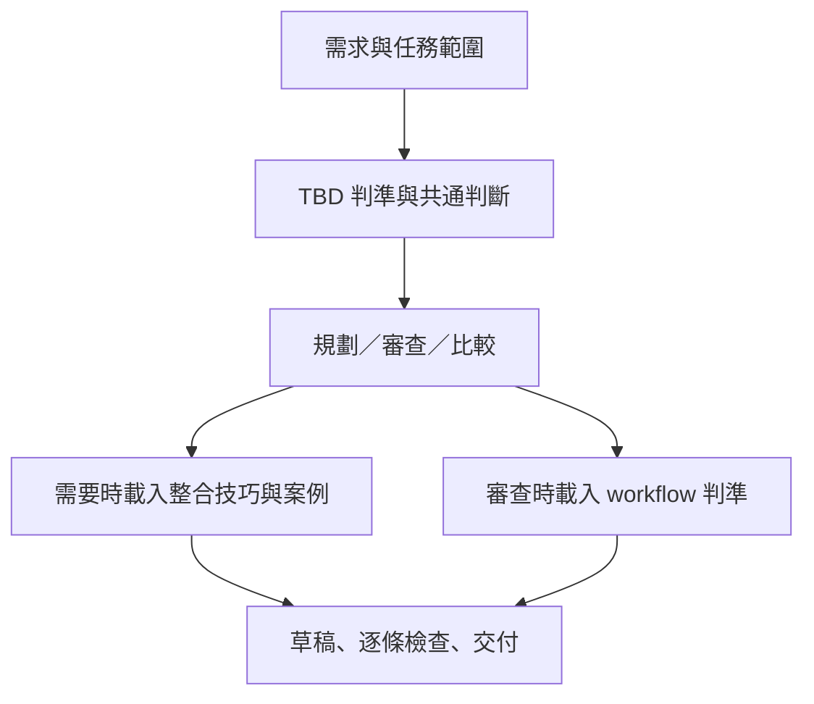

# 工程藍圖：trunk-based-development－保留行為的模組化重構

- 模式：優化。
- 紀錄目錄：`docs/過程/CH2/trunk-based-development/本次執行/`。
- 根因報告：[根因報告.md](根因報告.md)，總指揮已確認 E1–E10、S1–S8 與結構根因 R1。
- 確認紀錄：根因閘門已確認；本藍圖尚待第二閘門確認，尚未核准施工。
- 檔名依本次要求採繁體中文，保留工程藍圖樣板的八節內容。
- 本次只新增工程紀錄，未修改目標 Skill；下方程式區塊與 Rule 清單均為待確認設計。

## 1. 驗收條件

| 編號 | 驗收條件 | 來源 | 適用範圍 |
| ---- | -------- | ---- | -------- |
| E1 | 主檔保留可依序執行的 SOP；情境規則在需要的步驟先載入再使用，無失聯 RuleFile，沒有只為數量而拆出的部位 | 本次 | 通用 |
| E2 | 觸發用途仍涵蓋工作拆分、分支與整合策略、四類特殊技巧、hotfix、PR／workflow 審查及 TBD／GitFlow 比較 | 既有 | 通用 |
| E3 | 回答區分官方、DORA、團隊規則；保留官方通常 1～2 天、DORA 不到一天的差異，2 天不是硬性標準，Git 細節不冒充 TBD 規定 | 既有 | 通用 |
| E4 | 需求規劃保留獨立小變更、短期 branch、同步 main、build／lint／unit test／必要 integration test、review／CI green 後 merge、merge 後刪 branch，並以原格式列 PR、技巧、各 PR 的 main 可工作理由與含 review 的壽命 | 既有 | 通用 |
| E5 | 未完成且不能曝光的功能以 Feature Flag 持續整合，區分 Deploy 與 Release，保留用後清理 flag | 既有 | 通用 |
| E6 | 大型重構保留抽象層、舊接入、新實作、逐步切換、移除舊實作；相容性遷移保留新舊並存、consumer 遷移、刪舊介面，每一步 main 可工作 | 既有 | 通用 |
| E7 | Release Branch 晚切且只做版本穩定、修復與發布；hotfix 先在 main 修復驗證，再 cherry-pick，不新增 release 功能開發 | 既有 | 通用 |
| E8 | workflow 審查保留長期分支、每日整合、含 review 壽命、active branches、CI 回饋、main 紅燈立即修或 revert、code freeze、flag 清理與導入前提檢查；缺前提先指出，不直接建議全面導入 | 既有 | 通用 |
| E9 | 保留適用專案及三項價值條件、GitFlow 與 TBD 的整合順序差異、常見錯誤、送出前六題與六類案例／來源資訊 | 既有 | 通用 |
| E10 | 兩側為一致實體副本，施工後結構診斷無 error；修改僅限目標 Skill 兩側及本次紀錄，不 commit／push／安裝 | 本次 | 個案 |

## 2. To-Be SOP

### 從預期推導

先由驗收條件推導行為，才對照既有章節；不是先照原章節逐一追加補丁。

| To-Be 步驟 | 目的與後續使用者 | 追溯 |
| ----------- | ---------------- | ---- |
| P1-1 | 取得本次輸入，供任務定位與判斷使用 | E2、必要讀取流程 |
| P1-2 | 保留需求包含的全部任務，決定條件式分析路徑 | E1、E2 |
| P1-3、P1-4 | 在首次 TBD 判斷前取得共用判準，產生共通判斷供 P2 使用 | E1、E3、E9、R1 |
| P2-1 | 小批次與可整合性判斷，產生拆分與阻礙 | E4、E5–E7 |
| P2-2、P2-3、P2-4 | 僅在需要時載入技巧與案例，完成短期 branch 的整合安排 | E1、E4–E7、E9 |
| P2-5–P2-7 | 維持同步、驗證、合併後清理的原先規劃順序 | E4 |
| P2-8、P2-9 | 僅在審查或導入評估時取得審查判準並形成結果 | E1、E8、E9 |
| P2-10 | 提供原有 GitFlow／TBD 比較 | E2、E9 |
| P2-11 | 保留原規劃格式，亦能交付審查或比較內容 | E2、E4、E8、E9 |
| P2-12、P2-13 | 六題與本次適用規則的逐條驗證後交付 | E1、E9、必要驗證流程 |

兩個 Phase 分別產生「任務範圍／共通判斷」與「通過檢查的回答」，不為載入規則另建 Phase。不新增使用者確認或 Git 執行；原五步是規劃內容，To-Be 仍只分析與回答。

### 完整主檔

````markdown
---
name: trunk-based-development
description: 依主幹式開發（Trunk-Based Development，TBD）規劃與審查工作拆分、branch 策略與整合方式。用在：收到需求或 ticket 時規劃要拆成幾個 PR、判斷一個變更該直接走短期 branch 還是需要 Feature Flag／Branch by Abstraction／新舊並存／Release Branch、大型重構或框架遷移（例如 Vuex → Pinia、Axios → Fetch）如何每天安全 merge main、舊版本 hotfix 怎麼修、檢查某個 branch 或 PR 是否活太久或太大、審查團隊的 Git workflow 算不算 TBD，以及比較 TBD 與 GitFlow。
---

# SOP

## Phase 1 -- 理解任務與判斷基準

1. `READ` 使用者需求，以及需求提供的工作範圍、工期、branch／PR 現況、CI 與 review 流程、團隊 Git 規則；只讀取本次需求涉及的資料。
2. `THINK` 判定本次任務涉及需求規劃、branch／PR／workflow 審查（含導入與適用性評估）或 TBD 與 GitFlow 比較中的哪些工作，建立「任務範圍」。同時涉及多項時保留各項，不以單一分支排除其他工作。
3. `READ` 進行 TBD 判斷時，讀取 `rules/TBD判準-格式規範.md` 的所有 Rule，建立「TBD 判準檢查清單」。
4. `THINK` 依「任務範圍」與「TBD 判準檢查清單」建立本次的「共通判斷」，作為後續規劃、審查或比較的依據。

完成條件：已確定任務範圍，並建立後續分析可使用的共通判斷。

## Phase 2 -- 規劃、審查與交付

1. `THINK` 需求規劃時，**切小**：把需求拆成多個能獨立整合的小變更。一張 Story／Ticket 不等於一個 branch 或一個 PR。先判斷能否幾小時／一天內完成；否則嘗試再切小，對每個小變更重做判斷；仍不能時辨識功能不能曝光、大型程式重構、舊系統／相容性遷移或維護已發布版本的原因，建立「拆分與阻礙」。
2. `READ` 規劃、審查或比較需要判斷 Feature Flag、Branch by Abstraction、新舊並存或 Release Branch 的適用方式時，讀取 `rules/整合技巧-格式規範.md` 的所有 Rule，建立「整合技巧檢查清單」。
3. `READ` 本次需要完整拆法或案例對照時，讀取 `references/cases.md` 中相關情境，建立「案例對照」。
4. `THINK` 需求規劃時，依「拆分與阻礙」、「共通判斷」及已載入的「整合技巧檢查清單」與「案例對照」（若有），安排**每個小變更開短期 branch**，目標是「這個小變更做完就 merge」，不是「整個 feature 做完才 merge」。
5. `THINK` 需求規劃時，安排**工作期間同步 main**，merge 前 branch 要跟 main 保持最新。
6. `THINK` 需求規劃時，安排**CI 驗證**：build → lint → unit test → 必要的 integration test；PR → review → CI green → merge。DORA 建議每個 commit 都觸發 build 與自動測試，回饋在幾分鐘內。
7. `THINK` 需求規劃時，安排**merge 後刪 branch**。
8. `READ` 審查 branch、PR、團隊 workflow，或評估 TBD 導入與適用性時，讀取 `rules/workflow審查-格式規範.md` 的所有 Rule，建立「workflow 審查檢查清單」。
9. `THINK` 任務涉及審查、導入或適用性評估時，依「共通判斷」、「workflow 審查檢查清單」與已載入的「整合技巧檢查清單」及「案例對照」（若有），建立「審查結果」。
10. `THINK` 任務涉及 TBD 與 GitFlow 比較時，依「共通判斷」及已載入的「整合技巧檢查清單」與「案例對照」（若有）建立「比較結果」：GitFlow 類：先隔離 → 做完整 → 最後整合。TBD：先切小 → 持續整合 → 任何時候都保持可工作。TBD 主要改變拆分工作的方式，Git 操作本身變化不大。
11. `WRITE` 依任務範圍、共通判斷與已完成的規劃、審查結果或比較結果，建立回答草稿。需求規劃結果用這個格式給出：

    ```text
    PR 1：<變更>  — 使用技巧：<無／Feature Flag／Abstraction／新舊並存>
    PR 2：...
    每個 PR merge 後 main 為什麼仍可工作：<說明>
    預估 branch 壽命（含等 review）：<時間>
    ```

12. `CHECK` 依「TBD 判準檢查清單」與本次已載入的其他檢查清單，逐條驗證回答草稿是否符合需求；未通過時返回對應的分析步驟修正後重新檢查。
13. `WRITE` 向使用者交付通過檢查的回答。

完成條件：任務範圍內的規劃、審查或比較均已回答，並通過本次適用的檢查清單。

````

主檔仍保留短而只屬於單一步驟的輸出格式與比較文字。格式是聊天回答的片段，不是一份要求落盤的產出檔案，不另建樣板組。共通判準始終適用，技巧與 workflow 兩個主題按任務條件載入；需要任一整合技巧時讀取同一份完整技巧主題，不拆成四個單規則檔案。



## 3. 差異表

### 刪除

**沒有整檔刪除，也沒有刪除用途、正確規則、案例或來源。以下是刪除重複載體，內容的唯一規範位置仍保留。**

| 元素 | 位置 | 理由 |
| ---- | ---- | ---- |
| branch 壽命的第二份敘述 | 原主檔 :26 的「官方約 1～2 天，DORA < 1 天」 | C3 統一存放在 TBD 判準 Rule 1，不在強烈建議再重述數字 |
| Story 等於單一 PR 的第二份規範描述 | 原主檔 :80 | C9 的唯一規範位置為 P2-1，原常見錯誤轉為對應正反例，不另立規範 |
| 主檔中的來源、核心、技巧、審查與六題全文 | 原 :8–28、:66、:70–73、:79、:81–83、:87–98、:109–114 | 改換存放位置至對應 RuleFile；由主檔載入與檢查清單引用取代內文，不構成語意刪除 |
| 常見錯誤的獨立規範章節 | 原 :77–83 | 各錯誤分配回對應唯一規範位置，作為正反例示範；無新增第五份錯誤清單 |

### 修改、合併、改換存放位置與新增

| 元素 | 動作 | 內容 | 追溯 |
| ---- | ---- | ---- | ---- |
| 主檔入口與所有章節編排 | 修改 | 組成兩 Phase，將輸入、任務範圍、分析、檢查、交付串起；對應原流程而非新增操作權限 | R1、E1、E2；C28–C30 |
| 規劃流程步驟 1 | 修改 | 保留切小與 Story 原句，將決策樹的先判斷一天、再切小、再辨識阻礙整理到同一流程步驟 | E4；C8–C10 |
| 規劃流程步驟 2–5 | 修改 | 原句加上 THINK 與「需求規劃時，安排」作為明確行為，順序與規劃目的不變 | E4；C11–C15 |
| 原 :10–28、:82 與六題 | 改換存放位置／合併 | 三類來源、壽命與 review 計算、核心與建議、團隊規則、六題集中為 TBD 判準四 Rule | E3、E9；C1–C7、C21 |
| 原技巧 :70–73 | 改換存放位置 | 四個技巧各一 Rule，整合為單一完整主題檔 | E5–E7；C17–C20 |
| 原審查 :87–98 | 改換存放位置 | 事實清單及導入適用性二 Rule；審查判斷沿用已載入共通與技巧判準 | E8、E9；C22–C24 |
| 三個 RuleFile 與十個 Rule 標題／正反例 | 新增結構載體 | 承接既有語意，不新增業務限制；說明強度依來源分級，正反例不得使用 S2–S8 測試輸入 | E1、R1；C1–C7、C17–C24、C26 |
| 載入與 CHECK 步驟、完成條件 | 新增流程結構 | 可辨識各分支的輸入、結果與驗證，按需載入且不得失聯 | E1、R1；C28–C30 |

### 保留

| 元素 | 追溯 | 約束 |
| ---- | ---- | ---- |
| frontmatter name、description 全文 | E2；原用途／觸發沒有缺陷，不交由 description Skill 改寫 | 無，只描述用途與觸發 |
| 核心目的原文（搬移） | E3、E9 | C1，TBD 判準 Rule 2 |
| 來源區分與兩種壽命標準原意（搬移） | E3 | C2、C3、C21 |
| 規劃步驟 1–5 的原句（加控制動詞與條件） | E4 | C8、C9、C11–C15 |
| 原規劃輸出 code block 全文 | E4 | C16，P2-11 |
| 原 Decision Tree 各判斷分支 | E4–E7 | C10 及 C17–C20；改為 SOP 條件與相應技巧 |
| 四類技巧原文（搬移） | E5–E7 | C17–C20 |
| workflow 六項事實問題及前提／適用性（搬移） | E8、E9 | C22–C24 |
| GitFlow／TBD 的三句比較原文 | E9 | C25，P2-10 |
| 六個送出前問題全文（搬移） | E9 | C7，TBD 判準 Rule 4 |
| references/cases.md 全文，包括目錄、六案例、來源連結 | E2、E9；維持檔案與 SHA-256 不變 | C27：範例示範對應規則，不另作規範來源 |
| docs/主幹式開發.md | 證據來源，不在施工範圍 | 無，不修改 |

As-Is 沒有 Phase、完成條件、RuleFile、Rule、樣板組或腳本；不存在的元素不虛列保留。各舊章節及五個步驟已在上述表逐一對應。除控制文字、格式標題及下列強度正規化外，追溯相同的原文搬移後保留。

強度正規化僅處理 RuleFile 作者規範與原用語的介面，不調整 TBD 規則：原「強烈建議」仍是應遵守而非必須；原「active branches 盡量少」寫為「active branches 應維持少量」；來源原句可作引文說明，不能把「官方通常 1～2 天」改成硬上限。六題是檢查問題，不改寫為六個硬性禁止條件。數字、技術術語、來源與例外界線保留。

## 4. 淨增減

| 項目 | As-Is | To-Be | 增減 |
| ---- | ----- | ----- | ---- |
| Phase | 0 | 2 | +2 |
| SOP 受控步驟 | 0 | 17 | +17 |
| 既有自然語言規劃步驟（另列，非受控 SOP） | 5 | 5 | 0 |
| RuleFile | 0 | 3 | +3 |
| Rule | 0 | 10 | +10 |
| 樣板組 | 0 | 0 | 0 |
| 腳本 | 0 | 0 | 0 |
| 案例參考檔 | 1 | 1 | 0 |

受控步驟的基準是稽核可解析的 SOP；不是聲稱原 Skill 沒有五個規劃動作。新增十七個結構步驟包含這五步的改寫，非額外十七個 Git 操作。

R1 的處理依序考慮：刪除整段會損失 E2–E9，僅可刪重複載體；僅改寫主檔仍無按需載入邊界；改換存放位置能處理情境規則，但必須搭配主檔可執行的讀取與引用；因此建立兩個 Phase 與三個主題載體。新增的是表示法、載入與驗證，不是判斷規則。單一步驟格式與比較不另拆、四技巧不拆四檔、六案例不改成 RuleFile。沒有可機械完成的語意判斷或要求落盤的整份文件格式，不引入腳本或樣板組。

## 5. 約束分配表

約束以唯一的規範位置計算。正反例／案例可以示範，description 與完成條件只概述結果；引用清單不重述規範。表中「判斷型」指無法由程式判斷語意，亦不約束某份落盤文件的整體格式，故腳本、樣板組均不適用；需具體正反例時選 RuleFile。流程／分支約束直接留在 SOP，不走載體強度排序。

| 編號 | 約束 | 所屬步驟 | 存放位置 | 理由 |
| ---- | ---- | -------- | -------- | ---- |
| C1 | 單一 trunk、避免長期開發分支、小變更整合且 main 可工作可發布；CI 紅優先修 main 或 revert | P1-4、P2-12 | TBD 判準 Rule 2 | 判斷型共通規則，需健康／失敗例；不再寫於 SOP |
| C2 | 回答區分官方、DORA、團隊來源 | P1-4 | TBD 判準 Rule 1 | 判斷型，需要同一說法的來源正反例 |
| C3 | 官方通常 1～2 天、DORA 不到一天；2 天非硬標準 | P1-4 | TBD 判準 Rule 1 | 判斷型，保留不同來源強度 |
| C4 | DORA 每日至少整合一次、一天多次更好 | P1-4 | TBD 判準 Rule 2 | 判斷型，頻率與整合事實相關 |
| C5 | 強烈建議短命分支、少量 active branches、不靠 code freeze | P1-4 | TBD 判準 Rule 2 | 判斷型，壽命具體數值引用 Rule 1，不重寫；刪 branch 順序另屬 C15 |
| C6 | squash／merge commit／rebase merge、同步方式、命名、reviewer、平台、direct push 由團隊決定 | P1-4 | TBD 判準 Rule 3 | 判斷型，避免把選擇冒充方法論規定 |
| C7 | 保留原送出前六題作自我檢查 | P2-12 | TBD 判準 Rule 4 | 判斷型，六題是檢查提示，與 Rule 1–3 的判斷依據分工，不重抄依據細節 |
| C8 | 先拆可獨立整合的小變更 | P2-1 | SOP P2-1 | 規劃流程順序 |
| C9 | Story／Ticket 不等於單一 branch／PR | P2-1 | SOP P2-1 | 屬單一步驟的一句限制，無需另建 Rule |
| C10 | 判斷一天內完成，再切小重判，再辨識阻礙 | P2-1 | SOP P2-1 | 分支與循環順序，技巧適用細節另屬 C17–C20 |
| C11 | 各小變更用短期 branch，做完小變更即 merge | P2-4 | SOP P2-4 | 原規劃的第二個順序動作 |
| C12 | 工作期間同步、merge 前與 main 最新 | P2-5 | SOP P2-5 | 原規劃的第三個順序動作，方式由 C6 判準處理 |
| C13 | build、lint、unit test、必要 integration test 與 PR、review、CI green、merge 的安排順序 | P2-6 | SOP P2-6 | 原規劃的第四個順序動作 |
| C14 | DORA 每 commit build／自動測試及幾分鐘回饋 | P2-6 | SOP P2-6 | 單一規劃步驟的附帶準則，一句可表達、不需另拆 |
| C15 | merge 後刪 branch | P2-7 | SOP P2-7 | 原規劃的第五個順序動作，不在其他規則再立同一要求 |
| C16 | 原四行 PR／技巧／可工作理由／含 review 壽命格式 | P2-11 | SOP P2-11 | 單步聊天輸出格式，不是整份產出檔案格式，不需樣板或程式 |
| C17 | 不能曝光用 Feature Flag；每日 merge、關閉至曝光、Deploy ≠ Release、完成清理 | P2-4 或 P2-9 | 整合技巧 Rule 1 | 判斷型，需正反例；適用條件與清理同置 |
| C18 | 大型重構用 Branch by Abstraction，保留五段演進與每步整合 | P2-4 或 P2-9 | 整合技巧 Rule 2 | 判斷型，五段是被規劃的領域方案、非 agent Phase 轉移，不可改為命令執行 |
| C19 | 相容遷移新舊並存，consumer 遷移後刪舊介面，避免跨層中間狀態壞掉 | P2-4 或 P2-9 | 整合技巧 Rule 3 | 判斷型，語意相容不能由格式或程式保證 |
| C20 | Release Branch 晚切、限穩定修復發布；main 修復驗證後 cherry-pick，不回灌整包或做新功能 | P2-4 或 P2-9 | 整合技巧 Rule 4 | 判斷型，領域版本策略與 hotfix 同一主題 |
| C21 | branch 壽命計入 review，耗時非同步 review 為 DORA 阻礙 | P1-4 | TBD 判準 Rule 1 | 判斷型，與壽命一起判斷；其他位置僅格式標籤或事實問題 |
| C22 | 收集原 workflow 六項事實問題，供已載入判準審查 | P2-9 | workflow 審查 Rule 1 | 判斷型，問題清單不是重抄共通判定門檻或技巧規則 |
| C23 | 檢查 build／test／快 CI／小批次／快 review；缺前提先指出，不直接全面導入；保留 DORA 條件風險 | P2-9 | workflow 審查 Rule 2 | 判斷型，導入判斷需正反例 |
| C24 | 適用專案類型與需求變動／多人／頻繁發布三項價值條件 | P2-9 | workflow 審查 Rule 2 | 判斷型，同屬導入適用性 |
| C25 | GitFlow 與 TBD 原比較三句 | P2-10 | SOP P2-10 | 單一條件步驟的短比較，無另拆價值 |
| C26 | 保留官方 You're Doing It Wrong 對長期 feature branch、多人共用 feature branch、code freeze 等錯誤模式的歸因 | P1-4 | TBD 判準 Rule 2 | 與核心及建議分級同一主題，保留方法論歸因；示例不構成新增規範 |
| C27 | 六類案例、目錄與來源資訊維持 | P2-3、P2-4 或 P2-9 | references/cases.md（既有範例） | 純範例，不作新規範載體；保留檔案 hash，不引入另份 source of truth |
| C28 | 需求可同時包含多項任務，按範圍執行相應工作 | P1-1、P1-2、P2 條件步驟 | SOP 流程 | 路由／分支；沿用 description 各用途，非新增業務功能 |
| C29 | 檔案只在使用前 READ，命名載入結果；情境規則依需求載入 | P1-3、P2-2、P2-3、P2-8 | SOP 流程 | 直接處理 R1，READ 與首個依賴步驟同 Phase 且僅間隔 READ |
| C30 | 草稿依適用清單驗證，失敗返回分析，通過才交付 | P2-11–P2-13 | SOP 流程 | 必要驗證與交付順序，不加入使用者確認或新副作用 |

C26 由既有核心主題承接，不另增 Rule；C27 是既有案例示範資訊，不新增規範。RuleFile 之間不新增參考檔路徑或相互轉載，避免循環；跨主題判斷由 SOP 已載入清單整合。

## 6. 施工工作項

| 順序 | 工作項 | 執行者 | 目標 | 內容 | 約束 | 狀態 |
| ---- | ------ | ------ | ---- | ---- | ---- | ---- |
| 1 | W1 | skill-form-sop | 目標主檔的整體 SOP | 先寫入胖 SOP，保留待抽規則全文於使用步驟，沒有尚未存在的規則引用 | C1–C30 | 待施工 |
| 2 | W2 | skill-derive-rule | Phase 2 -- 規劃、審查與交付，THINK「建立審查結果」 | 抽取 workflow 審查二 Rule，建立載入步驟與具名清單 | C22–C24、C29、C30 | 待施工 |
| 3 | W3 | skill-derive-rule | Phase 2 -- 規劃、審查與交付，THINK「每個小變更開短期 branch」 | 抽取整合技巧四 Rule，建立條件載入與清單引用 | C17–C20、C29、C30 | 待施工 |
| 4 | W4 | skill-derive-rule | Phase 1 -- 理解任務與判斷基準，THINK「建立共通判斷」 | 抽取 TBD 判準四 Rule，補齊六題及後續清單檢查，使最終主檔符合第 2 節 | C1–C7、C21、C29、C30 | 待施工 |

沒有整檔刪除或 frontmatter 工作，故從胖 SOP 開始。抽取依 SOP 從後往前執行 W2→W3→W4，不靠會變動的步驟編號定位。每個工作項完整內容含下方 Before／After 規則與共同限制；下游若回報與已確認設計不符，停止並記錄差異，返回設計確認，不自行略過或改藍圖。

### 工作項內容

#### 共同施工邊界

- 所有目標路徑相對 `.agents/skills/trunk-based-development/`；只編輯此側目標，完成後依專案腳本同步另一側。
- 下游執行者必須載入其 Skill 並依 SOP 執行，無需另開施工子代理；不是只按檔名直接改寫。
- 施工順序、Rule 主題與清單以下文為準，不增加規則或自訂推定；正反例只示範已列語意，不能額外發明硬限制。
- Rule 每條需連續編號、規則條列、Good Example、Bad Example。規範用必須／不得／應／可以，保留官方／DORA／團隊分級；沒有理由把強烈建議升級為硬規則。
- 既有五步的整合安排是回答內容，不授權 Git 變更。當前試驗不 commit、push、安裝或更新 submodule。
- 完成後更新本節狀態；任何工作項拒絕則保留已完成狀態、停止後續施工，依 Skill Engineering 流程處理。

#### W1：先寫入胖 SOP

使用 skill-form-sop。輸入為既有主檔及案例、已確認後的本藍圖第 2 節與 C1–C30；輸出為可進行抽取的胖 SOP；完成條件是所有內容可追溯且沒有引用未建立部位。

Before：主檔原章節結構，無 `# SOP`，詳根因 O1–O4。

After 由第 2 節完整主檔依以下**唯一轉換**產生：

1. frontmatter 保留位元組；references/cases.md 保留原文，不改寫。
2. 暫不建立三個 RuleFile，刪去 To-Be 中 P1-3、P2-2、P2-8 三個 READ 步驟。
3. 在 Phase 1 THINK「建立共通判斷」中，放入 W4 的全部待抽規則文字及原六題，作為當前內文判準；不出現尚未建立的規則路徑與清單名稱，後續稱「共通判斷」。
4. 在 Phase 2 THINK「每個小變更開短期 branch」中，放入 W3 四類技巧全部原文及映射原因；這一步只做整合規劃，四技巧為同一動作的約束，不拆成四個動作。將依賴這些內容的「整合技巧檢查清單」暫換成「整合規劃」。
5. 在 Phase 2 THINK「建立審查結果」中，放入 W2 的六項事實問題、導入前提及適用性原文，去除尚不存在的「workflow 審查檢查清單」稱呼。
6. P2-12 暫依「共通判斷」及本次規劃／審查內容驗證，不引用未建立清單；其餘步驟依第 2 節保留，Phase 完成條件只概述結果。各 Phase 步驟重新從 1 連續編號。
7. 原常見錯誤依其唯一規範位置放入上述相應胖步驟作示範（長期分支／多人共用／freeze 歸 C1、C5、C26；Story 歸 C9；main 中間態歸 C19；review 等待歸 C21；不刪 branch 歸 C15），C9／C15 所屬例留其原五步位置，不另重抄規範；原六題放在共通判斷的自我檢查段，不遺失。

這是先用既有內容建立承接位置，不是施工時另行設計；任何無法照此承接的差異須回報。

#### W2：抽取 workflow 審查

使用 skill-derive-rule，由其委派 skill-form-rule 與 skill-form-sop。唯一定位：Phase 2 -- 規劃、審查與交付，THINK「建立審查結果」。輸入是任務範圍、共通判斷與 workflow 資料；輸出是審查結果；風險是漏看 review／CI／前提或把缺乏測試的團隊直接導入 TBD。

Before：W1 胖步驟包含原 :87–98 的文字。

After：抽成 `rules/workflow審查-格式規範.md`，在該 THINK 前加入第 2 節 P2-8 的 READ，THINK 改為第 2 節 P2-9；更新 P2-12 為檢查本次已建立的 workflow 清單，完成條件概述已驗證審查結果。其他未抽內容不提前變為未建立清單。

| Rule | 名稱 | 完整語意與原文來源 |
| ---- | ---- | ---------------- |
| 1 | workflow 的審查事實 | 保留原 :89–94 六項問題：長期 develop／team-a／release-next；每人每日整合；含 review 壽命及 active branches；CI 多快、main 紅如何處理；code freeze；flag 清理。要求依輸入核對這些事實，判斷沿用共通與已載入技巧，不重寫各主題門檻 |
| 2 | 導入前提與適用性 | 保留原 :96、:98 全文語意：自動 build／test、快速 CI、小批次、快速 review；缺前提先指出，不直接全面導入；DORA 對經驗不足、缺 gated checks、缺 broken trunk 紀律的風險；SaaS／Web／Backend／Frontend／Microservice／企業內部系統／頻繁發布／多人維護適用；需求常變、多人同改、頻繁 release 同時成立價值最高 |

正反例分別展示基於事實的審查與忽略事實的誤判、先指出缺前提與直接全面導入的差異。不使用 S7、S8 輸入。Rule 1 只收集事實與套用判準，不重抄健康標準；Rule 2 不擴張成一定適用或必然失敗。

#### W3：抽取整合技巧

使用 skill-derive-rule，由其委派 skill-form-rule 與 skill-form-sop。唯一定位：Phase 2 -- 規劃、審查與交付，THINK「每個小變更開短期 branch」。輸入是拆分與阻礙及共通判斷；輸出是可獨立整合的小 PR 安排；風險是未曝光功能靠長分支隔離、相容中間態壞掉或 hotfix 漏回 main。

Before：W1 胖步驟保留四技巧，規劃與審查引用其整合規劃結果。

After：抽成 `rules/整合技巧-格式規範.md`，在同 Phase 第一個依賴步驟前加入第 2 節 P2-2 的 READ；允許與既有案例 READ 相鄰，再由 P2-4 首次使用。適用條件同時涵蓋規劃、審查與比較，避免只有規劃才可讀技巧。P2-4、P2-9 與 CHECK 改引用具名清單；其他文字仍依第 2 節。

| Rule | 名稱 | 完整語意與原文來源 |
| ---- | ---- | ---------------- |
| 1 | 未曝光功能使用 Feature Flag | 保留原 :70：不能曝光的功能用 flag 關閉、每天 merge、最後打開，Deploy ≠ Release；上線後清理 flag，官方警告不清理會變技術債 |
| 2 | 大型重構使用 Branch by Abstraction | 保留原 :71：建立 abstraction → 舊實作接上 → 加入新實作 → 逐步切換 → 刪舊實作，每一步 merge main |
| 3 | 相容性遷移使用新舊並存 | 保留原 :72：先舊 API 與新 API 並存 → consumer 遷移 → 刪舊 API；避免 API 改完前端未跟上的壞中間態 |
| 4 | 已發布版本使用 Release Branch | 保留原 :73：很晚切、只做該版本穩定／bug fix／發布、不做新功能；main 先修驗證，再 cherry-pick；只在 release 修再回灌 main 為官方錯誤模式 |

每條以相同情境的正反例對照，使用既有 cases 的場景或其他不與 S3–S6 相同的輸入；不新增時程硬門檻、部署機制或版本例外。案例檔不改，Rule 內容不用另個 RuleFile 才能理解。

#### W4：抽取 TBD 共通判準與完成引用

使用 skill-derive-rule，由其委派 skill-form-rule 與 skill-form-sop。唯一定位：Phase 1 -- 理解任務與判斷基準，THINK「建立共通判斷」。輸入是使用者資料與任務範圍；輸出為共通判斷，供 P2 及送出檢查使用；風險是來源混淆、把兩天或團隊選擇當硬規則、漏看 main 與 review。

Before：W1 胖步驟中的共通規則與六題；W2、W3 已完成各自清單。

After：抽成 `rules/TBD判準-格式規範.md`，在 THINK 前加入第 2 節 P1-3 的 READ。P1-4、P2-12 改用具名清單，移除胖 SOP 的規範原文；保留原六題於 Rule 4。確認最終主檔與第 2 節完全一致，不需要額外 SOP 收尾工作。

| Rule | 名稱 | 完整語意與原文來源 |
| ---- | ---- | ---------------- |
| 1 | 規則來源與 branch 壽命 | 保留原 :10–16、:82 的三來源、官方通常 1～2 天與 DORA <1 天、2 天非硬標準、branch 壽命計入等 review、耗時非同步 review 是 DORA 障礙；原 :26 重複數字不再另列 |
| 2 | TBD 核心與建議分級 | 保留原 :8、:20–26、:66：單一 trunk、小批次、無長期開發分支、頻繁整合、main 可工作可發布、DORA 至少每日一次且多次更好、CI 紅先修或 revert；強烈建議短命分支、少量 active branches、不靠 code freeze；未完工靠小批次／flag／抽象層／向後相容／CI／測試而非藏長分支。壽命數字由 Rule 1 管，merge 後刪除順序由 SOP P2-7 管，不重抄 |
| 3 | 團隊自行決定的 Git 規則 | 保留原 :28 全部選項：squash／merge commit／rebase merge、同步 merge／rebase、命名、reviewer、GitHub／GitLab、禁止 direct push 與否；不得說成 TBD 的要求 |
| 4 | 送出前六題 | 保留原 :109–114 六題全文：能否一天 merge、現在 merge main 能否工作、flag 隱藏、abstraction 共存、CI 快速反饋、branch 明天是否仍存在；最後一題是檢查切分，不是活到明天一律違規 |

Rule 2 以核心／建議拆條並標明強度；原 active branches「盡量少」僅正規化為「應維持少量」。對應常見錯誤以原場景作正反例，保留官方 You're Doing It Wrong 與 DORA 歸因；不使用 S2、S7、S8 輸入。Rule 4 的六題是自我檢查提示，不重抄前三 Rule 判定條件。

### 施工後的工程驗證（不屬於目標 Skill 的新增步驟）

1. 用 audit_skill.py 指定目前 `.agents/skills`、`.claude/skills`、`skills` 三個絕對根目錄與目標名稱，要求 JSON 可解析且無 error。
2. 執行同步前先確認兩側差異仍只在目標；若其他 agent 新增無關差異，停止全域同步並回報，不覆蓋別人。依專案要求執行 `scripts/sync-skills.sh --from agents` 與 `--check`，記錄目標端獨有未刪目錄。
3. 核對 frontmatter、cases hash 與原始來源 hash、三檔十 Rule、十七步、清單先讀後用及非 symlink；Git 變更僅目標兩側與本次紀錄。
4. 逐一準備含未提交修改的 S2–S8 暫存專案複本、記錄執行前狀態與 hash；乾淨子代理不繼承工程分析，每次只提供目標 Skill 路徑、環境位置、情境輸入與預先回覆，要求按 Skill 執行、回報讀取路徑、任何確認閘門的展示及最終產出。既有無閘門，不預設「確認」讓其越過新增閘門。
5. 子代理回傳後由工程執行者按第 7 節判斷，不向測試者透露判斷方式。S1 為結構與來源映射演練，記明非行為實跑。S2–S8 若無法建乾淨代理，提供總指揮確切複本與完整輸入以安排獨立 session；不以結構通過取代行為驗收。
6. 環境失敗修正後重跑；Skill 失敗回 Phase 2 重新根因分析，不以部分通過結案。全部通過才回填第 8 節並回報。

## 7. 驗收情境

以下完整沿用已確認 S1–S8，沒有改動驗收門檻。S2–S8 測試環境分別為獨立暫存複本（施工後配置確切路徑），內含本次修改與情境資料，只要求回答、不執行 Git mutation。預先回覆均為不適用；資訊不足時依已給資料說明限制，不虛構專案現況。目標 Skill 沒有既有使用者確認閘門。S1 工程閘門由總指揮實際回覆，不轉成目標 Skill 的新閘門。

| 編號 | 驗證 | 類型 | 輸入 | 預先回覆 | 判斷方式 |
| ---- | ---- | ---- | ---- | -------- | -------- |
| S1 | E1、E2、E9 | 本次／結構 | 原始輸入：重構 trunk-based-development，不改變既有行為；主檔保留 SOP、規則按需載入、不硬拆 | 兩個工程確認閘門由總指揮實際回覆，不預設確認 | 前後逐條映射既有主檔及案例資訊；檢查各規則有先載入再使用的路徑、SOP 可執行、用途與六題均保留。此情境是工程結構檢查，不遞迴啟動 Skill Engineering |
| S2 | E1–E4 | 回歸 | 修正列印預覽的日期格式，預估 45 分鐘、review 30 分鐘，團隊用 merge commit 並以 merge 同步 main，僅規劃 | 不適用 | 有原規劃格式與整合步驟；無多餘特殊技巧；不把團隊方式說成違反 TBD；壽命含 review、來源區分正確 |
| S3 | E1、E2、E4、E5 | 回歸 | 新增需四天的報表匯出 UI／API／權限，月底才能對使用者曝光，團隊每日部署；請拆 PR | 不適用 | 小 PR 可獨立整合、main 理由與壽命齊備；flag 隱藏、部署與曝光區分、最後清理 |
| S4 | E1、E2、E4、E6 | 回歸 | 將散落的 SMTP 呼叫換成新郵件供應商，估六天，現有寄信需持續服務；僅規劃 | 不適用 | 抽象層至清理的整合次序完整，每步 main 可工作，非長分支等全部完成 |
| S5 | E1、E2、E4、E6 | 回歸 | 帳單 API 更換欄位，兩個 consumer 各需一天遷移，舊 consumer 不可停機；僅規劃 | 不適用 | 新舊相容並存、遷移 consumer 後刪舊；中間每個 PR 仍可工作 |
| S6 | E1、E2、E4、E7 | 回歸 | production 2.4 金額計算錯誤，main 在開發 2.5；安排 hotfix 與 release/2.4 維護，不執行命令 | 不適用 | 先 main 修復驗證再 cherry-pick；release 限制、晚切與規劃格式保持 |
| S7 | E1–E3、E8、E9 | 回歸 | 審查 workflow：多人共用 develop 三週、PR 寫一小時但等 review 三天、CI 40 分鐘且偶爾無測試、main 紅燈晚間才修、發布前 freeze；應直接全面導入 TBD 嗎？ | 不適用 | 涵蓋審查清單、main 優先修或 revert、缺前提先指出；不把兩天當硬門檻；常見錯誤判斷有資料依據 |
| S8 | E1–E3、E9 | 回歸 | 團隊開發內部排班 Web 系統，需求常變、多人維護、每週發布；比較 GitFlow 與 TBD，squash 與 reviewer 人數是否由 TBD 規定？ | 不適用 | 比較整合順序、適用性與三項價值條件，團隊規則界線正確；不要求與範例逐字相同 |

直接與間接呼叫者：基線呼叫圖為無，不虛構呼叫鏈回歸。S2–S8 涵蓋原有 description 的用途，S1 另逐條核對原主檔與 references/cases.md，避免只測代表案例而漏掉既有資訊。

## 8. 驗收結果

尚未施工。

- 根因閘門已確認，第二個藍圖閘門尚待確認。
- 所有工作項均待施工；尚未執行施工後結構、同步或行為驗收。
- 設計檢查：步驟皆有追溯；舊章節逐一分配；R1 在主檔結構處理；已考慮刪改搬移再增載體；數量增減已揭露；無呼叫者；各約束單一規範位置。
- 委派檢查：胖 SOP 先行；三個新增 RuleFile 均交給 skill-derive-rule；從最後步驟向前抽取；Before／After、必要 Rule、依賴 CHECK 與完成條件已指定；不一致即停止回報。
- 本次不提出任何個案偏好為新的通用規則；E10 僅約束本次施工。

待確認：請總指揮確認完整 To-Be、刪除重複載體項目、三個 RuleFile／十個 Rule、約束分配與 W1–W4。確認前不修改目標 Skill。
