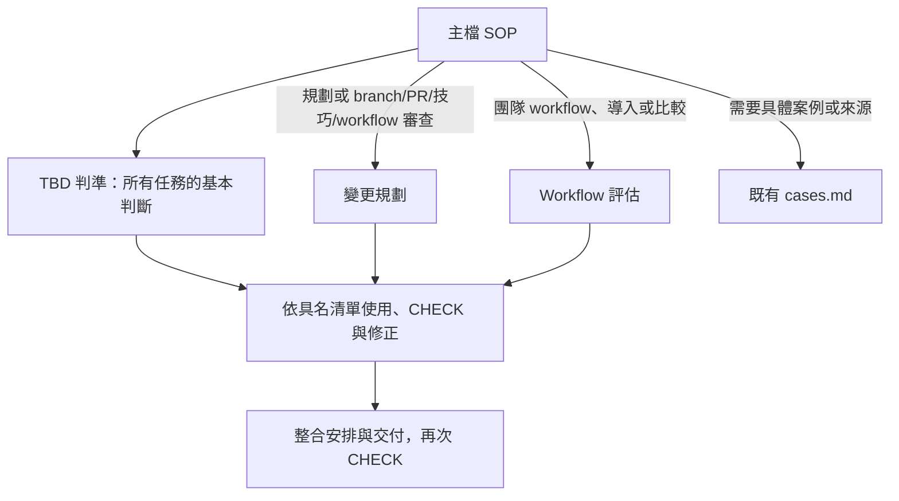

# 工程藍圖：trunk-based-development－補回 workflow 的 flag 清理審查

- 模式：局部回修；As-Is 為首次施工技能，不是原始基線。
- 紀錄目錄：`docs/過程/CH2/trunk-based-development/本次執行/`
- 根因報告：「共同保留題失敗根因分析.md」；R1 歷史結構根因保留，本次修正已確認 R2。
- 確認紀錄：2026-10-17 總指揮確認 E1～E9、S5、R2，授權提出局部回修藍圖；本藍圖尚待第二閘門確認，尚未施工。原「工程藍圖.md」「工程藍圖初版.md」、首次快照、失敗輸出與原測試均保留。
- 版本證據：僅摘錄主樹指定核對檔的 c03a／c03b；兩個項目的 snapshot 均與本次首次快照相同且兩側一致，見「共同題版本核對摘錄.json」。未讀其他 run 或 c03b 輸出。

## 1. 驗收條件


沿用根因閘門確認版本，以下列出全文，未變更判準。

| 編號 | 驗收條件 | 來源 | 適用範圍 |
| --- | --- | --- | --- |
| E1 | 主檔含可依序執行的 SOP 與完成條件；判斷規則置於有主題邊界的 RuleFile，無為檔數拆分 | 本次 | 通用 |
| E2 | 每份 RuleFile 的每個 Rule 都有可核對規則、Good Example、Bad Example；不改變原本正確的約束 | 本次 | 通用 |
| E3 | 每個外部規則載入都列明觸發條件、相對路徑、讀取範圍並建立具名清單；使用步驟及 CHECK 明確引用清單，失敗時有修正回路 | 本次 | 通用 |
| E4 | 小需求可用短期 branch/小 PR 規劃，說明技巧、main 可工作理由與含 review 等待的壽命；維持同步、CI/review、刪 branch 的流程 | 既有 | 通用 |
| E5 | 大變更保留切小優先、flag 隱藏及清理、abstraction 遷移、新舊 API 並存的適用條件與安全整合順序 | 既有 | 通用 |
| E6 | 審查區分官方/DORA/團隊、核心/建議/團隊決策；不把兩天或 merge 方法當硬性標準，指出紅燈優先及導入前提，保留 GitFlow 比較 | 既有 | 通用 |
| E7 | 舊版本 hotfix 先 main 修復驗證再 cherry-pick release；release 不作長期新功能線 | 既有 | 通用 |
| E8 | 前後相同情境與判準使用乾淨新對話；保存輸入、完整原始輸出、設定與限制、結構/行為分開比較；兩側一致且結構無 error | 本次 | 個案 |
| E9 | 只修改目標兩側與本次指定目錄；兩個確認閘門各別通過；提供草稿且不 commit/push/家目錄安裝 | 本次 | 個案 |

### 從驗收推導步驟目的，再對照舊版

| To-Be 步驟 | 目的與後續使用 | 追溯 |
| --- | --- | --- |
| P1-1 | 取得任務輸入，供所有判斷使用 | E1、E4～E7；必要輸入 |
| P1-2 | 辨識本次任務分支，決定適用載入 | E1、E3 |
| P1-3～4 | 載入基本判準，形成來源/分級判斷 | E2、E3、E6 |
| P1-5～6 | 按需載入拆分/技巧規則，形成變更方案或相關審查結果 | E2～E5、E7 |
| P1-7～8 | 按需載入導入/比較規則，形成評估結論 | E2、E3、E6 |
| P1-9～10 | 按需讀案例/來源，將參考用於具體方案或評估 | E3、E5、E6 |
| P1-11 | 逐條核對所有適用清單，未過返回判斷 | E3 |
| P2-1 | 安排原有分支/同步/驗證/合併/清理流程 | E4 |
| P2-2 | 呈現任務所需結果，保留原規劃格式 | E4～E7 |
| P2-3 | 核對交付內容，未過則修正再交付 | E3 |

E8/E9 為本次工程交付條件，不新增到目標 Skill 的一般規則。


E1～E9 不變，完整判準沿用原根因報告、測試輸入與判準及已確認失敗根因報告；本藍圖不放寬任何情境。S5 的未知狀態列待確認是原 workflow 審查用途的保留，不是新增領域政策。

先由驗收條件推導目的：E2、E5、E6 要求規劃時的清理安排與一般 workflow 清理狀態審查兩種用途都保留；E1、E3 要求此判斷留在按需 RuleFile，透過既有 READ／使用／CHECK 鏈運作；E4、E7 要求正常規劃、hotfix 不被改動。由此需要的是既有評估步驟能取得完整審查義務，無需新增 Phase、步驟或部位。再與 As-Is 比較，僅 Workflow評估 Rule 1 的涵蓋範圍不同，其餘追溯相同者逐字保留。

## 2. To-Be SOP


以下為完整主檔提案，尚未寫入目標 Skill。frontmatter 逐字保留。

````markdown
---
name: trunk-based-development
description: 依主幹式開發（Trunk-Based Development，TBD）規劃與審查工作拆分、branch 策略與整合方式。用在：收到需求或 ticket 時規劃要拆成幾個 PR、判斷一個變更該直接走短期 branch 還是需要 Feature Flag／Branch by Abstraction／新舊並存／Release Branch、大型重構或框架遷移（例如 Vuex → Pinia、Axios → Fetch）如何每天安全 merge main、舊版本 hotfix 怎麼修、檢查某個 branch 或 PR 是否活太久或太大、審查團隊的 Git workflow 算不算 TBD，以及比較 TBD 與 GitFlow。
---

# SOP

## Phase 1 -- 分析需求與判斷策略

1. `READ` 使用者需求與已提供的專案規範；有既有 branch、PR、CI 或團隊 workflow 資訊時，一併讀取作為「任務輸入」。
2. `THINK` 依「任務輸入」判定本次涉及變更規劃、workflow 審查、導入評估或 GitFlow 比較，可同時適用多種任務。
3. `READ` 進行變更規劃、審查、導入評估或 GitFlow 比較時，讀取 `rules/TBD判準-格式規範.md` 的所有 Rule，建立「TBD判準檢查清單」。
4. `THINK` 依「任務輸入」與已載入的「TBD判準檢查清單」，判定相關事實對應的規則來源與分級，形成「基本判斷」。
5. `READ` 任務涉及變更規劃、branch 或 PR 審查、技巧使用審查或團隊 workflow 審查時，讀取 `rules/變更規劃-格式規範.md` 的所有 Rule，建立「變更規劃檢查清單」。
6. `THINK` 已載入「變更規劃檢查清單」時，依「任務輸入」、「基本判斷」與該清單，形成「變更方案」或「拆分與技巧審查結果」。
7. `READ` 任務涉及團隊 workflow 審查、導入評估或 GitFlow 比較時，讀取 `rules/Workflow評估-格式規範.md` 的所有 Rule，建立「Workflow評估檢查清單」。
8. `THINK` 已載入「Workflow評估檢查清單」時，依「任務輸入」、「基本判斷」、適用時的「拆分與技巧審查結果」及已載入的「TBD判準檢查清單」與「Workflow評估檢查清單」，形成符合任務範圍的「評估結論」。
9. `READ` 需要完整情境拆法協助具體化方案或說明評估時，讀取 `references/cases.md` 中相應案例；需要核對規則來源時讀取其中的參考資料，建立「案例與來源參考」。
10. `THINK` 已載入「案例與來源參考」時，將相應案例對照「變更方案」、「拆分與技巧審查結果」或「評估結論」，具體化本次內容。
11. `CHECK` 逐條驗證已載入的「TBD判準檢查清單」，以及適用時的「變更規劃檢查清單」與「Workflow評估檢查清單」；未通過時返回本 Phase 對應的判斷步驟修正並重新檢查。

完成條件：已依任務形成「基本判斷」及適用的「變更方案」、「拆分與技巧審查結果」或「評估結論」，並通過所有已載入檢查清單。

## Phase 2 -- 安排整合與交付

1. `THINK` 涉及變更規劃時，依「變更方案」安排整合流程：每個小變更開短期 branch，工作期間同步 main，merge 前 branch 要跟 main 保持最新；build → lint → unit test → 必要的 integration test；PR → review → CI green → merge；merge 後刪 branch。
2. `WRITE` 依「基本判斷」及已載入的檢查清單，向使用者呈現「變更方案」與其整合安排、「拆分與技巧審查結果」或符合任務範圍的「評估結論」。規劃結果用這個格式給出：

   ```text
   PR 1：<變更>  — 使用技巧：<無／Feature Flag／Abstraction／新舊並存>
   PR 2：...
   每個 PR merge 後 main 為什麼仍可工作：<說明>
   預估 branch 壽命（含等 review）：<時間>
   ```

3. `CHECK` 交付內容符合「任務輸入」與所有已載入的檢查清單；未通過時返回 Phase 1 對應的判斷步驟或本 Phase 的整合安排步驟修正，再更新交付內容並重新檢查。

完成條件：使用者要求的規劃、審查、導入評估或比較已呈現，且交付內容符合所有已載入檢查清單。
````

### 模組關係與界線



三個檔案依「判準」「拆分與技巧」「導入與比較」分主題，各含 3／5／2 條 Rule。沒有把每個技巧拆成單檔。小修正不載入 Workflow評估；單純比較不載入變更規劃；完整團隊審查同時需要基本判準、拆分/技巧與導入評估。規則檔路徑只在主檔 READ 提名，首次使用緊鄰 READ 且位於同一 Phase。


以上 frontmatter、SOP 及完成條件與首次施工版逐字相同。回修只修改已存在的規則內容；主檔不新增 flag 專用提醒或補償步驟。

### 每步目的與追溯

| 元素 | 目的 | 驗收條件／約束 |
| --- | --- | --- |
| P1-1 | 取得已提供需求與現況 | E1；C1 |
| P1-2 | 判定本次任務，可複合 | E1、E3；C2 |
| P1-3 | 載入基本規則並具名 | E1～E3；C23 |
| P1-4 | 形成來源及分級判斷 | E4、E6；C3～C9、C23 |
| P1-5 | 按任務載入變更規劃清單 | E1～E3；C24 |
| P1-6 | 形成變更方案／技巧審查結果 | E4、E5、E7；C10～C16、C24 |
| P1-7 | 按任務載入 workflow 清單，含修復後義務 | E1～E3、E6；C25 |
| P1-8 | 依具名清單形成適用的評估結論 | E2、E5、E6；C3、C17～C19、C25、C29 |
| P1-9 | 必要時載入案例／來源 | E3；C22 |
| P1-10 | 用已載入參考具體化 | E3；C26 |
| P1-11 | 逐條核對已載入清單，失敗回判斷 | E2、E3；C27（涵蓋清單內 C29） |
| P1 完成條件 | 概述分析及清單通過 | E1、E3；不另存判斷約束 |
| P2-1 | 規劃任務安排整合順序 | E4；C20 |
| P2-2 | 呈現適用方案／審查／結論 | E2～E7；C21，使用已載入清單 |
| P2-3 | 核對交付並回修重檢 | E2、E3；C28（涵蓋清單內 C29） |
| P2 完成條件 | 概述交付且清單通過 | E1、E3；不另存判斷約束 |

### 唯一修改部位的 To-Be

目標：`rules/Workflow評估-格式規範.md` Rule 1。Rule 2 逐字不動。下列為 Rule 1 完整預期內容，非新增另一份規範：

```markdown
# Rule 1 - 審查 workflow 並依前提與情境評估導入

- 評估導入時，必須檢查自動 build、自動 test、快速 CI、小批次開發能力與快速 code review。
- 必須指出經驗不足、缺 gated checks、沒有「broken trunk 優先修復」紀律時的風險；DORA 指出這類團隊實行 TBD 反而可能增加錯誤與返工。
- 缺少上述前提時，必須先指出缺的前提，不得直接建議全面導入。
- 可以依適用情境說明價值：SaaS、Web App、Backend API、Frontend App、Microservice、企業內部系統、頻繁發布、多人共同維護的 codebase。需求一直變、多人同時改、需要頻繁 release 三者同時成立時價值最高。
- 審查團隊 workflow 時，必須檢查 Feature Flag 的用後清理狀態；未提供使用與清理狀態時，必須列為待確認的審查項，不得推定已使用或未清理。

## Good Example

### Example 1

先指出團隊缺少的前提，沒有把改 branch 命名當成完成導入。

- 情境：SaaS 團隊沒有自動測試，review 需要三天，打算明天全面導入 TBD。
- 評估：先補自動 build/test、快速 CI 與 gated checks，縮短 review，建立 broken trunk 優先修復紀律，再逐步導入；團隊仍有小批次開發能力與經驗需要評估。

### Example 2

一般 workflow 審查仍檢查 flag 清理，資訊不足時明列待確認。

- 情境：團隊有長期 develop 與 release-next、PR review 常等待兩天、CI 變紅後仍繼續開發，要求檢查是否符合 TBD。
- 評估：針對長期開發線、含 review 的 branch 壽命與紅燈處理指出問題；另列「是否使用 Feature Flag，以及用後是否清理」為待確認的審查項，不把未知狀態判為已使用或未清理。

## Bad Example

### Example 1

相同團隊缺少安全前提，卻被直接建議全面導入。

- 情境：SaaS 團隊沒有自動測試，review 需要三天，打算明天全面導入 TBD。
- 評估：明天把 branch 改名為 `short-task/*`，所有人開始直接整合 main，就算完成導入。

### Example 2

相同 workflow 審查漏掉 flag 清理狀態，或把未知狀態當事實。

- 情境：團隊有長期 develop 與 release-next、PR review 常等待兩天、CI 變紅後仍繼續開發，要求檢查是否符合 TBD。
- 評估：只列長期線、review、紅燈及導入前提，完全不列 Feature Flag 清理審查項；或在沒有資訊時直接斷言「團隊使用了 flag 而且沒有清理」。
```

原 Rule 1 四個條列與既有正反例正文逐字保留，只擴充標題、新增審查條列、為原例加 Example 1 層級並補入 Example 2。例子示範既有判斷，不產生額外數字門檻、輸出模板或必須使用 flag 的政策。變更規劃 Rule 2 仍是規劃時如何控制曝光及安排清理的唯一規範位置；C29 規範的是一般 workflow 的檢查涵蓋範圍及未知資訊處理，兩者不可互相替代。

## 3. 差異表

### 刪除

無整檔、Rule、步驟或既有判準刪除。唯一文字替換是 Rule 1 原標題改為同時涵蓋 workflow 審查與導入評估；沒有另留舊標題。未授權任何其他刪除。

### 修改、合併、改換存放位置與新增

| 元素 | 動作 | 內容 | 追溯 |
| --- | --- | --- | --- |
| Workflow評估 Rule 1 標題 | 修改 | 擴充為審查 workflow 與導入評估 | R2；C17、C18、C29 |
| Workflow評估 Rule 1 條列 | 修改既有部位內容 | 保留四條，補回清理狀態審查及未知時待確認 | E2、E5、E6；R2；C29 |
| 同一 Rule 正反例 | 修改 | 原例正文保留並標 Example 1，新增同題 Example 2 對照漏項及無依據斷言 | E2；C29 |

### 保留

| 元素 | 追溯 | 約束 |
| --- | --- | --- |
| frontmatter name／description | 原用途、觸發範圍符合 E1、E2，不改觸發 | 概述，不另存判斷細節 |
| Phase 1 全部 11 步與完成條件 | E1～E7；每步追溯見第 2 節 | C1～C19、C22～C27；使用新增清單內容 C29 |
| Phase 2 全部 3 步與完成條件 | E1～E7；每步追溯見第 2 節 | C20、C21、C28；依清單交付／檢核 |
| TBD判準檔案及 Rule 1／2／3 的條列與全部正反例 | E2、E4、E6 | C3～C4／C5～C8／C9 |
| 變更規劃檔案及 Rule 1／2／3／4／5 的條列與全部正反例 | E2、E4、E5、E7 | C10～C11／C12／C13／C14／C15～C16 |
| Workflow評估 Rule 1 原四條及原正反例正文 | E6，既有導入／適用性仍正確 | C17、C18 |
| Workflow評估 Rule 2 標題、條列及全部正反例 | E2、E6 | C19 |
| references/cases.md 全文 | E2、E4～E7；相應案例與來源示範 | 示範 C3～C19，不另存新規範 |
| 樣板組與腳本 | 無，As-Is 亦無 | 無 |

已依刪除→改寫→改換存放位置→新增順序考慮：刪除正確導入規則不能恢復審查用途；只改寫四個正確導入條列會改變其原意；把變更規劃 Rule 2 搬到 workflow 會傷害規劃用途；因此在既有同主題 Rule 1 內擴充一個遺漏的審查條列及正反例。不是新增檔案、Rule 或 SOP，也不重寫其他正確規則。

## 4. 淨增減

| 項目 | As-Is 首次施工 | To-Be 回修 | 增減 |
| --- | --- | --- | --- |
| Phase | 2 | 2 | 0 |
| SOP 步驟 | 14 | 14 | 0 |
| RuleFile | 3 | 3 | 0 |
| Rule | 10（3＋5＋2） | 10（3＋5＋2） | 0 |
| 樣板組 | 0 | 0 | 0 |
| 腳本 | 0 | 0 | 0 |
| references 檔案 | 1 | 1 | 0 |

內容增減：僅 Rule 1 更換標題、新增一個審查條列與一組正反例；既有正反例正文不改。C29 是工程約束編號新增、原用途補回，不是新增 TBD 領域行為。無可合理刪去的正確既有要求，故無整項刪除。

## 5. 約束分配表


位置簡寫對應第 2 節同名規則檔。每條約束只有一個規範位置；範例可示範，SOP 只引用載入結果。

| 編號 | 約束 | 所屬步驟 | 存放位置 | 理由 |
| --- | --- | --- | --- | --- |
| C1 | 讀取需求、已提供規範及存在的現況資訊 | P1-1 | P1-1 內文 | E1；輸入流程留 SOP |
| C2 | 辨識規劃/審查/導入/比較，可複合 | P1-2 | P1-2 內文 | E1、E3；任務分支留 SOP |
| C3 | 區分官方、DORA、團隊規則來源 | P1-4、P1-8 | TBD判準 Rule 1 | E6；語意分類需判斷，非腳本/固定檔案結構 |
| C4 | 官方通常 1～2 天、DORA <1 天，兩天非硬性國際標準 | P1-4 | TBD判準 Rule 1 | E6；來源與強度需判斷，腳本/樣板不能保證 |
| C5 | 單一 trunk/main、沒有長期開發分支，main 可工作及可發布 | P1-4 | TBD判準 Rule 2 | E4、E6；工作流語意判斷，非固定結構 |
| C6 | 頻繁整合；DORA 至少每日一次，多次更好 | P1-4 | TBD判準 Rule 2 | E4、E6；需判斷頻率與規範來源 |
| C7 | CI 紅燈立即先修或 revert；DORA 建議每 commit 自動 build/test、幾分鐘回饋 | P1-4 | TBD判準 Rule 2 | E6；需判斷優先性及來源，非單一機械輸出 |
| C8 | 短命、少量 active branches、不靠 code freeze；長期多人共用 feature 線、不清理等錯誤模式 | P1-4 | TBD判準 Rule 2 | E6；建議與錯誤模式判斷；刪 branch 動作另屬 C20 |
| C9 | merge 方法、同步方法、命名、reviewer 數、平台、direct push 政策由團隊決定 | P1-4 | TBD判準 Rule 3 | E6；需分類，非固定結構 |
| C10 | 小批次優先，Story/Ticket 不等於單 PR；小變更短 branch，不能完成再切或依原因選技巧；不以長分支藏未完成工作 | P1-6 | 變更規劃 Rule 1 | E4、E5；拆分及策略選擇需語意判斷 |
| C11 | branch 壽命含 review 等待；明天仍存在須檢查是否切太大 | P1-6 | 變更規劃 Rule 1 | E4；情境估計，腳本/樣板不能保證 |
| C12 | 不能曝光用 flag 關閉，完成後開啟；Deploy ≠ Release；上線後清理 | P1-6 | 變更規劃 Rule 2 | E5；曝光與清理時機需判斷 |
| C13 | 大改造：抽象→舊接入→新實作→逐步切換→刪舊；各階段可整合 | P1-6 | 變更規劃 Rule 3 | E5；規劃對象的遷移判準，不是本 Skill 的 Phase 轉移 |
| C14 | API 新舊並存，consumer 遷移後才刪舊 API | P1-6 | 變更規劃 Rule 4 | E5；相容性判斷，非固定檔案結構 |
| C15 | Release Branch 很晚才切，只穩定/修復/發布，不作新功能開發 | P1-6 | 變更規劃 Rule 5 | E7；分支用途需判斷 |
| C16 | main 先修並驗證，再 cherry-pick release；不只修 release 再回灌 | P1-6 | 變更規劃 Rule 5 | E7；版本維護方案的判準，不新增操作授權 |
| C17 | 自動 build/test、快速 CI/gated checks、小批次、快速 review、broken trunk 優先紀律；缺少時先指出，不全面導入；保留 DORA 返工風險 | P1-8 | Workflow評估 Rule 1 | E6；團隊能力判斷，腳本或樣板不能保證 |
| C18 | 保留適用專案及需求變動/多人共改/頻繁發布的價值情境 | P1-8 | Workflow評估 Rule 1 | E6；適用性評估，非排他清單或機械門檻 |
| C19 | GitFlow 先隔離做完整再合；TBD 先切小持續整合保持可工作，主要改變拆分方式 | P1-8 | Workflow評估 Rule 2 | E6；比較語意需正反例，非檔案骨架 |
| C20 | 短 branch→同步→build/lint/unit/必要 integration→PR/review/CI green/merge→刪 branch | P2-1 | P2-1 內文 | E4；整合流程順序留 SOP |
| C21 | 原 PR/技巧/main 安全性/含 review 壽命呈現格式 | P2-2 | P2-2 內文 | E4；既有一小段對話格式，不是要生成獨立檔案，不硬加雙檔樣板 |
| C22 | 按需要讀案例或來源，建立具名參考 | P1-9 | P1-9 內文 | E3；載入條件與路徑留 SOP |
| C23 | 基本判準 READ 緊鄰 THINK，以具名清單使用 | P1-3～4 | P1-3～4 載入鏈 | E1～E3；流程留 SOP，不重述規則 |
| C24 | 規劃或相關審查時 READ，緊鄰 THINK 使用具名清單 | P1-5～6 | P1-5～6 載入鏈 | E1～E3；條件分支留 SOP |
| C25 | 團隊審查/導入/比較時 READ，緊鄰 THINK 使用具名清單 | P1-7～8 | P1-7～8 載入鏈 | E1～E3；條件分支留 SOP |
| C26 | 用具名案例結果具體化方案或審查 | P1-10 | P1-10 內文 | E3；單一步驟，不需獨立規則檔 |
| C27 | 分析後逐條 CHECK 所有已載入清單，未過返回判斷 | P1-11 | P1-11 內文 | E3；檢核與回路留 SOP |
| C28 | 核對交付與輸入/清單，未過修正並再次檢查 | P2-3 | P2-3 內文 | E3；檢核與回路留 SOP |
| C29 | 團隊 workflow 審查必須檢查 Feature Flag 用後清理狀態；未知使用／清理狀態列待確認，不能推定已使用或未清理 | P1-8，P1-11／P2-3 檢核及 P2-2 交付 | Workflow評估 Rule 1 | E2、E5、E6／R2；審查涵蓋範圍與資訊充分性需要判斷，腳本無法由任意敘述確認真實狀態，非產出檔整體結構，不適用樣板；用既有 RuleFile 與正反例承接 |

同一載入鏈的 READ 與使用步驟並非兩份重述的規則。RuleFile 約束需語意判斷，不能由程式直接產生/判斷，且不規定整份產出檔的骨架，因此不選較高順序的腳本或樣板。流程本身依載體規則直接留 SOP。


C1～C28 沿用原已確認分配；C29 唯一規範位置是既有 Workflow評估 Rule 1，不在 SOP 或變更規劃檔重述。範例只是示範。沒有將所有未知資訊泛化成新的強制審查制度。

## 6. 施工工作項

| 順序 | 工作項 | 執行者 | 目標 | 內容 | 約束 | 狀態 |
| --- | --- | --- | --- | --- | --- | --- |
| 1 | W5 | skill-form-rule | rules/Workflow評估-格式規範.md Rule 1 | 按第 2 節完整 To-Be 局部擴充，保留 Rule 2 | C17、C18、C29 | 已完成 |

### 工作項內容

- 本節內容須在本次第二閘門明確確認後，完整交給 skill-form-rule；不得帶入藍圖以外要求。執行 primitive 可在本 agent 依其 SOP 操作，不必另開施工子代理。
- Before：首次快照的 Workflow評估 Rule 1（依前提與情境評估導入，四條＋一組正反例）；無一般 workflow 的 flag 清理狀態審查義務。
- After：第 2 節所列 Rule 1 完整文字。只改 `.agents/skills/trunk-based-development/rules/Workflow評估-格式規範.md` 此一 Rule；Rule 2、其他 RuleFile、SKILL.md、cases 逐字保留。
- 定位：既有規則檔的 `# Rule 1 - 依前提與情境評估導入`，原條列與 Good／Bad Example 區段；不是以行號定位。
- 不改載入條件、路徑、範圍、清單名稱、使用步驟或 CHECK。因此用 skill-form-rule，無需 skill-derive-rule 或胖 SOP；沒有新增部位，也沒有 SOP 施工可交 skill-form-sop。
- skill-form-rule 若認為工作項不符合其檢查清單，保存狀態、停止並返回 Phase 3，不能自行增加規則或省略要求。完成 W5 後逐項更新狀態；後續若仍失敗返回 Phase 2，不覆寫首次快照或挑成功結果。

## 7. 驗收情境

| 編號 | 驗證 | 類型 | 輸入 | 預先回覆 | 判斷方式 |
| --- | --- | --- | --- | --- | --- |
| S1 | E2、E4 | 既有回歸 | 原 S1/輸入.md，逐字不變 | 無 | 原判準不變：小 PR／無技巧、main 安全、CI/review、含等待壽命、刪 branch；同步有無另列觀察 |
| S2 | E2、E4、E5 | 既有回歸 | 原 S2/輸入.md，逐字不變 | 無 | 原三種技巧、安全順序、清理安排、含 review 壽命判準不變 |
| S3 | E2、E6、E7 | 既有回歸 | 原 S3/輸入.md，逐字不變 | 無 | 原 workflow／來源分級／前提／比較／hotfix 判準不變；未明示資訊不當作已知事實 |
| S4 | E1～E6 | 靜態逐項 | 同一原始模組化需求、兩側檔案及原版 workflow 六項清單 | 無 | 保留原所有檢查，逐 Rule 正反例、READ／具名／使用／CHECK；新增精確核對原六項審查用途的對應，尤其 C29，不能只查「清理」字詞 |
| S5 | E2、E5、E6 | 已確認共同題回歸 | 失敗根因報告第 2 節固定完整輸入，與首次失敗相同 | 無 | 保留三項現況的正確判斷；必須列 Feature Flag 用後清理待確認／審查項；未給狀態不得斷言已使用或未清理 |

S5 完整輸入：

```text
請讀取並使用目前專案 .agents/skills/trunk-based-development/SKILL.md 回答以下需求，僅讀取檔案，不修改專案。

團隊有長期 develop 與 release-next、PR review 常等待兩天、CI 變紅後仍繼續開發；請檢查是否符合 TBD。
```

### READ／使用／CHECK 驗收

- P1-7 對團隊 workflow 審查／導入／比較讀 Workflow評估所有 Rule，建立「Workflow評估檢查清單」，不改既有條件。
- P1-8 緊鄰使用此清單形成評估結論；本題屬團隊 workflow 審查，C29 適用，不能以輸入沒提 flag 跳過審查項。
- P1-11 及 P2-3 沿用所有已載入清單逐條核對及修正回路；P2-2 依清單交付，不能只讀檔而未在評估中處理此項。
- 小變更規劃不因此強制載入 Workflow評估；單純比較不因此新增 flag 清理檢查義務，C29 限一般團隊 workflow 審查。不重述或改變其他既有領域判準。

### 實跑與證據安排

1. 首次快照與首次失敗永久保留。施工前先核對兩側與首次快照雜湊；施工後另存「回修技能」及雜湊，所有新原始輸出另命名，不覆寫原 S1～S3／S5。
2. S1～S3 前測與首次後測已實跑，保留證據；回修後以相同輸入、路徑與「測試執行包裝.md」在 fork_turns=none 全新子代理實跑，模型／推理不另覆寫，逐案評分並與原版及首次施工結果分開比較。不得把不同環境當嚴格配對；可得設定不一致即揭露並交總指揮安排。
3. S5 的首次失敗是既有全新 Herdr Codex session、GPT-6.1-Sol medium fast 畫面；回修後優先由總指揮安排相同 CLI／model medium／fast 設定的新 session，使用相同完整輸入、工作目錄中的同一路徑，只替換受測 Skill。現有子代理若無法證明與 Herdr 設定相同，只能當補充測試，不拿來替代此配對。
4. S5 若需補原始基線配對：提供「修改前技能複本」同名路徑與相同輸入給另一乾淨 session，採相同設定及判準，完整保存結果；不假稱已有此基線實跑，也不以重跑首次候選來消除既存失敗。S5 主要修復比較是首次候選失敗與回修候選；原始基線結果只補足三版本對照。
5. 各獨立情境可平行啟動，仍各自保存完整輸入、原始 final、可得工具載入紀錄、模型設定、前後檔案清單／雜湊／Git 狀態及副作用核對。只給路徑、輸入、原相同必要操作限制，不給根因、藍圖、判準、其他答案或預先提示 flag。
6. 子代理啟動／等待超過一分鐘，立即交付情境完整輸入、環境位置、Skill 雜湊與設定要求給總指揮安排 Herdr；不省略實跑。S4 是人工語義核對加既有 audit，不假稱乾淨模型測試。
7. 失敗輸出全部保留。環境失敗先證明環境與情境不符再修正；Skill 失敗返回 Phase 2，不改判準、不只重跑挑成功、不以部分通過完成。分開記錄結構差異與行為差異；未改善如實記錄。
8. 限制沿用：無後端部署精確版本、temperature／seed 或 OS sandbox；讀取 trace 不完整時只報可得證據，設定自述不等於 runtime metadata。無真實 Git mutation 或部署驗證。無呼叫者回歸，且不重跑 conventional-commits。

### 診斷、同步、範圍及交付

- 施工前保存 Git diff／狀態，以及兩側目標與本次紀錄外的檔案清單、內容雜湊，涵蓋其他 Skill、AGENTS.md／CLAUDE.md；若同步範圍原本有非目標差異，先回報，不覆寫。
- 施工完成後分別以既有 audit_skill.py 對 agents、claude 目標診斷，兩側均須 0 error；另人工核對本藍圖、全部 Rule／正反例及原 workflow 六項審查用途。既有機械 audit 不足以證明語義保留。
- 從專案根目錄依序執行 `scripts/sync-skills.sh --from agents` 及 `scripts/sync-skills.sh --check`，保存輸出及兩個退出狀態；須皆為零且兩邊一致，不建立 symlink。不以手工複製目標代替規定命令，不改腳本。
- 再保存相同範圍檔案清單、內容雜湊及 Git diff，核對目標外無新增／刪除／內容變更；同步重建造成 inode／時間改變不算內容差異。保存目標端獨有而未刪除的 Skill 資訊。若出現目標外差異或檢查失敗，保存證據停止回報，不回退他人內容。
- 預期 Skill diff 只含兩側 Workflow評估 Rule 1；SKILL.md、其他規則、Rule 2、cases 及首次快照皆以雜湊確保不變。紀錄只在指定目錄，Markdown 檔名繁體中文；必要的 Skill 複本原路徑例外沿用。
- 全部情境通過才完成並更新 commit message 草稿；不 commit、push、安裝或修改其他 Skill／應用程式。

## 8. 驗收結果

W5 已完成；S1～S3 原判準乾淨回歸、S4 靜態及總指揮執行的 S5-a／S5-b 已知題回歸均通過。兩側結構診斷各 0 error／0 warning，規定同步與檢查皆退出零、兩側一致，目標外內容不變；回修快照已保存，與主樹共同複驗技能五個檔案雜湊全等。原 S5 首次失敗與原快照完整保留，不重跑已完成共同題。詳「回修前後比較與最終驗收.md」逐案結果、原始證據、模型／隔離限制（含 f03b 搜尋記憶）及交付；已更新最終提交訊息草稿，未 commit／push。

藍圖自檢：已由 E2／E5／E6 與 R2 推導再與 As-Is 對照；原各元素及 C1～C28 保留追溯，C29 僅一處；無新增 SOP、部位或 Rule；施工用 skill-form-rule；規定同步與範圍雜湊、原失敗保存、相同輸入判準、乾淨配對及設定限制均明列。呼叫者：無。

### 確認紀錄

- 根因閘門：總指揮已確認 E1～E9、S5、R2，並補足共同題版本雜湊歸屬證據。
- 本次藍圖閘門：2026-10-17 總指揮已讀完整局部回修藍圖並核准 W5；只改 Workflow評估 Rule 1，其餘原文保留。核准平行回歸 S1～S3、靜態 S4；S5 由總指揮以相同 Herdr 環境複驗，屬已知題回歸，不當新保留題。同步與回修快照完成後立即通知總指揮，不以子代理取代 S5。
- 共同複驗回報：2026-10-17 總指揮確認 f03a workflow 清理 PASS、f03b hotfix 四欄／安全／壽命與載入 PASS，授權只讀指定證據並要求核對共同複驗技能雜湊。已核對全等並保存原始畫面與自身評分列，不讀其他 run、不重跑共同題。
