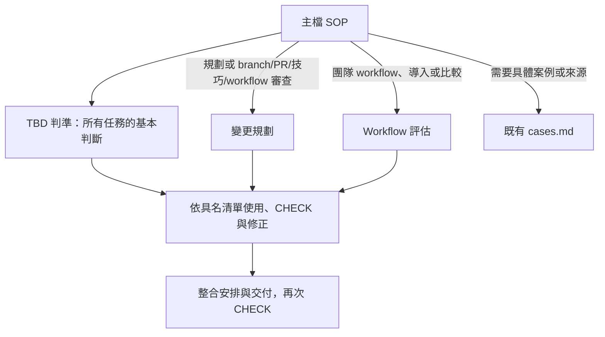

# 工程藍圖：trunk-based-development－規則按需載入模組化

- 模式：優化；針對已確認的結構根因 R1，不預設行為改善。
- 紀錄目錄：`docs/過程/CH2/trunk-based-development/本次執行/`
- 根因報告：[根因分析.md](根因分析.md)
- 確認紀錄：2026-10-17，總指揮確認既有驗收條件、情境與結構根因，准許進入 Phase 3；尚未核准施工。本藍圖沒有新增推定驗收條件。

## 1. 驗收條件

沿用根因閘門確認版本，以下列出全文，未變更判準。

| 編號 | 驗收條件 | 來源 | 適用範圍 |
| --- | --- | --- | --- |
| E1 | 主檔含可依序執行的 SOP 與完成條件；判斷規則置於有主題邊界的 RuleFile，無為檔數拆分 | 本次 | 通用 |
| E2 | 每份 RuleFile 的每個 Rule 都有可核對規則、Good Example、Bad Example；不改變原本正確的約束 | 本次 | 通用 |
| E3 | 每個外部規則載入都列明觸發條件、相對路徑、讀取範圍並建立具名清單；使用步驟及 CHECK 明確引用清單，失敗時有修正回路 | 本次 | 通用 |
| E4 | 小需求可用短期 branch/小 PR 規劃，說明技巧、main 可工作理由與含 review 等待的壽命；維持同步、CI/review、刪 branch 的流程 | 既有 | 通用 |
| E5 | 大變更保留切小優先、flag 隱藏及清理、abstraction 遷移、新舊 API 並存的適用條件與安全整合順序 | 既有 | 通用 |
| E6 | 審查區分官方/DORA/團隊、核心/建議/團隊決策；不把兩天或 merge 方法當硬性標準，指出紅燈優先及導入前提，保留 GitFlow 比較 | 既有 | 通用 |
| E7 | 舊版本 hotfix 先 main 修復驗證再 cherry-pick release；release 不作長期新功能線 | 既有 | 通用 |
| E8 | 前後相同情境與判準使用乾淨新對話；保存輸入、完整原始輸出、設定與限制、結構/行為分開比較；兩側一致且結構無 error | 本次 | 個案 |
| E9 | 只修改目標兩側與本次指定目錄；兩個確認閘門各別通過；提供草稿且不 commit/push/家目錄安裝 | 本次 | 個案 |

### 從驗收推導步驟目的，再對照舊版

| To-Be 步驟 | 目的與後續使用 | 追溯 |
| --- | --- | --- |
| P1-1 | 取得任務輸入，供所有判斷使用 | E1、E4～E7；必要輸入 |
| P1-2 | 辨識本次任務分支，決定適用載入 | E1、E3 |
| P1-3～4 | 載入基本判準，形成來源/分級判斷 | E2、E3、E6 |
| P1-5～6 | 按需載入拆分/技巧規則，形成變更方案或相關審查結果 | E2～E5、E7 |
| P1-7～8 | 按需載入導入/比較規則，形成評估結論 | E2、E3、E6 |
| P1-9～10 | 按需讀案例/來源，將參考用於具體方案或評估 | E3、E5、E6 |
| P1-11 | 逐條核對所有適用清單，未過返回判斷 | E3 |
| P2-1 | 安排原有分支/同步/驗證/合併/清理流程 | E4 |
| P2-2 | 呈現任務所需結果，保留原規劃格式 | E4～E7 |
| P2-3 | 核對交付內容，未過則修正再交付 | E3 |

E8/E9 為本次工程交付條件，不新增到目標 Skill 的一般規則。

## 2. To-Be SOP

以下為完整主檔提案，尚未寫入目標 Skill。frontmatter 逐字保留。

````markdown
---
name: trunk-based-development
description: 依主幹式開發（Trunk-Based Development，TBD）規劃與審查工作拆分、branch 策略與整合方式。用在：收到需求或 ticket 時規劃要拆成幾個 PR、判斷一個變更該直接走短期 branch 還是需要 Feature Flag／Branch by Abstraction／新舊並存／Release Branch、大型重構或框架遷移（例如 Vuex → Pinia、Axios → Fetch）如何每天安全 merge main、舊版本 hotfix 怎麼修、檢查某個 branch 或 PR 是否活太久或太大、審查團隊的 Git workflow 算不算 TBD，以及比較 TBD 與 GitFlow。
---

# SOP

## Phase 1 -- 分析需求與判斷策略

1. `READ` 使用者需求與已提供的專案規範；有既有 branch、PR、CI 或團隊 workflow 資訊時，一併讀取作為「任務輸入」。
2. `THINK` 依「任務輸入」判定本次涉及變更規劃、workflow 審查、導入評估或 GitFlow 比較，可同時適用多種任務。
3. `READ` 進行變更規劃、審查、導入評估或 GitFlow 比較時，讀取 `rules/TBD判準-格式規範.md` 的所有 Rule，建立「TBD判準檢查清單」。
4. `THINK` 依「任務輸入」與已載入的「TBD判準檢查清單」，判定相關事實對應的規則來源與分級，形成「基本判斷」。
5. `READ` 任務涉及變更規劃、branch 或 PR 審查、技巧使用審查或團隊 workflow 審查時，讀取 `rules/變更規劃-格式規範.md` 的所有 Rule，建立「變更規劃檢查清單」。
6. `THINK` 已載入「變更規劃檢查清單」時，依「任務輸入」、「基本判斷」與該清單，形成「變更方案」或「拆分與技巧審查結果」。
7. `READ` 任務涉及團隊 workflow 審查、導入評估或 GitFlow 比較時，讀取 `rules/Workflow評估-格式規範.md` 的所有 Rule，建立「Workflow評估檢查清單」。
8. `THINK` 已載入「Workflow評估檢查清單」時，依「任務輸入」、「基本判斷」、適用時的「拆分與技巧審查結果」及已載入的「TBD判準檢查清單」與「Workflow評估檢查清單」，形成符合任務範圍的「評估結論」。
9. `READ` 需要完整情境拆法協助具體化方案或說明評估時，讀取 `references/cases.md` 中相應案例；需要核對規則來源時讀取其中的參考資料，建立「案例與來源參考」。
10. `THINK` 已載入「案例與來源參考」時，將相應案例對照「變更方案」、「拆分與技巧審查結果」或「評估結論」，具體化本次內容。
11. `CHECK` 逐條驗證已載入的「TBD判準檢查清單」，以及適用時的「變更規劃檢查清單」與「Workflow評估檢查清單」；未通過時返回本 Phase 對應的判斷步驟修正並重新檢查。

完成條件：已依任務形成「基本判斷」及適用的「變更方案」、「拆分與技巧審查結果」或「評估結論」，並通過所有已載入檢查清單。

## Phase 2 -- 安排整合與交付

1. `THINK` 涉及變更規劃時，依「變更方案」安排整合流程：每個小變更開短期 branch，工作期間同步 main，merge 前 branch 要跟 main 保持最新；build → lint → unit test → 必要的 integration test；PR → review → CI green → merge；merge 後刪 branch。
2. `WRITE` 依「基本判斷」及已載入的檢查清單，向使用者呈現「變更方案」與其整合安排、「拆分與技巧審查結果」或符合任務範圍的「評估結論」。規劃結果用這個格式給出：

   ```text
   PR 1：<變更>  — 使用技巧：<無／Feature Flag／Abstraction／新舊並存>
   PR 2：...
   每個 PR merge 後 main 為什麼仍可工作：<說明>
   預估 branch 壽命（含等 review）：<時間>
   ```

3. `CHECK` 交付內容符合「任務輸入」與所有已載入的檢查清單；未通過時返回 Phase 1 對應的判斷步驟或本 Phase 的整合安排步驟修正，再更新交付內容並重新檢查。

完成條件：使用者要求的規劃、審查、導入評估或比較已呈現，且交付內容符合所有已載入檢查清單。
````

### 模組關係與界線



三個檔案依「判準」「拆分與技巧」「導入與比較」分主題，各含 3／5／2 條 Rule。沒有把每個技巧拆成單檔。小修正不載入 Workflow評估；單純比較不載入變更規劃；完整團隊審查同時需要基本判準、拆分/技巧與導入評估。規則檔路徑只在主檔 READ 提名，首次使用緊鄰 READ 且位於同一 Phase。

## 3. 差異表

### 刪除

**不刪除專業規則、案例、來源或整個檔案。刪除下列主檔舊位置與重複表達：**

| 元素 | 位置 | 理由 |
| --- | --- | --- |
| 參考式主標題與章節骨架 | 原主檔 | 改成兩個 Phase；內容依下表移轉，不因移除標題遺失規則 |
| 常見錯誤中重複的長期線、Story=PR、破壞 main、review 等待判準 | 原「常見錯誤」 | C5、C7、C8、C10、C11 各有唯一規範位置，反例可以示範，不能再複製規範 |
| 舊六項問句作為另一份檢核規範 | 原「送出前檢查」 | 問句語意由 C7、C10～C13、C17 承接；SOP 改用具名清單 CHECK |
| 移出規則的原文位置 | 原規則分級、Decision Tree、技巧、審查與比較 | 改換存放位置，不保留常駐規範副本 |

### 修改、合併、改換存放位置與新增

| 元素 | 動作 | 內容 | 追溯 |
| --- | --- | --- | --- |
| 核心目的、來源、branch 壽命、規則分級 | 改換存放位置 | TBD判準 Rule 1～3；保留來源、核心/建議/團隊強度 | E6；C3～C9 |
| 原規劃流程 1：切小 | 改換存放位置 | 變更規劃 Rule 1 | E4、E5；C10 |
| 原規劃流程 2：短期 branch | 修改流程呈現 | P2-1 整合安排的第一段 | E4；C20 |
| 原規劃流程 3：同步 main | 修改流程呈現 | P2-1 工作期間與 merge 前同步 | E4；C20 |
| 原規劃流程 4：CI/review | 修改流程呈現 | P2-1 驗證順序；DORA 每 commit 快速驗證建議置基本判準 | E4、E6；C7、C20 |
| 原規劃流程 5：刪 branch | 修改流程呈現 | P2-1 合併後清理安排 | E4；C20 |
| Decision Tree、未完成工作說明、review 壽命 | 合併及改換存放位置 | 變更規劃 Rule 1；其選擇葉節點細節由 Rule 2～5 承接 | E4、E5、E7；C10～C16 |
| Feature Flag 技巧 | 改換存放位置 | 變更規劃 Rule 2 | E5；C12 |
| Branch by Abstraction 技巧 | 改換存放位置 | 變更規劃 Rule 3 | E5；C13 |
| 新舊並存技巧 | 改換存放位置 | 變更規劃 Rule 4 | E5；C14 |
| Release Branch 技巧 | 改換存放位置 | 變更規劃 Rule 5 | E7；C15、C16 |
| workflow 六項審查問題 | 合併與修改 | 依基本判準及變更規劃逐項判斷；不再設另一份重複規範 | E5、E6；C4～C8、C11、C12 |
| 導入前提、風險及適用情境 | 改換存放位置 | Workflow評估 Rule 1 | E6；C17、C18 |
| TBD 與 GitFlow | 改換存放位置 | Workflow評估 Rule 2 | E6；C19 |
| 舊案例連結 | 修改 | 條件 READ 與具名結果使用 | E3；C22、C26 |
| 載入/任務分支/分析與交付 CHECK | 新增流程形式 | 重組 SOP，建立具名清單及失敗回路，不新增 TBD 政策 | E1～E3、R1；C1、C2、C23～C28 |
| 正反例及規範用詞 | 新增結構、必要文字調整 | 每 Rule 正反例；必須/不得/應/可以，保留強度與來源 | E2；C3～C19 |

### 保留

| 元素 | 追溯 | 約束 |
| --- | --- | --- |
| frontmatter name、description 原文 | E4～E7，既有用途/觸發不變 | 無，概述用途 |
| 規劃輸出格式原文 | E4 | C21，移入 P2-2，格式不變 |
| references/cases.md 全文及來源連結 | E4～E7，完整案例及原始資料索引 | 案例示範 C3～C20，沒有新增規範權威 |
| 既有規劃、事後審查、導入評估、比較等用途 | E4～E7 | C3～C21，不新增執行 Git 或確認閘門 |

As-Is 沒有正式 Phase、完成條件、RuleFile、Rule、樣板組或腳本，沒有這些既有元素需要保留或刪改。原五個流程步驟已逐一處置；新 Phase 僅組織流程，完成條件概述結果。既有內容追溯相同且無去重/載體/固定規範用詞調整需要時保留原文，不為美化重寫正確規則。

## 4. 淨增減

| 項目 | As-Is | To-Be | 增減 |
| --- | --- | --- | --- |
| 正式 Phase | 0 | 2 | +2 |
| 受控動詞 SOP 步驟 | 0 | 14 | +14 |
| RuleFile | 0 | 3 | +3 |
| Rule | 0 | 10 | +10 |
| 樣板組 | 0 | 0 | 0 |
| 腳本 | 0 | 0 | 0 |
| references 檔案 | 1 | 1 | 0 |

原文雖有五項流程與六項問題，並非正式受控 SOP/Rule。表中數字是結構數量，不表示新增十四個業務動作或十條 TBD 政策。P1 11 步、P2 3 步；三檔各 3/5/2 Rule，按主題及載入情境分工。

處理順序已考慮：僅刪除會丟失用途；原地改寫不能滿足按需 RuleFile；改換存放位置可保留正確規則並滿足 E1/E2；最後才新增搬移本身無法產生的 READ、具名結果與 CHECK 鏈（E3）。同時刪除重複、改寫主檔，不是只有新增。正反例是驗收所需，不是新政策；不新增腳本或雙檔樣板。

## 5. 約束分配表

位置簡寫對應第 2 節同名規則檔。每條約束只有一個規範位置；範例可示範，SOP 只引用載入結果。

| 編號 | 約束 | 所屬步驟 | 存放位置 | 理由 |
| --- | --- | --- | --- | --- |
| C1 | 讀取需求、已提供規範及存在的現況資訊 | P1-1 | P1-1 內文 | E1；輸入流程留 SOP |
| C2 | 辨識規劃/審查/導入/比較，可複合 | P1-2 | P1-2 內文 | E1、E3；任務分支留 SOP |
| C3 | 區分官方、DORA、團隊規則來源 | P1-4、P1-8 | TBD判準 Rule 1 | E6；語意分類需判斷，非腳本/固定檔案結構 |
| C4 | 官方通常 1～2 天、DORA <1 天，兩天非硬性國際標準 | P1-4 | TBD判準 Rule 1 | E6；來源與強度需判斷，腳本/樣板不能保證 |
| C5 | 單一 trunk/main、沒有長期開發分支，main 可工作及可發布 | P1-4 | TBD判準 Rule 2 | E4、E6；工作流語意判斷，非固定結構 |
| C6 | 頻繁整合；DORA 至少每日一次，多次更好 | P1-4 | TBD判準 Rule 2 | E4、E6；需判斷頻率與規範來源 |
| C7 | CI 紅燈立即先修或 revert；DORA 建議每 commit 自動 build/test、幾分鐘回饋 | P1-4 | TBD判準 Rule 2 | E6；需判斷優先性及來源，非單一機械輸出 |
| C8 | 短命、少量 active branches、不靠 code freeze；長期多人共用 feature 線、不清理等錯誤模式 | P1-4 | TBD判準 Rule 2 | E6；建議與錯誤模式判斷；刪 branch 動作另屬 C20 |
| C9 | merge 方法、同步方法、命名、reviewer 數、平台、direct push 政策由團隊決定 | P1-4 | TBD判準 Rule 3 | E6；需分類，非固定結構 |
| C10 | 小批次優先，Story/Ticket 不等於單 PR；小變更短 branch，不能完成再切或依原因選技巧；不以長分支藏未完成工作 | P1-6 | 變更規劃 Rule 1 | E4、E5；拆分及策略選擇需語意判斷 |
| C11 | branch 壽命含 review 等待；明天仍存在須檢查是否切太大 | P1-6 | 變更規劃 Rule 1 | E4；情境估計，腳本/樣板不能保證 |
| C12 | 不能曝光用 flag 關閉，完成後開啟；Deploy ≠ Release；上線後清理 | P1-6 | 變更規劃 Rule 2 | E5；曝光與清理時機需判斷 |
| C13 | 大改造：抽象→舊接入→新實作→逐步切換→刪舊；各階段可整合 | P1-6 | 變更規劃 Rule 3 | E5；規劃對象的遷移判準，不是本 Skill 的 Phase 轉移 |
| C14 | API 新舊並存，consumer 遷移後才刪舊 API | P1-6 | 變更規劃 Rule 4 | E5；相容性判斷，非固定檔案結構 |
| C15 | Release Branch 很晚才切，只穩定/修復/發布，不作新功能開發 | P1-6 | 變更規劃 Rule 5 | E7；分支用途需判斷 |
| C16 | main 先修並驗證，再 cherry-pick release；不只修 release 再回灌 | P1-6 | 變更規劃 Rule 5 | E7；版本維護方案的判準，不新增操作授權 |
| C17 | 自動 build/test、快速 CI/gated checks、小批次、快速 review、broken trunk 優先紀律；缺少時先指出，不全面導入；保留 DORA 返工風險 | P1-8 | Workflow評估 Rule 1 | E6；團隊能力判斷，腳本或樣板不能保證 |
| C18 | 保留適用專案及需求變動/多人共改/頻繁發布的價值情境 | P1-8 | Workflow評估 Rule 1 | E6；適用性評估，非排他清單或機械門檻 |
| C19 | GitFlow 先隔離做完整再合；TBD 先切小持續整合保持可工作，主要改變拆分方式 | P1-8 | Workflow評估 Rule 2 | E6；比較語意需正反例，非檔案骨架 |
| C20 | 短 branch→同步→build/lint/unit/必要 integration→PR/review/CI green/merge→刪 branch | P2-1 | P2-1 內文 | E4；整合流程順序留 SOP |
| C21 | 原 PR/技巧/main 安全性/含 review 壽命呈現格式 | P2-2 | P2-2 內文 | E4；既有一小段對話格式，不是要生成獨立檔案，不硬加雙檔樣板 |
| C22 | 按需要讀案例或來源，建立具名參考 | P1-9 | P1-9 內文 | E3；載入條件與路徑留 SOP |
| C23 | 基本判準 READ 緊鄰 THINK，以具名清單使用 | P1-3～4 | P1-3～4 載入鏈 | E1～E3；流程留 SOP，不重述規則 |
| C24 | 規劃或相關審查時 READ，緊鄰 THINK 使用具名清單 | P1-5～6 | P1-5～6 載入鏈 | E1～E3；條件分支留 SOP |
| C25 | 團隊審查/導入/比較時 READ，緊鄰 THINK 使用具名清單 | P1-7～8 | P1-7～8 載入鏈 | E1～E3；條件分支留 SOP |
| C26 | 用具名案例結果具體化方案或審查 | P1-10 | P1-10 內文 | E3；單一步驟，不需獨立規則檔 |
| C27 | 分析後逐條 CHECK 所有已載入清單，未過返回判斷 | P1-11 | P1-11 內文 | E3；檢核與回路留 SOP |
| C28 | 核對交付與輸入/清單，未過修正並再次檢查 | P2-3 | P2-3 內文 | E3；檢核與回路留 SOP |

同一載入鏈的 READ 與使用步驟並非兩份重述的規則。RuleFile 約束需語意判斷，不能由程式直接產生/判斷，且不規定整份產出檔的骨架，因此不選較高順序的腳本或樣板。流程本身依載體規則直接留 SOP。

## 6. 施工工作項

| 順序 | 工作項 | 執行者 | 目標 | 內容 | 約束 | 狀態 |
| --- | --- | --- | --- | --- | --- | --- |
| 1 | W1 | skill-form-sop | 主檔 | 先寫胖 SOP，不預先引用尚未建立的部位 | C1～C28 | 已完成 |
| 2 | W2 | skill-derive-rule → skill-form-rule / skill-form-sop | P1 THINK「形成符合任務範圍的評估結論」 | 抽取 Workflow評估並接載入/使用/檢核 | C17～C19、C25 | 已完成 |
| 3 | W3 | skill-derive-rule → skill-form-rule / skill-form-sop | P1 THINK「形成變更方案或拆分與技巧審查結果」 | 抽取變更規劃並接載入/使用/檢核 | C10～C16、C24 | 已完成 |
| 4 | W4 | skill-derive-rule → skill-form-rule / skill-form-sop | P1 THINK「形成基本判斷」 | 抽取 TBD判準，完成所有依賴調整 | C3～C9、C23 | 已完成 |

### 工作項內容

只施工 `.agents/skills/trunk-based-development/`，驗證後只同步另一側目標。執行上述 Skill 代表載入並依其 SOP 工作，不等於另開施工子代理；不得修改委派者 Skill。只交付本節對應工作項全文與已確認 To-Be，不授權額外設計。與被委派 Skill 的檢查清單不一致時，保存已完成狀態、記錄差異、停止後續工作並返回 Phase 3，不能自行改藍圖或略過項目。

#### W1：胖 SOP

- Before：目前基線主檔，見修改前隔離複本。
- After：以第 2 節為準，保留原 frontmatter 與兩 Phase，暫時移除三個 RuleFile READ 步驟，重新連續編號；保留現有案例資源的條件 READ 與使用步驟。
- 將 C3～C9 的既有正文寫入 THINK「基本判斷」，C10～C16 寫入 THINK「變更方案或拆分與技巧審查結果」，C17～C19 寫入 THINK「評估結論」。各步驟都只做一個判斷動作，其約束留在該步驟待抽取，不混入另一個不同工作。
- 所有尚未建立的檢查清單名稱也暫不引用；THINK、CHECK 與完成條件暫時核對上述對應步驟內文的約束，不能假稱已載入規則檔。
- 整合流程、原輸出格式及案例條件不變，舊參考式章節移除，不散留另一份規範。
- 完成胖 SOP 後，在本次紀錄保存「胖流程施工基準.md」，不成為正式 Skill 的外部依賴。

#### W2：抽取 Workflow評估（最後的判斷點先抽）

- 唯一定位：Phase 1 -- 分析需求與判斷策略，THINK「形成符合任務範圍的評估結論」。
- Before：W1 此步驟中的 C17～C19；輸入任務與基本判斷、適用時的技巧審查結果，產生評估結論。
- RuleFile：`rules/Workflow評估-格式規範.md`，只含下列兩條 Rule。
- After：在該 THINK 前插入第 2 節 P1-7 條件 READ，並以「Workflow評估檢查清單」使用；移除該步驟 C17～C19 規範全文。TBD 基本判準尚未抽取前只引用「基本判斷」，W4 完成後才引用最終基本清單。
- 依賴調整：P1/P2 CHECK 與完成條件對已抽取部分改用 Workflow評估檢查清單，尚未抽取部分繼續核對胖 SOP 內文；不引用不存在的基本/變更清單。

| Rule | 承接語意 | Good Example 方向 | Bad Example 方向 |
| --- | --- | --- | --- |
| 1：依前提與情境評估導入 | C17、C18，保留原適用專案清單及 DORA 風險警示 | SaaS 無自動測試且 review 慢，先指出前提並逐步改善 | 同一團隊只改 branch 命名就明天全面導入 |
| 2：比較工作拆分與整合方式 | C19，原三句比較保留原文 | 對比隔離完成再合與切小持續整合，指出 Git 操作不決定方法論 | 同樣兩個團隊只依有無 squash 就判斷 GitFlow/TBD |

#### W3：抽取變更規劃

- 唯一定位：Phase 1 -- 分析需求與判斷策略，THINK「形成變更方案或拆分與技巧審查結果」。
- Before：W1 此步驟中的 C10～C16；輸入任務與基本判斷，產生小變更、技巧、安全性或對既有情境的審查。
- RuleFile：`rules/變更規劃-格式規範.md`。五條 Rule 共同承接拆分與技巧選擇主題，不拆成五檔。
- After：插入第 2 節 P1-5 的條件 READ，P1-6 使用「變更規劃檢查清單」；移除 THINK 中 C10～C16 正文。P1/P2 CHECK 與完成條件對此部分改用具名清單，保留 W2 已建立的載入鏈。
- 不重述基本判準或 SOP 整合流程，也不要求每次回答都塞入所有技巧。Rule 1 保留 Decision Tree 的小變更/再切小/依原因選技巧關係，其細節分別由 Rule 2～5 規範。

| Rule | 承接語意 | Good Example 方向 | Bad Example 方向 |
| --- | --- | --- | --- |
| 1：以可獨立整合的小變更選擇策略 | C10、C11，含 review 壽命與送出前切小判斷；不強加技巧 | 登入文案半小時，單一短 PR；同時估 review 等待 | 同一文案修正綁進整張登入改版票留兩週 branch，且壽命只算寫程式 |
| 2：控制曝光與清理 Feature Flag | C12，保留 Deploy ≠ Release | 活動橫幅先在關閉 flag 下整合，上線後清理 | 同一橫幅留長期 branch 等上線，或永遠不清 flag |
| 3：以抽象層承接大型重構 | C13，原階段順序保留 | 日誌元件替換：抽象→舊接入→新實作→逐步切換→清理 | 相同替換留不穩定 branch 兩週後才合 |
| 4：維持遷移期間的新舊相容 | C14，保留不可讓 main 處於跨層不相容狀態 | 新舊配送 API 並存，consumer 遷移後刪舊 | 相同 API 先刪舊格式，下一 PR 才改 consumer |
| 5：限定 Release Branch 與修正方向 | C15、C16，保留很晚才切、trunk-first 與驗證後 cherry-pick | 3.4 修正先進 main 驗證再 cherry-pick，只維護發布 | 同情境只修 release 再回灌，或在 release 開下版功能 |

#### W4：抽取 TBD判準（最前的判斷點最後抽）

- 唯一定位：Phase 1 -- 分析需求與判斷策略，THINK「形成基本判斷」。
- Before：W1 此步驟中的 C3～C9；對任務事實做來源與規則分級判斷。
- RuleFile：`rules/TBD判準-格式規範.md`，三條 Rule。
- After：插入第 2 節 P1-3 READ，P1-4 使用「TBD判準檢查清單」；移除 THINK 中 C3～C9 正文。P1-8 及兩個 CHECK 依最終 To-Be 使用基本清單；完成條件也改成最終全文，不留下暫時內文引用。
- 強度處理：「active branches 盡量少」以「active branches 應維持少量」表達，保留建議強度，不另加三支等門檻。官方與 DORA 壽命目標不得升格為國際硬性標準。刪 branch 動作順序只留 C20，不重述成另一流程。

| Rule | 承接語意 | Good Example 方向 | Bad Example 方向 |
| --- | --- | --- | --- |
| 1：區分來源與 branch 壽命目標 | C3、C4 | 官方 1～2 天、DORA <1 天，兩天不是硬性國際標準 | 將三種來源混成超過兩天必然違規 |
| 2：區分核心規則與強烈建議 | C5～C8，含原常見錯誤與 DORA CI 建議 | main 頻繁整合、紅燈立即修或 revert、少量短命線 | 從 main 開 branch 但長期多人共用，月底才合，紅燈晚上修 |
| 3：保留團隊工作流的決策空間 | C9 | 同步採 merge、整合採 merge commit 可以是團隊選擇 | 同團隊被要求一定 rebase/squash/兩人 review 才算 TBD |

每 RuleFile 直接從 `# Rule 1 - ...` 開始，連續編號，每 Rule 依序有條列、Good Example、Bad Example。Good/Bad 必須同題對照，說明符合或違反處；行為用原生條列，字面輸出用 text 區塊。上表限定規則與範例方向，可具體化情境，不能新增政策。

沒有 frontmatter 施工、整檔刪除或既有部位改寫項。W1→W2→W3→W4 固定由後往前抽取，以 Phase/動詞/關鍵字定位，不依會變動的步驟編號。W4 含全部最終依賴調整，無需多加 SOP 收尾工作項。

## 7. 驗收情境

輸入與判準沿用已確認版本，完整原文位於「隔離環境/S1～S3/輸入.md」與「測試輸入與判準.md」。不因本藍圖提高或放寬判準，沒有新增使用者閘門。

| 編號 | 驗證 | 類型 | 輸入 | 預先回覆 | 判斷方式 |
| --- | --- | --- | --- | --- | --- |
| S1 | E2、E4 | 回歸 | 檔名日期補零、40 分鐘、CI 4 分鐘、review 20 分鐘；原文 S1/輸入.md | 無 | 一個小 PR、無技巧、main 安全性、CI/review、含 review 壽命、刪 branch；同步有無另列觀察 |
| S2 | E2、E4、E5 | 回歸 | SMTP→SDK、未曝光點數頁、庫存 API consumer 分批遷移；原文 S2/輸入.md | 無 | abstraction/flag/新舊並存的選擇、安全整合、清理及含 review 壽命符合原判準 |
| S3 | E2、E6、E7 | 回歸 | develop 每週合、review 三天、紅燈延後、無自動測試、來源混淆、比較與 2.7 hotfix；原文 S3/輸入.md | 無 | 來源/分級、導入前提、GitFlow 比較、trunk-first hotfix 符合原判準 |
| S4 | E1～E6 | 本次靜態 | 本次原始模組化需求及兩側目標檔案 | 無 | 逐條核對 SOP、Rule/正反例、READ 條件/路徑/範圍/具名清單/緊鄰首次使用/後續使用與 CHECK、去重、無孤兒；確認原有語意與 frontmatter/cases 保留 |

### 配對實跑、證據及失敗處理

- 前測原始輸出、輸入及雜湊不動。先將基線 Skill 複本另存「修改前技能複本/」並比對既有雜湊；再只替換原 S1～S3 隔離環境下的 skill 內容，保留相同路徑與輸入。
- 後測使用三個全新 fork_turns=none 子代理，不帶本次分析/藍圖/判準，不覆寫模型或推理設定；使用前測相同包裝，只提供該案路徑與輸入，保留唯讀/禁止 Git mutation/禁止其他資料的限制。將前測包裝全文補存「測試執行包裝.md」供重現，不能為後測加入提示答案。
- 原始 final 全文分存「修改後原始輸出-S1～S3.md」，再另存結果、環境/檔案雜湊、Git 狀態及實際載入自述。沒有完整 trace 時不把自述當機械讀取證據，不推測模型內部思考。
- 沿用已揭露限制：平台繼承設定相同，但無精確部署版本、temperature、seed；沒有 OS sandbox，單次抽樣無統計顯著性。若可得模型設定有變，明列差異，停止當作嚴格配對比較，交總指揮安排相同設定的獨立 session。
- S4 是人工逐條核對加既有 audit，不算乾淨模型行為實跑。靜態演練確認小修正不必讀 Workflow評估、單純比較不必讀變更規劃、完整 workflow 審查與複合任務載入適用檔案。
- 環境造成失敗：保存失敗輸出，修正環境並重跑；Skill 造成失敗：返回 Phase 2 重析根因並依流程重新確認。不能將部分通過當完成。
- 前後比較分開記錄結構差異與實際行為差異。若核心判準前後都過、只是表達不同，寫明「未觀察到行為改善」。前測 S1/S2 的完整性觀察以同尺度保留，不偷偷改成新門檻。
- 無呼叫者，無需補其他 Skill 回歸；不重跑 conventional-commits。這三個案例不能證明所有真實 Git/部署操作安全。

### 同步、範圍與最終交付

- 依專案 AGENTS.md 與 skill-engineering，在本次專案根目錄依序執行 `scripts/sync-skills.sh --from agents` 及 `scripts/sync-skills.sh --check`；不修改同步腳本，不使用目標單獨複製取代規定步驟。同步為實體副本，不建立 symlink。
- 執行前保存 Git 狀態、Git diff，以及目標 Skill 兩側與本次紀錄目錄以外的檔案清單和內容雜湊；包含同步會處理的其他 Skill、AGENTS.md 與 CLAUDE.md。先確認這些內容兩側一致；若發現非目標內容已不一致，列出並交總指揮處理，不以同步覆寫差異。
- 執行後保存兩個命令的完整輸出與退出狀態，並重新保存相同範圍的檔案清單、內容雜湊及 Git diff；比對新增、刪除與內容變更。修改範圍以內容的 Git diff／雜湊核對，不以同步重建檔案的時間或 inode 判定。正常同步應不產生目標外內容差異。
- 兩個命令退出狀態均須為零，且檢查輸出須為「兩邊一致」。記錄同步輸出中只存在於目標端、未被刪除的 Skill。若出現目標外內容差異或檢查失敗，保存證據、停止後續作業並回報總指揮；不回退或覆寫其他人的內容，不假稱檢查通過。
- 施工後分別對 `.agents/skills` 與 `.claude/skills` 執行既有 audit_skill.py，避免雙根 shadowing 遮住另一側；兩側 error 都要為零。人工核對 To-Be、約束分配、Rule 語意及正反例，機械 audit 不能取代。
- 保存施工前後目標外追蹤檔雜湊及 git diff 範圍；目標外內容不得因本次施工改變，不將同時出現的他人改動回退。cases 與 frontmatter 依原雜湊/原文核對。
- 只用本次指定紀錄目錄，工程 Markdown 使用繁體中文檔名；測試 Skill 複本的必要 SKILL.md 及原資源路徑保留原貌，不重新命名。
- 不修改程式或其他 Skill、不跑無關 Java 測試、不操作安裝/commit/push。全部驗收通過後才提供 commit message 草稿，先不 commit。

## 8. 驗收結果

最終狀態補註：首次施工及失敗紀錄以下保留。R2 已另經根因與局部藍圖確認後完成 W5，S1～S4 與共同 S5 已知題回歸通過，兩側診斷／規定同步／範圍核對完成，詳「局部回修工程藍圖.md」第 8 節及「回修前後比較與最終驗收.md」。不將首次失敗改判為通過。

首次施工已完成，但整體驗收未通過；共同保留題 S5 失敗，已依 Phase 5 步驟 13 返回 Phase 2，尚待「共同保留題失敗根因分析.md」確認。W1～W4 的已完成表示施工完成，不代表驗收通過。已確認的設計及約束分配在本次診斷階段不改寫。

- 兩側首次施工結構診斷各為 0 error、0 warning；這只驗證機械結構。
- 已執行規定的 `scripts/sync-skills.sh --from agents` 及 `--check`，退出狀態均為 0、兩邊一致；目標外內容雜湊不變，詳同步命令結果與前後雜湊紀錄。同步輸出中的目標端獨有項目保留，未刪除其他 Skill。
- S1～S3 依原判準核心通過，原始輸出、輸入及副作用核對保留；S4 的格式／載入鏈通過，但原審查語意全保留的結論被 S5 及靜態對照推翻，整體改記未通過。
- S5 已讀主檔與三規則，仍漏 Feature Flag 清理審查／待確認項；採納總指揮提供的指定原始畫面，保存逐位元複本及來源雜湊。來源版本與模型設定限制見失敗根因報告。
- 首次施工快照及目前目標兩側雜湊均未變，未回修或重跑挑結果；未 commit／push。

以下保留原藍圖自檢紀錄，不能取代修改後實跑結果：

- 設計檢查：逐步追溯、舊元素處置、根因位置、先刪改再新增、淨增減及呼叫者範圍已對照；C1～C28 各有唯一規範位置。
- 委派檢查：胖 SOP 在先、抽取由後往前、新增部位交 derive、目標由標題/動詞/關鍵字定位、CHECK/完成條件依賴調整與差異停止均已指定。
- 按需載入檢查：條件、相對路徑、讀取範圍、具名清單、同 Phase 緊鄰使用、逐條 CHECK 及修正回路均在 To-Be 呈現。
- 藍圖確認時尚未執行 audit、同步與後測；施工後結果已補於本節上方及前後比較。未證明行為改善，現因 S5 失敗停止於根因確認。

### 確認紀錄

- 第一閘門已通過：總指揮明確確認原根因報告，原文保存在根因報告末尾。
- 同步段修訂：總指揮要求恢復規定的 `--from agents` 與 `--check`，以目標外內容的 Git diff／雜湊核對範圍，不改腳本、不回退他人內容；已保留「工程藍圖初版.md」，本次僅修正同步段及此相關確認紀錄。
- 第二閘門：2026-10-17，總指揮明確確認目前工程藍圖、驗收條件及所列刪除項目，授權 Phase 5 施工；另要求首度施工完成、實跑前保存「首次施工技能」快照，後續回修保留。
