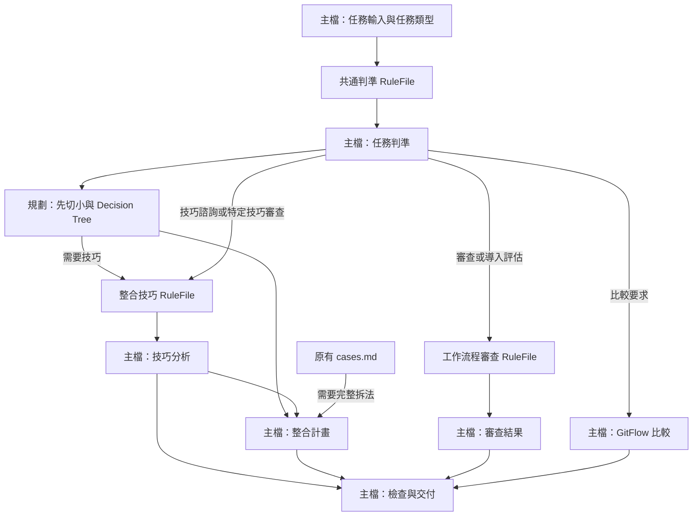

# 工程藍圖：trunk-based-development－行為不變的模組化重構

- 模式：優化。
- 紀錄目錄：`docs/過程/CH2/trunk-based-development/本次執行/`。
- 根因報告：[根因報告.md](根因報告.md)，R1 為結構及流程缺陷；不把未證實的行為故障列為根因。
- 確認紀錄：2026-10-17 總指揮已確認根因報告的驗收條件、情境及結構根因，只授權 Phase 3；**2026-10-17總指揮已確認本藍圖及全部刪除項目，授權依Phase 5施工**。無推定驗收條件。新增執行要求：首度施工且準備實跑時保存「首次施工技能」不可覆寫快照；後續失敗依原流程返回分析，不變更判準。
- 依指定檔名規定，以 `工程藍圖.md` 代替樣板的 `blueprint.md`，保留全部八節。

## 1. 驗收條件

以下原樣承接已確認的 E1～E10，不擴大用途或新增領域規則。

| 編號 | 驗收條件 | 來源 | 適用範圍 |
| ---- | -------- | ---- | -------- |
| E1 | 主檔保有可依序執行的 SOP；規則按需載入，只有符合當次任務的條件式部位被要求載入；每個部位有使用位置，不為數量拆分 | 本次 | 通用 |
| E2 | description 保留規劃、技巧選擇、大型重構、遷移、hotfix、branch／PR 審查、workflow 審查及 GitFlow 比較的觸發用途 | 既有 | 通用 |
| E3 | 區分官方／DORA／團隊規則、核心／建議／自訂；保留官方約 1～2 天與 DORA <1 天的差異，不把兩天設為硬門檻；review 等待計入壽命 | 既有 | 通用 |
| E4 | 規劃先切小，再用短期 branch，同步 main、CI／review green 後 merge、刪 branch；輸出保留 PR 變更、技巧、每次 merge 後 main 可工作理由、含 review 的壽命 | 既有 | 通用 |
| E5 | 先判斷能否一天內完成及能否切小；不能曝光用 flag 並清理、重構用 abstraction 並逐步切換清理、相容性遷移先新舊並存再移 consumer，不能破壞中間 main | 既有 | 通用 |
| E6 | release branch 很晚才切，只做穩定／修 bug／發布；hotfix 先 main 修及驗證，再 cherry-pick，不在 release 開新功能 | 既有 | 通用 |
| E7 | 審查涵蓋長期開發分支、每日整合、壽命與 active branches、CI 及 broken trunk、freeze、flag 清理；缺導入前提先指出，不直接全面導入；保留適用環境說明 | 既有 | 通用 |
| E8 | 比較保留 GitFlow 類「隔離→做完整→最後整合」與 TBD「切小→持續整合→保持可工作」；指出重點是工作拆分 | 既有 | 通用 |
| E9 | 原有六組案例、來源連結與六項送出前檢查涵義均保留，沒有新增原 Skill 不要求的互動確認閘門 | 既有 | 通用 |
| E10 | 只變更指定兩側 Skill 及本紀錄，兩側為相同實體檔、結構診斷零 error，所有驗收情境通過才完成 | 本次 | 個案 |

## 2. To-Be SOP

### 從預期推導

先依驗收條件決定步驟目的與約束，再對照既有主檔；下列推導不以改寫舊章節為起點。

| 階段／步驟 | 目的與後續使用結果 | 追溯 |
| --------- | ------------------ | ---- |
| P1-1、P1-2 | 取得任務輸入及任務類型，控制後續條件式步驟；複合任務可同時走多條路徑 | E1、E2、R1 |
| P1-3、P1-4 | 載入共同適用判準，立即應用為任務判準；不是單獨建立一個只載入規則的 Phase | E3、E9、R1 |
| P2-1 | 規劃先切小及判斷技巧需求，產生變更切分 | E4、E5 |
| P2-2、P2-3 | 技巧需要時才載入並應用，支援技巧諮詢、遷移與hotfix，而非只支援新功能 | E1、E2、E5、E6 |
| P2-4、P2-5 | 需要完整拆法才讀案例；規劃形成可獨立整合、含驗證與刪branch的計畫 | E1、E4、E9 |
| P2-6、P2-7 | 審查或導入評估才載入審查規則並應用，不要求載入無關規劃案例 | E1、E2、E7 |
| P2-8 | 比較要求才分析GitFlow整合順序 | E2、E8 |
| P2-9 | 逐條驗證當次結果，失敗回到其分析步驟 | E3～E9；必要驗證流程 |
| P3-1 | 依任務產生草稿，保留規劃四項輸出 | E4、E9 |
| P3-2 | 保留原六項送出檢查並核對需求，失敗修正重查 | E9；必要驗證流程 |
| P3-3 | 交付檢查後結果，沒有新增互動確認閘門 | E2、E9 |

### 完整主檔提案

這是最終 To-Be，**僅列在藍圖內，尚未寫入目標 Skill**。frontmatter 保留原文。驗證狀態文字依 AGENTS.md「未經學員實際驗證」要求，不宣稱工程測試等同學員驗證。

````markdown
---
name: trunk-based-development
description: 依主幹式開發（Trunk-Based Development，TBD）規劃與審查工作拆分、branch 策略與整合方式。用在：收到需求或 ticket 時規劃要拆成幾個 PR、判斷一個變更該直接走短期 branch 還是需要 Feature Flag／Branch by Abstraction／新舊並存／Release Branch、大型重構或框架遷移（例如 Vuex → Pinia、Axios → Fetch）如何每天安全 merge main、舊版本 hotfix 怎麼修、檢查某個 branch 或 PR 是否活太久或太大、審查團隊的 Git workflow 算不算 TBD，以及比較 TBD 與 GitFlow。
---

本次重構尚未經學員實際驗證。

# SOP

## Phase 1 -- 確認任務與判準

1. `READ` 使用者需求，以及使用者提供的工作範圍、branch／PR 現況與團隊 workflow，建立「任務輸入」。
2. `THINK` 依「任務輸入」辨識本次涉及需求規劃、技巧諮詢、branch／PR／workflow 審查、導入評估或 GitFlow 比較的哪些任務，建立「任務類型」；同時涉及多類時，各自套用相關步驟。
3. `READ` 讀取 `rules/共通判準-格式規範.md` 的所有 Rule，建立「共通判準檢查清單」。
4. `THINK` 依「任務輸入」與已載入的「共通判準檢查清單」判斷本次適用的規則及其來源，建立「任務判準」。

完成條件：已辨識任務類型，且任務判準可對應已載入的共通判準檢查清單。

## Phase 2 -- 規劃或審查

1. `THINK` 規劃需求時，先把需求拆成能獨立整合的小變更，一張 Story／Ticket 不等於一個 branch 或一個 PR。逐項判斷幾小時／一天內能否完成；不能時先嘗試切小並重新判斷，仍不能時依原因選擇：功能還不能曝光用 Feature Flag、大型程式重構用 Branch by Abstraction、舊系統／相容性遷移用新舊並存（Strangler）、維護已發布版本用 Release Branch，建立「變更切分」。
2. `READ` 「變更切分」需使用整合技巧，或「任務輸入」涉及技巧諮詢、遷移、hotfix 或特定技巧的審查時，讀取 `rules/整合技巧-格式規範.md` 的所有 Rule，建立「整合技巧檢查清單」。
3. `THINK` 已載入「整合技巧檢查清單」時，依該清單、「任務輸入」、「任務判準」及已有的「變更切分」分析所需技巧，建立「技巧分析」。
4. `READ` 規劃需求且需要完整拆法時，讀取 `references/cases.md` 的相關案例，建立「案例參考」。
5. `THINK` 規劃需求時，依「變更切分」、「任務判準」及已取得的「技巧分析」、「案例參考」形成「整合計畫」：每個小變更開短期 branch，目標是「這個小變更做完就 merge」，不是「整個 feature 做完才 merge」；工作期間同步 main，merge 前 branch 要跟 main 保持最新；CI 驗證為 build → lint → unit test → 必要的 integration test，PR → review → CI green → merge；DORA 建議每個 commit 都觸發 build 與自動測試，回饋在幾分鐘內；merge 後刪 branch。
6. `READ` 審查 branch／PR／團隊 workflow 或評估導入時，讀取 `rules/工作流程審查-格式規範.md` 的所有 Rule，建立「工作流程審查檢查清單」。
7. `THINK` 已載入「工作流程審查檢查清單」時，依該清單、「任務輸入」、「任務判準」及已取得的「技巧分析」形成「審查結果」。
8. `THINK` 比較 TBD 與 GitFlow 時，形成「比較結果」：GitFlow 類是先隔離 → 做完整 → 最後整合；TBD 是先切小 → 持續整合 → 任何時候都保持可工作。TBD 主要改變拆分工作的方式，Git 操作本身變化不大。
9. `CHECK` 依已載入的「共通判準檢查清單」及本次適用且已載入的「整合技巧檢查清單」、「工作流程審查檢查清單」，逐條驗證本次產生的「整合計畫」、「技巧分析」、「審查結果」與「比較結果」；未通過時返回對應分析步驟修正後重查。

完成條件：本次任務所需的分析或計畫已產生，且符合本次適用且已載入的檢查清單。

## Phase 3 -- 檢查與交付

1. `WRITE` 依「任務輸入」與已通過檢查的本次計畫或分析建立答覆草稿；規劃結果用這個格式給出：

   ```text
   PR 1：<變更>  — 使用技巧：<無／Feature Flag／Abstraction／新舊並存>
   PR 2：...
   每個 PR merge 後 main 為什麼仍可工作：<說明>
   預估 branch 壽命（含等 review）：<時間>
   ```

2. `CHECK` 確認答覆草稿涵蓋「任務輸入」，並符合本次適用且已載入的檢查清單；送出前依原六題檢查適用的計畫或建議：能不能切到一天內可以 merge？這個 PR 現在 merge，main 還能正常工作嗎？未完成功能能不能用 Feature Flag 隱藏？大改造能不能用 abstraction 讓新舊實作共存？CI 能不能快速告訴我這次改動有沒有破壞系統？這個 branch 明天還會存在嗎？是的話，檢查是不是切得太大。未通過時返回對應分析或草稿步驟修正後重查。
3. `WRITE` 向使用者展示已通過檢查的答覆。

完成條件：使用者已收到涵蓋其任務、通過適用檢查的規劃或分析結果。
````

### 部位及載入關係



共通判準供每次任務使用；整合技巧為一個完整主題，不再按四技巧拆四個檔。審查與導入評估共用審查主題。純比較的三句話與輸出片段留於單一步驟，不另造 RuleFile 或樣板。既有 cases.md 是案例示範，不增加規範來源。

## 3. 差異表

### 刪除

**不刪除任何用途、正確領域規則、案例或整個檔案**。下列是必須明示的原載體移除及重複表述合併：

| 元素 | 位置 | 理由 |
| ---- | ---- | ---- |
| 原主檔內規則實體段落 | 第8～28、66、70～73、79～83、89～98行 | 改換至下表指定唯一位置後，移除舊載體；不是丟棄規則。對應C1～C7、C15～C22 |
| 強烈建議中的「branch非常短命（官方約1～2天，DORA<1天）」重複數值 | 第26行 | 數值由共通判準Rule 1保存（C1），強烈建議分級由Rule 3保存（C4），不在兩處重複門檻 |
| 強烈建議中的「merge後刪branch」及錯誤段落中的「branch一直不刪」重複要求 | 第26、83行 | 刪branch僅以規劃流程C14為規範來源；Rule 3反例可示範未刪branch，不再重複立規則 |
| 「一張Story=一個branch=一個PR」與「不能工作的程式merge main」的重複說明 | 第80～81行 | 規範分別由C8及C2～C3、C17承接；共通判準反例可示範，不再另列同義規則 |
| 原知識文章章節包裝 | 第6、18、30、49、68、77、85、100、107行標題 | 用SOP階段及Rule標題取代；標題不承載獨立領域要求 |

### 修改、合併、改換存放位置與新增

| 元素 | 動作 | 內容 | 追溯 |
| ---- | ---- | ---- | ---- |
| 原核心目的、規則來源、分級及常見錯誤 | 改換存放位置及合併 | 三個Rule集中至 `rules/共通判準-格式規範.md`；保留未重複的原文，去掉上表重複表述 | E3、E9、R1；C1～C7、C18 |
| 原規劃步驟1、Decision Tree | 修改及合併 | 保留先切小及路由順序於P2-1，不把執行分支搬進RuleFile | E4、E5；C8～C9 |
| 原規劃步驟2～5 | 改換存放位置 | 保留原意與原句至P2-5，僅接上具名分析結果 | E4；C10～C14 |
| 原技巧四條 | 改換存放位置 | 四個Rule至 `rules/整合技巧-格式規範.md`，只在P2-2條件成立時載入，P2-3立即使用 | E5、E6、R1；C15～C17、C19 |
| 原workflow審查、導入前提、適用環境 | 改換存放位置 | 三個Rule至 `rules/工作流程審查-格式規範.md`，P2-6載入、P2-7立即使用 | E7、R1；C20～C22 |
| 案例引用 | 修改 | 保留現有引用目標，改為P2-4的條件式READ，P2-5立即使用案例參考 | E1、E9；C32 |
| GitFlow比較 | 改換存放位置 | 原三句保留至P2-8；只有使用者要求比較時執行 | E8；C23 |
| 原規劃輸出片段 | 改換存放位置 | 原四項格式保留至P3-1；這是對話輸出片段，沒有要求整份產出檔案，故不造樣板組 | E4；C24 |
| 原六項送出檢查 | 改換存放位置 | 原問題與檢查涵義保留至P3-2，不把六題變成使用者問答閘門 | E9；C25 |
| 三階段SOP、具名結果與檢查回路 | 新增流程包裝 | P1取得任務判準，P2分析，P3檢查交付；RuleFile依賴在相同Phase內就近載入 | E1、E2、E9、R1；C26～C37 |
| 學員驗證狀態 | 新增狀態說明 | 標明本次重構未經學員實際驗證，工程驗收不能替代學員實際使用 | AGENTS.md必要規範；C38 |

### 保留

| 元素 | 追溯 | 約束 |
| ---- | ---- | ---- |
| frontmatter的name與description全文 | E2；沒有觸發缺陷，無需重寫 | 無，只概述用途與觸發 |
| `references/cases.md`全文，六組案例、目錄與七個來源連結（含繁中連結） | E9；檔案SHA-256保持基線值 | 案例示範C1～C24，不另立規範 |
| 原內容中追溯相同且未重複的原句 | E3～E9；依第5節及各工作項的原文範圍轉置 | C1～C25 |

As-Is 沒有正式Phase、完成條件、RuleFile、樣板或腳本，故無這些既有元素可標記保留或刪除。原5個規劃步驟均於上表處置；六項檢查全部承接。原常見錯誤五項逐一承接：第79行→C7；第80行→C8；第81行→C2～C3及C17；第82行→C6；第83行→C7、C14。沒有無法追溯而需要丟棄的領域規則。

## 4. 淨增減

| 項目 | As-Is | To-Be | 增減 |
| ---- | ----- | ----- | ---- |
| 正式Phase | 0 | 3 | +3 |
| 正式受控動詞步驟 | 0 | 16 | +16 |
| RuleFile | 0 | 3 | +3 |
| Rule | 0 | 10 | +10 |
| 樣板組 | 0 | 0 | 0 |
| 腳本 | 0 | 0 | 0 |
| 原有案例檔 | 1 | 1 | 0 |

As-Is 另有5個規劃步驟及6個編號自檢問題；上表0代表沒有正式SOP受控步驟，並非沒有流程。To-Be為4＋9＋3個步驟。增加的是分流、載入、應用及可檢查的交付包裝，對應E1、R1；不宣稱步驟或總文字變少。

刪改優先評估：僅刪除會丟失E2～E9；僅改寫仍把所有任務規則固定載入；因此先合併重複表述，再改換三類判斷規則的存放位置，最後補足相應READ與使用步驟。增加RuleFile是承接既有規則，不新增TBD領域門檻；正反例會增加總文字。沒有可量測的token或時間改善承諾，也不為達成固定檔數再拆分。

三個Phase各有可觀察產出，並非為載入參考檔設獨立Phase。三個RuleFile分別負責共通分類、技巧實施限制、審查及導入判斷。技巧決策樹、計畫步驟、簡短比較與對話格式留在主檔。

## 5. 約束分配表

存放位置只列最終規範來源；藍圖及cases的示範、CHECK對規範的引用不另立一份規則。理由代碼：

- A：需要語意判斷與正反例，無明確機械輸入輸出可交腳本，亦非整份產出檔案的結構，故選RuleFile。
- B：屬執行順序、分支或重查回路，必須放SOP；不抽腳本、樣板或RuleFile。
- C：只屬單一步驟的一句決策或對話片段，無需正反例；沒有整份檔案結構，也不需要腳本，不另造部位。
- D：保留既有案例示範，不是新增規範載體。

| 編號 | 約束 | 所屬步驟 | 存放位置 | 理由 |
| ---- | ---- | -------- | -------- | ---- |
| C1 | 回答區分官方／DORA／團隊；官方通常1～2天、DORA不到一天，兩天非硬標準 | P1-4 | 共通判準Rule 1 | A；E3 |
| C2 | 核心目的：單一main、不長期分叉、持續小變更，main可工作且可發布 | P1-4 | 共通判準Rule 2 | A；E3 |
| C3 | 三個核心規則及其分級：無長期開發分支、DORA至少每天整合、紅燈先立即修或revert | P1-4 | 共通判準Rule 2 | A；E3 |
| C4 | 強烈建議分級：branch非常短命、active branches少、不靠freeze | P1-4 | 共通判準Rule 3 | A；E3 |
| C5 | merge形式、同步手法、命名、review人數、平台、direct push屬團隊決定 | P1-4 | 共通判準Rule 3 | A；E3 |
| C6 | 壽命含review等待，重量級非同步耗時review是阻礙 | P1-4 | 共通判準Rule 3 | A；E3 |
| C7 | 從main開branch不等於TBD；2～3週feature branch、多人同feature branch、靠freeze都是錯誤模式 | P1-4 | 共通判準Rule 3 | A；E3、E9 |
| C8 | 收到需求先切成獨立整合小變更；Story不等於一branch／PR | P2-1 | P2-1內文 | B；E4 |
| C9 | 幾小時／一天可完成先短期工作；否則先切小重判，再按不能曝光／重構／相容遷移／版本維護選四技巧 | P2-1 | P2-1內文 | B；E5、E6 |
| C10 | 每小變更開短期branch，做完小變更就merge | P2-5 | P2-5內文 | B；E4 |
| C11 | 工作期間同步main，merge前保持最新 | P2-5 | P2-5內文 | B；E4 |
| C12 | build→lint→unit test→必要integration test；PR→review→green→merge | P2-5 | P2-5內文 | B；E4 |
| C13 | DORA建議每commit觸發build／自動測試，回饋幾分鐘 | P2-5 | P2-5內文 | C；E4 |
| C14 | merge後刪branch | P2-5 | P2-5內文 | B；E4 |
| C15 | flag關閉每天merge、最後打開、Deploy≠Release、上線後清理flag | P2-3 | 整合技巧Rule 1 | A；E5 |
| C16 | abstraction→舊實作→新實作→逐步切換→刪舊，每步進main | P2-3 | 整合技巧Rule 2 | A；E5；是計畫內容規則，非agent的Phase轉移 |
| C17 | 舊新API並存、consumer遷移後刪舊，不能API先改而前端未跟上 | P2-3 | 整合技巧Rule 3 | A；E5 |
| C18 | 未完成工作靠小批次、flag、抽象、相容、CI及測試而非branch隱藏 | P1-4 | 共通判準Rule 2 | A；E5、E9；總原則不重述四技巧細節 |
| C19 | release很晚切、僅穩定／bugfix／發布，不承載新功能；先main修及驗證再cherry-pick，release先修回灌是錯誤模式 | P2-3 | 整合技巧Rule 4 | A；E6 |
| C20 | workflow檢查長期分支、每日整合、含review的壽命與active branches、CI及紅燈、freeze、flag清理 | P2-7 | 工作流程審查Rule 1 | A；E7；問項引用共通判準，不重立數值標準 |
| C21 | 導入需自動build/test、快CI、小批次與快review；缺前提先指出，缺gated checks／優先修trunk可能增錯誤返工，不直接全面導入 | P2-7 | 工作流程審查Rule 2 | A；E7 |
| C22 | 保留SaaS/Web/API/frontend/microservice/內部系統/頻繁發布/多人維護及三因素同時存在價值最高 | P2-7 | 工作流程審查Rule 3 | A；E7 |
| C23 | GitFlow隔離後完整再整合；TBD切小持續整合保持可工作；工作拆分是主要差異 | P2-8 | P2-8內文 | C；E8；三句完成單一比較決策 |
| C24 | 規劃四項輸出：PR變更／技巧、main可工作理由、含review壽命 | P3-1 | P3-1內文 | C；E4；對話片段非整份檔案格式 |
| C25 | 交付前依原六題自檢適用建議 | P3-2 | P3-2內文 | B；E9；保留檢查行為，不再立新的領域標準 |
| C26 | 讀需求與使用者提供的工作範圍及現況，建立任務輸入 | P1-1 | P1-1內文 | C；E2；未要求搜尋任意repo或Git mutation |
| C27 | 辨識可複合任務類型，控制相應步驟 | P1-2 | P1-2內文 | B；E1、R1 |
| C28 | 每次讀共通規則並具名檢查清單 | P1-3 | P1-3內文 | B；E1、E3 |
| C29 | 讀取後立即對輸入形成任務判準 | P1-4 | P1-4內文 | B；E1、E3 |
| C30 | 技巧需求或諮詢／遷移／hotfix／特定技巧審查才讀技巧清單 | P2-2 | P2-2內文 | B；E1、E2 |
| C31 | 以已載入技巧清單與輸入形成技巧分析 | P2-3 | P2-3內文 | B；E5、E6 |
| C32 | 規劃需求且需要完整拆法才讀相關案例，規劃步驟接著使用 | P2-4 | P2-4內文；案例為原cases.md示範 | B、D；E1、E9 |
| C33 | 審查及導入評估才讀審查清單 | P2-6 | P2-6內文 | B；E1、E7 |
| C34 | 以已載入審查清單對輸入產生審查結果 | P2-7 | P2-7內文 | B；E7 |
| C35 | 逐條驗證當次適用已載入清單，失敗回對應分析重查 | P2-9 | P2-9內文 | B；必要驗證 |
| C36 | 草稿涵蓋輸入及已載入清單，失敗回對應分析／草稿步驟重查 | P3-2 | P3-2內文 | B；必要驗證 |
| C37 | 交付已檢查結果；沒有新增使用者確認閘門 | P3-3 | P3-3內文及整體SOP流程 | B；E9 |
| C38 | 不把工程驗收聲稱為學員實際驗證 | 主檔狀態 | frontmatter後狀態文字 | C；AGENTS.md必要規範 |

RuleFile的正反例僅示範上述約束，不增數值門檻、固定PR數或額外確認閘門。原規則中的「盡量／建議」分級保留，不能為通過靜態檢查就改成強制數字。

## 6. 施工工作項

總指揮已確認；W1～W4已依表順序完成施工。寫入側僅 `.agents/skills/trunk-based-development/`，另一側由同步產生；工程紀錄僅本目錄。不得改其他Skill、來源筆記、腳本或根目錄規範。

| 順序 | 工作項 | 執行者 | 目標 | 內容 | 約束 | 狀態 |
| ---- | ------ | ------ | ---- | ---- | ---- | ---- |
| 1 | W1 | skill-form-sop | 主檔三階段 | 先寫胖SOP，規則內嵌，保留既有案例引用；不提名未建立部位 | C1～C38 | 已完成 |
| 2 | W2 | skill-derive-rule | Phase 2 -- 規劃或審查；THINK「形成審查結果」 | 抽取workflow單一主題三個Rule及就近載入，調整使用及檢查步驟 | C20～C22、C33～C36 | 已完成 |
| 3 | W3 | skill-derive-rule | Phase 2 -- 規劃或審查；THINK「建立技巧分析」 | 抽取整合技巧單一主題四個Rule及就近載入，調整使用及檢查步驟 | C15～C17、C19、C30～C31、C35～C36 | 已完成 |
| 4 | W4 | skill-derive-rule | Phase 1 -- 確認任務與判準；THINK「建立任務判準」 | 抽取共通判準三個Rule及就近載入，調整使用及檢查步驟；完成後等於To-Be | C1～C7、C18、C28～C29、C35～C36 | 已完成 |

frontmatter無工作項，因全文保留。無整個部位刪除及既有部位內容修改；三次抽取由後往前執行，最後的抽取同時完成全部依賴步驟及完成條件，不需額外SOP收尾工作項。每次使用指定Skill都必須載入其SOP；不是把Skill名稱當作寫檔工具。若其分析拒絕或與藍圖不一致，記錄差異、停止施工，返回Phase 3及確認，不自行換方案。

### 工作項內容

以下為將來委派的完整要求，**只有藍圖確認後才可稱為已確認工作項**。執行者不是唯一工作的agent，不得回退他人變更。定位以Phase標題、受控動詞、內文關鍵字為準，編號僅作最終對照。

#### W1：先建立胖SOP

- 執行者：skill-form-sop。Before：目前114行知識文章，無正式SOP。After：第2節的三階段流程骨架，但依以下逆向抽取方式先內嵌待抽規則，不能直接寫入引用未建立檔案的最終稿。
- 保留frontmatter全文、現有cases.md全文及SHA-256，不增檔案輸出要求。
- P1「建立任務判準」的THINK內嵌W4列出的三組完整原文；移除其前的共通RuleFile READ，將該THINK中的清單引用改為「下列共通判準」。
- P2「建立技巧分析」的THINK保留最終READ的適用條件並內嵌W3四條完整技巧；移除其前的技巧RuleFile READ，將該THINK中的清單引用改為「下列整合技巧」。
- P2「形成審查結果」的THINK保留最終READ的適用條件並內嵌W2三組完整原文；移除其前的審查RuleFile READ，將該THINK中的清單引用改為「下列工作流程審查判準」。
- 胖SOP P2「逐條驗證」用「任務判準與本次各分析步驟的適用判準」，不引用不存在的具名清單；P1完成條件及P2完成條件同樣改為當前內嵌判準。P3草稿檢查用「任務判準及本次各分析步驟的適用判準」，其餘六題原文保留。
- 其餘步驟依To-Be，連續重新編號。這時是3個Phase、13個步驟；沒有rules路徑，只有既有案例READ。原句轉置允許只調整清單符號／主詞連接，不能改正確規則強度。
- 驗證：三個待抽取THINK都可唯一定位，內嵌規則齊備；檔案未引用未建立RuleFile；不改cases及frontmatter。

#### W2：抽取工作流程審查

- Before：W1的 Phase 2「THINK 形成審查結果」，內嵌本項三組判準，尚無對應RuleFile。
- 歸屬：新增 `rules/工作流程審查-格式規範.md`；單一主題為workflow審查及導入評估，不包含技巧實施細節或比較格式。
- Rule 1「審查項目」：C20。承接原SKILL.md第87～94行的六個檢查問項，保留原文。用已形成的任務判準解讀答案，不重寫共同門檻。
- Rule 2「導入前提」：C21。承接第96行全文，保留自動build/test、快速CI、小批次、review、gated checks及broken trunk紀律風險與缺前提不直接全面導入的原文。
- Rule 3「適用情境」：C22。承接第98行全文，保留所有適用系統類型及三因素價值判斷。
- 正反例規格：Rule 1以長期team分支與短期共同main整合對比；Rule 2以缺自動測試時先指出前提與直接全面導入對比；Rule 3以需求常變且多人頻繁發布的內部系統判斷適用價值與僅因採用某Git平台就判定適用對比。例子不得額外立規則，不能複製S1～S7輸入。
- After：目標THINK前加入To-Be P2-6的READ全文，THINK改為To-Be P2-7全文，移除內嵌三組規範。P2、P3的CHECK在保留尚未抽取內嵌判準引用外，加入「本次適用且已載入的工作流程審查檢查清單」；P2完成條件概述已建立的清單及其餘適用內嵌判準。
- READ與第一個使用同Phase相鄰，路徑只出現在READ；不觸動規劃及技巧規則。由skill-derive-rule依其SOP委派skill-form-rule及skill-form-sop實作，回報拒絕則停止。

#### W3：抽取整合技巧

- Before：W1的 Phase 2「THINK 建立技巧分析」，內嵌四條技巧；W2已完成，這時已有workflow檢查清單，但沒有技巧RuleFile。
- 歸屬：新增 `rules/整合技巧-格式規範.md`，四Rule構成一個完整整合技巧主題，不再按技巧拆檔。
- Rule 1「Feature Flag」：C15，承接原第70行全文。
- Rule 2「Branch by Abstraction」：C16，承接原第71行全文。
- Rule 3「新舊並存」：C17，承接原第72行全文。
- Rule 4「Release Branch」：C19，承接原第73行全文。
- 正反例規格：flag關閉分批整合、最後開放清理，對比一個branch藏完整功能；抽象層下舊新影像處理實作逐步切換，對比一週隔離最後一次切換；舊新商品編碼欄位共存後移consumer，對比先刪舊欄位；main修復驗證後挑到release，對比release修後回灌並繼續開新功能。不得新增固定天數、PR數或未出現的強制技巧，案例不得與S1～S7相同。
- After：目標THINK前加入To-Be P2-2 READ全文，THINK改為P2-3全文，移除內嵌四條規則。P2及P3 CHECK引用W2清單與新建技巧清單，未抽取共通部分仍以任務判準／共通內嵌判準引用；P2完成條件同樣只引用已存在清單及適用內嵌判準。
- READ與使用相鄰，條件保留所有技巧入口，不能只限於新功能規劃。由skill-derive-rule依其SOP委派兩個form Skill；差異即停止。

#### W4：抽取共通判準並完成依賴步驟

- Before：W1的 Phase 1「THINK 建立任務判準」仍內嵌共通判準；W2及W3已完成。
- 歸屬：新增 `rules/共通判準-格式規範.md`。主題為每次TBD判斷共同使用的規則來源及規則分級，不混入技巧實施或workflow問項。
- Rule 1「來源與branch壽命」：C1，承接原第10～16行全文，來源三類及官方／DORA差異均保留。
- Rule 2「核心目的與規則」：C2、C3、C18，承接原第8、20～24、66行原文；核心目的、三條核心及未完成工作的總原則保持原文。
- Rule 3「建議、團隊選項及常見誤判」：C4～C7，承接第26行的建議分級（移除重複數值及刪branch要求）、第28行全文、第79、82行全文、第83行的多人feature branch與freeze部分。第80、81行只作反例示範，分別由原規劃流程與核心／相容規則作規範來源，避免重複立規則。保留DORA對重量級非同步review的說明。
- 正反例規格：Rule 1正確區分官方與DORA及反例把兩天當絕對門檻；Rule 2以每日小變更維持main與長期分叉／紅燈延後處理對比；Rule 3以承認merge方式為團隊選項且計入review等待與只看寫碼時間／把rebase強制化對比。例子不得與S1～S7輸入相同。
- After：目標THINK前加入To-Be P1-3 READ全文，THINK改為P1-4全文，移除內嵌共通規則；P1完成條件、P2逐條驗證與完成條件、P3草稿檢查引用全部已存在且當次適用的清單，精確等於第2節完整To-Be。不得留下同義內嵌規則或胖SOP過渡用語。
- 由skill-derive-rule依其SOP委派兩個form Skill；檢查全部16步驟、3Phase及3RuleFile／10Rule，確認每項C僅有一個規範來源。不改frontmatter及案例原文。

## 7. 驗收情境

| 編號 | 驗證 | 類型 | 輸入 | 預先回覆 | 判斷方式 |
| ---- | ---- | ---- | ---- | -------- | -------- |
| S0 | E1、E2、E9；本次另檢查E10 | 本次原始需求的結構驗收，靜態逐步演練 | 原始輸入：重構 trunk-based-development、不改行為、主檔留 SOP 及按需 RuleFile；在目前工作樹比對施工前後檔案及逐條規則對照 | 不適用：原Skill無互動確認閘門 | 檢查 E1、E2、E9；原始輸入是工程要求，不交給 TBD 假裝是產品需求；另檢查 E10 |
| S1 | E1～E4、E9 | 回歸及本次載入驗收 | 設定頁標點錯了，預計20分鐘、review15分鐘、CI4分鐘，請用 TBD 規劃 | 不適用：原Skill無互動確認閘門 | 檢查 E1～E4、E9；不用大型技巧，保留輸出欄位，壽命含 review；不要求精確分鐘總數或固定 PR 數 |
| S2 | E2、E4、E5、E9 | 回歸 | 推薦清單需四天，週四才可曝光；API、UI、追蹤可分別完成，CI5分鐘、review30分鐘，請拆 PR | 不適用：原Skill無互動確認閘門 | 檢查 E2、E4、E5、E9；先拆小、關旗標進 main、部署與曝光分離、最終清理 flag |
| S3 | E2、E4、E5、E9 | 回歸 | 將通知寄送由 SMTP adapter 換為雲端郵件 SDK，需六天，不能中斷寄信，CI6分鐘、review30分鐘 | 不適用：原Skill無互動確認閘門 | 檢查 E2、E4、E5、E9；抽象、舊實作接上、新實作、逐步切換及清理，每步可工作 |
| S4 | E2、E4、E5、E9 | 回歸 | 地址 API 的 street 欄位改為 addressLines，舊版手機 app 仍使用 street，要分批遷移，CI5分鐘、review30分鐘 | 不適用：原Skill無互動確認閘門 | 檢查 E2、E4、E5、E9；新舊相容並存、consumer 遷移後刪舊介面，不先破壞 main |
| S5 | E2、E4、E6、E9 | 回歸 | production 3.2 有時區 bug，main 已開發3.3；review20分鐘、CI5分鐘，如何 hotfix，release branch 可否順便開新報表 | 不適用：原Skill無互動確認閘門 | 檢查 E2、E4、E6、E9；main fix及驗證後再挑到 release，拒絕用 release 開新功能 |
| S6 | E1～E3、E7～E9 | 回歸及本次載入驗收 | 都從main開branch，寫半天、review三天、CI45分鐘、紅燈晚上再看、發布前freeze；規定squash及兩位reviewer。算TBD嗎？和GitFlow差在哪？超過兩天一律違規嗎 | 不適用：原Skill無互動確認閘門 | 檢查 E1～E3、E7～E9；正確辨認阻礙、規則來源、比較，沒有把團隊選項判成違規；審查不要求載入無關規劃案例 |
| S7 | E2、E7、E9 | 回歸 | 企業內部 Web 系統需求常變、多人維護、想頻繁發布，但無自動測試、build手動、review平均四天。能直接全面改TBD嗎？ | 不適用：原Skill無互動確認閘門 | 檢查 E2、E7、E9；指出適用價值及缺少前提，不直接全面導入 |

### 執行環境與完整通過標準

- S0為靜態逐步演練，其餘在包含本次未提交修改的暫存專案複本實跑。每案獨立複本及不繼承工程脈絡的代理，只交付修改後Skill路徑、測試位置、該案輸入及預先回覆；不能把預期答案、工程根因或其他案例結果交給代理。
- 複本放本次紀錄目錄下的暫存測試環境；測後移除可重建的複本，輸入、前後狀態、載入路徑、完整輸出及判讀保留為繁中Markdown紀錄。所有工程紀錄都限本目錄。測試環境不讀其他實驗，沒有Git mutation授權；不接觸家目錄安裝。
- 測前保存git status及受保護檔案SHA-256，測後比對。若複本無Git資料，明記無Git，使用檔案清單及雜湊證明副作用；不能捏造乾淨Git輸出。
- 載入期望：S1只載入共通判準，技巧／workflow／案例條件未成立；S2～S5載入共通與技巧，案例僅需完整拆法時；S6載入共通與workflow，不要求技巧或案例；S7載入共通與workflow。以上僅用於檢查E1，不加入對話輸出欄位要求。複合任務依其輸入可多路徑，不能硬限制所有任務只能一種。
- 對照S0：frontmatter與cases保持原文／雜湊；主檔原第8～114行所有實質規則逐項對照C表及移除清單；RuleFile正反例不增減門檻；每個載入步驟同Phase就近使用且沒有未用部位。
- 施工後依skill-engineering執行audit_skill.py，使用目前worktree的三個skills root絕對路徑，目標trunk-based-development，退出碼0且error=0；warning逐項回報，不把原有建議強度改成硬規則來消警告。
- 已讀取同步腳本：`--from agents` 會刪除重建全部claude側Skill及CLAUDE.md，沒有只同步單一Skill的選項。為遵守本次「只修改目標Skill兩側」的較高優先指示，不在目前工作樹直接執行這個全量寫入。先在本紀錄目錄的隔離同步專案複本中，保留目前兩側Skill、根規範及原同步腳本，於該複本根目錄執行 `scripts/sync-skills.sh --from agents` 與 `scripts/sync-skills.sh --check` 並保存完整輸出；檢查僅目標端存在而未刪除的Skill。確認複本目標兩側一致後，只把目標claude側目錄的實體檔同步回目前worktree；不複製其他Skill或根規範回來。最後在目前worktree根目錄執行唯讀的 `scripts/sync-skills.sh --check`，並核對兩側實體目標檔、非目標雜湊及Git範圍。這是為遵守使用者邊界調整全量同步的執行位置，不改寫同步腳本；若現場已有非本次差異，保留差異並回報，不回退他人修改。
- 全部W1～W4已完成、audit無error、同步一致、S0～S7全數通過、副作用範圍正確才完成。無法安排乾淨代理時交付確切Skill路徑、環境、輸入及預先回覆請總指揮安排，保持未完成；不把單純演練冒充實跑。
- 情境環境不符先修環境重跑，記錄原因；Skill失敗依原流程返回Phase 2根因確認，不能以部分通過完成。所有判斷只使用已確認E條件，沒有固定PR數、字句完全一致或精確耗時要求。

## 8. 驗收結果

首次施工完成；S1有效實跑失敗，依Phase 5步驟13返回Phase 2，等待回修根因確認。

- 本藍圖已確認；W1～W4已完成，首次施工技能快照已保存。
- audit：0 error、1原文用詞warning；同步兩邊一致；S0通過、S1失敗、S2～S4通過、S5～S7未執行。逐案輸出與判讀見實跑驗收.md；回修根因報告.md待確認，沒有改驗收條件。
- 同步輸出中僅目標端存在而未刪除的Skill：無。首次施工技能5檔案及雜湊保持原樣；非目標追蹤檔未變。學員實際驗證仍未進行；工程整體尚未通過。
- 個案E10僅用於本次工程交付，不寫入TBD領域RuleFile。

### 藍圖檢查紀錄（不是施工驗收）

- 重新設計Rule 1～6：已檢查預期推導、As-Is逐項處置、根因位置、刪改優先、淨增減及呼叫者（無）。
- 約束分配Rule 1～3：已檢查C1～C38唯一存放位置、依腳本／樣板／RuleFile／內文選擇理由及同主題集中；沒有把流程分支放入RuleFile。
- 施工委派Rule 1～5：已檢查執行者、胖SOP先行、後往前抽取、完整交接及差異停止。下游實際是否接受仍須在施工時依其SOP判定。
- 驗收條件Rule 1～4：E1～E10承接根因閘門已確認內容；通用條件均有S情境，原工程輸入以S0演練，案例輸入與Skill範例不同，無推定項目。
- 主檔提案預檢：保留frontmatter全文，三Phase編號連續，16受控步驟；RuleFile路徑僅在READ出現並具名、同Phase緊接使用，沒有新增確認閘門。
- 上述為藍圖設計檢查；尚未寫入或audit實際修改後Skill，不能據此宣稱施工及行為驗收通過。

### 第二個確認閘門

請總指揮確認本版To-Be、全部刪除／去重項目、三個RuleFile的10個Rule、約束分配與W1～W4及驗收方式。無推定驗收條件，沒有變更E1～E10或S0～S7的預期。未明確確認即依skill-engineering Phase 4步驟2停止，不進入施工。

## 本次最終結案追記

後續回修、全量重跑及總指揮結案確認見回修工程藍圖.md、第二次驗收根因報告.md、最終結果與範圍檢查.md。最終整體未全數驗收；本段不覆寫首次失敗結果。總指揮確認不再修改Skill、不重跑挑成功，最終技能為保存版本而非通過版。
