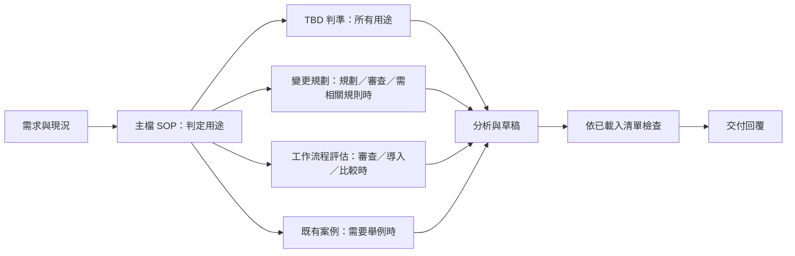

# 工程藍圖：trunk-based-development－行為不變的模組化重構

- 模式：優化。
- 紀錄目錄：`docs/過程/CH2/trunk-based-development/本次執行/`。
- 根因報告：[根因報告.md](根因報告.md)。
- 確認紀錄：總指揮已確認 E1–E10、S1–S8 與結構根因 R1。第一版因 branch／PR 審查漏載六題自檢而審查未通過；本版返回 Phase 3 修正載入與檢查，不改驗收條件或領域規則。**第二版尚待確認，未核准施工。**
- 版本紀錄：第一版原樣保存在 [工程藍圖第一版.md](工程藍圖第一版.md)；差異、跨檔核對與設計回歸詳見 [藍圖修正紀錄.md](藍圖修正紀錄.md)。
- 依既有藍圖樣板保留八節；檔名與位置依本次使用者指示採繁體中文。

## 1. 驗收條件

| 編號 | 驗收條件 | 來源 | 適用範圍 |
| ---- | -------- | ---- | -------- |
| E1 | 主檔保留可執行 SOP；領域規則按適用情境載入 RuleFile，引用可解析、使用前已載入，無孤立或重複存放的約束；結構診斷無 error | 本次 | 通用 |
| E2 | 既有 description 的規劃、技巧判斷、重構／遷移、hotfix、branch／PR 審查、workflow 審查、GitFlow 比較用途全部保留；不新增目標 Skill 的使用者確認閘門 | 本次＋既有 | 通用 |
| E3 | 規劃以獨立可整合的小 PR 為單位，交代技巧、各次 merge 後 main 可工作原因及含 review 等待的 branch 壽命；保留工作期間同步 main、CI／review／green 後 merge、merge 後刪 branch | 既有 | 通用 |
| E4 | 區分官方、DORA、團隊選擇；官方約 1～2 天不是硬性兩天上限，DORA 目標不到一天／至少每天整合；merge 策略、同步方法、命名、review 人數、平台、direct push 限制不提升為 TBD 強制規則 | 既有 | 通用 |
| E5 | 依變更性質選技巧：未曝光功能用 flag 並於上線後清理；大型重構包含 abstraction、接舊、加新、逐步切換、刪舊；相容遷移先並存再遷移 consumer 最後刪舊；每步 main 可工作 | 既有 | 通用 |
| E6 | Release Branch 很晚才切、只做版本穩定／bug fix／發布、不承載新功能；hotfix 先 main 修復驗證，再 cherry-pick 到 release | 既有 | 通用 |
| E7 | workflow 審查涵蓋長期共同開發分支、整合頻率、含 review 的 branch 壽命、active branches、CI 回饋、broken trunk 立即修或 revert、code freeze、flag 清理；不以「從 main 開 branch」單獨認定 TBD | 既有 | 通用 |
| E8 | 比較保留 GitFlow「隔離→完成→整合」與 TBD「切小→持續整合→保持可工作」；保留適用場合與自動 build／test、快速 CI／review、小批次前提；缺前提時先指出，不直接建議全面導入 | 既有 | 通用 |
| E9 | 原主檔各段規則、六項送出檢查、案例及參考資料均可追溯；沒有無理由刪除或新增領域規則，不以字數或拆檔數達標 | 本次＋既有 | 通用 |
| E10 | 兩側目標 Skill 同步為一致實體檔；變更路徑限目標 Skill 兩側及本次紀錄；不 commit、push、安裝或修改其他 Skill | 本次 | 個案 |

## 2. To-Be SOP

### 從預期推導

先由已確認驗收條件推導下列目的，再於第 3 節對照基線，不從既有段落逐步補丁。

| 步驟 | 目的與產物 | 追溯 |
| ---- | ---------- | ---- |
| P1-1 | 取得需求與使用者提供的工作現況 | E2，必要輸入 |
| P1-2 | 選擇適用用途及規則主題，複合與跨用途需求不遺漏 | E1、E2；R1 |
| P1-3 | 所有用途共用 TBD 判準 | E4、E7 |
| P1-4 | 規劃、branch／PR／workflow 審查及跨用途引用相關規則時載入變更規劃規則 | E3、E5、E6、E9 |
| P1-5 | 評估情境載入 workflow／導入／比較規則 | E7、E8 |
| P1-6 | 必要時取得具體案例與來源 | E9 |
| P1-7 | 使用已載入結果完成適用用途分析 | E1–E9 |
| P2-1 | 將分析形成符合需求的草稿 | E2–E9 |
| P2-2 | 先核對適用規則載入與實際使用，再驗證草稿，未通過回到正確步驟 | E1、E3–E9；必要驗證 |
| P2-3 | 交付已驗證的規劃／審查／比較／說明 | E2；必要交付 |

兩個 Phase 分別有分析結果及通過檢查的回覆，均非單獨載入 Phase。三個 RuleFile 主題是共同判準、變更整合方案、現況工作流程評估；載入依規則適用範圍，不以任務名稱一對一排除其他檔。變更規劃檔同時支援規劃與審查，名稱不限制適用範圍。不按每種技巧拆檔。GitFlow 比較與導入前提同屬流程選擇評估，因此集中處理。無新工具、外部依賴或目標 Skill 的使用者確認閘門。



### 完整目標主檔

以下是藍圖內容，尚未寫入目標 Skill。

````markdown
---
name: trunk-based-development
description: 依主幹式開發（Trunk-Based Development，TBD）規劃與審查工作拆分、branch 策略與整合方式。用在：收到需求或 ticket 時規劃要拆成幾個 PR、判斷一個變更該直接走短期 branch 還是需要 Feature Flag／Branch by Abstraction／新舊並存／Release Branch、大型重構或框架遷移（例如 Vuex → Pinia、Axios → Fetch）如何每天安全 merge main、舊版本 hotfix 怎麼修、檢查某個 branch 或 PR 是否活太久或太大、審查團隊的 Git workflow 算不算 TBD，以及比較 TBD 與 GitFlow。
---

# SOP

## Phase 1 -- 理解與分析

1. `READ` 使用者需求，以及使用者提供的變更、branch／PR 或團隊 workflow 資訊，建立「需求輸入」。
2. `THINK` 依「需求輸入」判定本次涉及變更規劃、branch／PR／workflow 審查、導入評估、GitFlow 比較或判準說明，並辨識需要使用的規則主題，建立「任務範圍」；同時涉及多種用途或規則主題時保留所有適用項目。
3. `READ` 讀取 `rules/TBD判準-格式規範.md` 的所有 Rule，建立「TBD 判準檢查清單」。
4. `READ` 「任務範圍」涉及變更規劃、branch／PR／workflow 審查，或其他用途需要判斷小批次、整合驗證、Feature Flag、Abstraction、相容遷移、Release Branch、hotfix 或六題自檢時，讀取 `rules/變更規劃-格式規範.md` 的所有 Rule，建立「變更規劃檢查清單」。
5. `READ` 「任務範圍」涉及 branch／PR／workflow 審查、導入評估或 GitFlow 比較時，讀取 `rules/工作流程評估-格式規範.md` 的所有 Rule，建立「工作流程評估檢查清單」。
6. `READ` 需要以具體案例輔助本次分析時，讀取 `references/cases.md` 中與「任務範圍」相關的案例及參考資料，建立「案例參考」。
7. `THINK` 依「需求輸入」、「任務範圍」、「TBD 判準檢查清單」，以及本次已載入的「變更規劃檢查清單」、「工作流程評估檢查清單」與「案例參考」，形成適用用途的規劃、審查、比較或判準分析，建立「分析結果」；發現尚需未載入的規則主題時，返回步驟 2 更新任務範圍後重新載入，不以未載入規則作判斷。

完成條件：已確定任務範圍，並取得依適用檢查清單形成的分析結果。

## Phase 2 -- 產出與檢查

1. `WRITE` 依「分析結果」、「TBD 判準檢查清單」，以及本次已載入的「變更規劃檢查清單」與「工作流程評估檢查清單」，形成符合「需求輸入」的「回覆草稿」。
2. `CHECK` 核對「任務範圍」的適用規則均已載入並實際使用，再逐條驗證「回覆草稿」符合「需求輸入」、「TBD 判準檢查清單」，以及本次已載入的「變更規劃檢查清單」與「工作流程評估檢查清單」；缺少適用規則時返回 Phase 1 步驟 2，分析有誤時返回 Phase 1 步驟 7，其餘未通過項返回步驟 1 修正。
3. `WRITE` 向使用者交付已通過檢查的回覆。

完成條件：回覆涵蓋本次需求，所有適用檢查清單均通過，且已交付使用者。
````

## 3. 差異表

### 刪除

**刪除的是原主檔中的重複表達與舊章節載體；不刪除用途、正確規則、案例檔或來源連結。**

| 元素 | 位置 | 理由 |
| ---- | ---- | ---- |
| 壽命的第二份規範表達 | 行 26 對行 16 | C6 集中判準 Rule 2；Rule 3 只引用該分級，不重述數字 |
| merge 後刪 branch 的重複規範 | 行 38 對行 26 | C8 集中判準 Rule 3；規劃整合次序可示範此行為，不另立相同規則 |
| Story／PR、小變更不可破壞 main 等重複規範 | 行 80–81 對 34、8、72 | C10、C1、C19 各保留單一來源，常見錯誤用原案例示範，不重立要求 |
| branch review 等待的重複規範 | 行 82 與 46、91 的共同要求 | C7 在判準 Rule 2；格式欄位與審查問題只使用其定義；審查同時載入規劃檔，不因此省略六題 |
| 原說明章節及單一案例導覽句 | 行 6–114 的舊主檔載體 | 規則搬至指定位置，案例由 P1-6 載入；主檔僅保留 SOP。C1–C37 均有歸屬 |

沒有整個部位刪除工作項；基線沒有 RuleFile、樣板組或腳本可刪。

### 修改、合併、改換存放位置與新增

| 元素 | 動作 | 內容 | 追溯 |
| ---- | ---- | ---- | ---- |
| 行 8–28：目的、來源、分級 | 改換位置／合併重複 | 判準檔四條 Rule；追溯相同的文字保留原文，必要強度詞調整見第 6 節 | C1–C9；E4、E7、E9 |
| 原規劃五步，行 32–38 | 改換位置／整理為規劃內容規則 | 是要產出的整合方案，不授權執行 Git；保留切小、branch、同步、驗證及清理次序 | C8、C10–C16；E3 |
| 格式、決策樹、技巧，行 40–73 | 改換位置 | 規劃檔 Rule 1–4；原 text 格式與決策樹作原生範例保留 | C12–C22；E3、E5、E6 |
| 常見錯誤，行 77–83 | 改換位置／合併規範 | 評估 Rule 1 的原例；相同約束僅在判準或規劃檔定義。只要審查涉及這些變更判準，P1-4 必須取得規劃清單 | C30，引用 C1、C2、C7、C8、C10、C19；E7、E9 |
| 審查六項，行 87–94 | 改換位置 | 評估 Rule 1：檢查維度，判定使用共通定義 | C29；E7 |
| 前提、場合、比較，行 96–105 | 改換位置 | 評估 Rule 2–3 | C31–C34；E8 |
| 六題自檢，行 109–114 | 改換位置 | 規劃 Rule 4 保留原六題；題目不是新增硬性一天期限 | C23–C28；E9 |
| `# SOP`、兩個 Phase、具名載入與交付檢查 | 改寫入口／新增執行結構 | 唯一修正 R1 的流程位置；不靠新增領域規則補償 | C35–C37；E1、E2；R1 |

### 保留

| 元素 | 追溯 | 約束 |
| ---- | ---- | ---- |
| frontmatter 的 `name`、`description` 全文 | E2、E9：全部觸發用途原樣 | 無；概述用途，不新增限制 |
| 所有追溯相同且未與其他部位重複的規則文字 | E3–E9；改換位置不表示任意改寫 | 逐項 C1–C34 |
| `references/cases.md` 全文、案例順序與全部參考連結 | E9；只作範例及來源 | 無新增規範；示範 C1–C34，原文保留 |
| 基線沒有的 Phase、完成條件、RuleFile、樣板組、腳本、上下游確認閘門 | 不假稱保留不存在元素 | 無；新增／淨增減如下 |

新增前的選擇：只刪說明會遺失 E3–E9；只改寫仍無按需邊界；因此優先改換規則存放位置並重組入口，再新增必要的載入與檢查結構。新增正反例僅示範既有規則，不新增領域約束。不建腳本，因需要判斷工作語意；不建樣板組，因沒有產出檔整體骨架，原 text 是對話回覆片段格式，留於規劃 Rule 4。

## 4. 淨增減

| 項目 | As-Is | To-Be | 增減 |
| ---- | ----- | ----- | ---- |
| 正式 Phase | 0 | 2 | +2 |
| 正式 SOP 步驟 | 0 | 10 | +10 |
| RuleFile | 0 | 3 | +3 |
| 具 `# Rule N` 的 Rule | 0 | 11 | +11 |
| 樣板組 | 0 | 0 | 0 |
| 腳本 | 0 | 0 | 0 |
| 案例參考檔 | 1 | 1 | 0 |

基線另有五個非正式規劃步驟、六個送出檢查問題與一棵決策樹，均有逐項追溯；不因缺正式 SOP 就算成「沒有既有流程」。正式數量增加是 R1／E1 的結構轉換，11 條 Rule 是將既有內容整理成可檢查主題，不表示新增 11 條領域要求。字數及拆檔數不是通過標準。

## 5. 約束分配表

每個 C 只有一個規範存放位置。案例、決策樹、格式與六題自檢可使用或示範共用定義，但不重複宣告共用規則。以下行號以蒐證時的基線主檔為準。

| 編號 | 約束 | 所屬步驟 | 存放位置 | 理由 |
| ---- | ---- | -------- | -------- | ---- |
| C1 | 核心目的、單一 trunk、main 可工作且可發布 | P1-7、P2-1～P2-2 | `rules/TBD判準-格式規範.md` Rule 1 | 語意判斷需正反例，不能由腳本決定；不是產出檔整體骨架，故不用樣板組。追溯：E2、E9；基線行 8。 |
| C2 | 沒有長期開發分支 | P1-7、P2-1～P2-2 | `rules/TBD判準-格式規範.md` Rule 1 | 語意判斷需正反例，不能由腳本決定；不是產出檔整體骨架，故不用樣板組。追溯：E4、E7；基線行 22。 |
| C3 | 頻繁整合，DORA 至少每天一次、一天多次更好 | P1-7、P2-1～P2-2 | `rules/TBD判準-格式規範.md` Rule 1 | 語意判斷需正反例，不能由腳本決定；不是產出檔整體骨架，故不用樣板組。追溯：E4、E7；基線行 23。 |
| C4 | main 紅時優先立即修或 revert，不繼續新功能或拖到晚上 | P1-7、P2-1～P2-2 | `rules/TBD判準-格式規範.md` Rule 1 | 語意判斷需正反例，不能由腳本決定；不是產出檔整體骨架，故不用樣板組。追溯：E4、E7；基線行 24。 |
| C5 | 回答區分 TBD 官方、DORA、團隊規則來源 | P1-7、P2-1～P2-2 | `rules/TBD判準-格式規範.md` Rule 2 | 語意判斷需正反例，不能由腳本決定；不是產出檔整體骨架，故不用樣板組。追溯：E4；基線行 10–14。 |
| C6 | 官方短命 branch 通常 1～2 天、DORA 目標不到一天；兩天不是硬性標準 | P1-7、P2-1～P2-2 | `rules/TBD判準-格式規範.md` Rule 2 | 語意判斷需正反例，不能由腳本決定；不是產出檔整體骨架，故不用樣板組。追溯：E4；基線行 16、26。 |
| C7 | branch 壽命計入 review 等待；耗時非同步 review 是 DORA 所指阻礙 | P1-7、P2-1～P2-2 | `rules/TBD判準-格式規範.md` Rule 2 | 語意判斷需正反例，不能由腳本決定；不是產出檔整體骨架，故不用樣板組。追溯：E3、E7；基線行 82。 |
| C8 | 短命 branch、active branches 少、不靠 code freeze、merge 後刪 branch 均保留強烈建議分級 | P1-7、P2-1～P2-2 | `rules/TBD判準-格式規範.md` Rule 3 | 語意判斷需正反例，不能由腳本決定；不是產出檔整體骨架，故不用樣板組。追溯：E3、E4、E7；基線行 26。 |
| C9 | merge 策略、同步 merge／rebase、命名、reviewer 數、平台、direct push 限制皆由團隊決定 | P1-7、P2-1～P2-2 | `rules/TBD判準-格式規範.md` Rule 4 | 語意判斷需正反例，不能由腳本決定；不是產出檔整體骨架，故不用樣板組。追溯：E4；基線行 28。 |
| C10 | 先切獨立整合的小變更，Story／Ticket 不等於一個 branch 或 PR | P1-7、P2-1～P2-2 | `rules/變更規劃-格式規範.md` Rule 1 | 語意判斷需正反例，不能由腳本決定；不是產出檔整體骨架，故不用樣板組。追溯：E3；基線行 32–34、80。 |
| C11 | 每個小變更用短期 branch，做完就 merge，不等整個 feature 完成 | P1-7、P2-1～P2-2 | `rules/變更規劃-格式規範.md` Rule 1 | 語意判斷需正反例，不能由腳本決定；不是產出檔整體骨架，故不用樣板組。追溯：E3；基線行 35。 |
| C12 | 決策樹：數小時／一天完成則短 branch，否則先嘗試再切小，再按阻礙選四種技巧 | P1-7、P2-1～P2-2 | `rules/變更規劃-格式規範.md` Rule 1 | 語意判斷需正反例，不能由腳本決定；不是產出檔整體骨架，故不用樣板組。追溯：E3、E5、E6；基線行 49–64。 |
| C13 | 未完成工作以小批次、flag、抽象層、向後相容、CI、自動測試整合，不靠長 branch 隱藏 | P1-7、P2-1～P2-2 | `rules/變更規劃-格式規範.md` Rule 1 | 語意判斷需正反例，不能由腳本決定；不是產出檔整體骨架，故不用樣板組。追溯：E3、E5；基線行 66。 |
| C14 | 工作期間同步 main，merge 前與 main 保持最新 | P1-7、P2-1～P2-2 | `rules/變更規劃-格式規範.md` Rule 2 | 語意判斷需正反例，不能由腳本決定；不是產出檔整體骨架，故不用樣板組。追溯：E3；基線行 36。 |
| C15 | 驗證 build→lint→unit test→必要 integration test；PR→review→CI green→merge | P1-7、P2-1～P2-2 | `rules/變更規劃-格式規範.md` Rule 2 | 語意判斷需正反例，不能由腳本決定；不是產出檔整體骨架，故不用樣板組。追溯：E3；基線行 37。 |
| C16 | DORA 每個 commit 觸發 build／自動測試，回饋在幾分鐘內 | P1-7、P2-1～P2-2 | `rules/變更規劃-格式規範.md` Rule 2 | 語意判斷需正反例，不能由腳本決定；不是產出檔整體骨架，故不用樣板組。追溯：E3；基線行 37。 |
| C17 | flag 關閉仍每天 merge，最後打開；Deploy ≠ Release，上線後刪 flag，避免技術債 | P1-7、P2-1～P2-2 | `rules/變更規劃-格式規範.md` Rule 3 | 語意判斷需正反例，不能由腳本決定；不是產出檔整體骨架，故不用樣板組。追溯：E5；基線行 70。 |
| C18 | abstraction→接舊→加新→逐步切換→刪舊，各步 merge main | P1-7、P2-1～P2-2 | `rules/變更規劃-格式規範.md` Rule 3 | 語意判斷需正反例，不能由腳本決定；不是產出檔整體骨架，故不用樣板組。追溯：E5；基線行 71。 |
| C19 | 相容遷移先舊新 API 並存→consumer 遷移→刪舊；不得讓跨層過渡破壞 main | P1-7、P2-1～P2-2 | `rules/變更規劃-格式規範.md` Rule 3 | 語意判斷需正反例，不能由腳本決定；不是產出檔整體骨架，故不用樣板組。追溯：E5；基線行 72、81。 |
| C20 | release branch 晚切，只做該版本穩定、bug fix、發布，不開新功能 | P1-7、P2-1～P2-2 | `rules/變更規劃-格式規範.md` Rule 3 | 語意判斷需正反例，不能由腳本決定；不是產出檔整體骨架，故不用樣板組。追溯：E6；基線行 73。 |
| C21 | hotfix main 先修並驗證，再 cherry-pick release；不得只修 release 再回灌 | P1-7、P2-1～P2-2 | `rules/變更規劃-格式規範.md` Rule 3 | 語意判斷需正反例，不能由腳本決定；不是產出檔整體骨架，故不用樣板組。追溯：E6；基線行 73。 |
| C22 | 規劃回答保留原 text 格式：PR／技巧、各次 main 可用原因、含 review 的 branch 壽命 | P1-7、P2-1～P2-2 | `rules/變更規劃-格式規範.md` Rule 4 | 語意判斷需正反例，不能由腳本決定；不是產出檔整體骨架，故不用樣板組。追溯：E3；基線行 40–47。 |
| C23 | 規劃與 branch／PR 審查均使用六題（workflow 涉及變更／分支時亦使用）；第 1 題：一天內能否 merge | P1-7、P2-1～P2-2 | `rules/變更規劃-格式規範.md` Rule 4 | 語意判斷需正反例，不能由腳本決定；不是產出檔整體骨架，故不用樣板組。追溯：E9；基線行 109。 |
| C24 | 送出六題第 2：PR merge 後 main 能否工作 | P1-7、P2-1～P2-2 | `rules/變更規劃-格式規範.md` Rule 4 | 語意判斷需正反例，不能由腳本決定；不是產出檔整體骨架，故不用樣板組。追溯：E9；基線行 110。 |
| C25 | 送出六題第 3：未完成功能能否 flag 隱藏 | P1-7、P2-1～P2-2 | `rules/變更規劃-格式規範.md` Rule 4 | 語意判斷需正反例，不能由腳本決定；不是產出檔整體骨架，故不用樣板組。追溯：E9；基線行 111。 |
| C26 | 送出六題第 4：大改造能否 abstraction 使新舊並存 | P1-7、P2-1～P2-2 | `rules/變更規劃-格式規範.md` Rule 4 | 語意判斷需正反例，不能由腳本決定；不是產出檔整體骨架，故不用樣板組。追溯：E9；基線行 112。 |
| C27 | 送出六題第 5：CI 能否快速驗證是否破壞系統 | P1-7、P2-1～P2-2 | `rules/變更規劃-格式規範.md` Rule 4 | 語意判斷需正反例，不能由腳本決定；不是產出檔整體骨架，故不用樣板組。追溯：E9；基線行 113。 |
| C28 | 送出六題第 6：branch 明天是否仍在，若是則檢查拆分，不提升為隔夜禁令 | P1-7、P2-1～P2-2 | `rules/變更規劃-格式規範.md` Rule 4 | 語意判斷需正反例，不能由腳本決定；不是產出檔整體骨架，故不用樣板組。追溯：E4、E9；基線行 114。 |
| C29 | workflow 六項檢查維度：長期共同分支、每日整合、壽命與 active 數、CI 與 broken trunk、freeze、flag 清理；用判準作判斷 | P1-7、P2-1～P2-2 | `rules/工作流程評估-格式規範.md` Rule 1 | 語意判斷需正反例，不能由腳本決定；不是產出檔整體骨架，故不用樣板組。追溯：E7；基線行 87–94。 |
| C30 | 常見錯誤例：從 main 開 branch 卻活數週、Story 單 PR、破壞 main、review 等三天、多人同 feature branch、branch 不刪、release freeze | P1-7、P2-1～P2-2 | `rules/工作流程評估-格式規範.md` Rule 1 的示例 | 語意判斷需正反例，不能由腳本決定；不是產出檔整體骨架，故不用樣板組。只示範既有約束，不另立重複規則。追溯：E7、E9；基線行 77–83。 |
| C31 | 導入前提為自動 build／test、快速 CI、切小能力、快速 review | P1-7、P2-1～P2-2 | `rules/工作流程評估-格式規範.md` Rule 2 | 語意判斷需正反例，不能由腳本決定；不是產出檔整體骨架，故不用樣板組。追溯：E8；基線行 96。 |
| C32 | 保留 DORA 對經驗不足／缺 gated checks／無 broken trunk 優先紀律的風險說明；缺前提先指出，不直接建議全面導入 | P1-7、P2-1～P2-2 | `rules/工作流程評估-格式規範.md` Rule 2 | 語意判斷需正反例，不能由腳本決定；不是產出檔整體骨架，故不用樣板組。追溯：E8；基線行 96。 |
| C33 | 適用 SaaS、Web、Backend／Frontend、Microservice、企業內部、頻繁發布、多人維護；需求變、多人改、頻繁 release 同時成立時價值最高 | P1-7、P2-1～P2-2 | `rules/工作流程評估-格式規範.md` Rule 3 | 語意判斷需正反例，不能由腳本決定；不是產出檔整體骨架，故不用樣板組。追溯：E8；基線行 98。 |
| C34 | GitFlow 隔離→完成→整合；TBD 切小→持續整合→可工作；主要改工作拆分，Git 操作變化不大 | P1-7、P2-1～P2-2 | `rules/工作流程評估-格式規範.md` Rule 3 | 語意判斷需正反例，不能由腳本決定；不是產出檔整體骨架，故不用樣板組。追溯：E8；基線行 100–105。 |
| C35 | 依用途與規則主題選載入分支；規劃與 branch／PR／workflow 審查均載入變更規劃規則，其他用途需相關規則時亦載入；複合需求不遺漏 | P1-2～P1-7 | SOP P1-2～P1-7 | 載入、分支或驗證順序，必須留 SOP；不適用腳本／樣板／RuleFile。追溯：E1、E2；R1；基線行 本次結構方向。 |
| C36 | 具體案例僅需舉例時載入，載入結果供分析使用 | P1-6～P1-7 | SOP P1-6～P1-7 | 載入、分支或驗證順序，必須留 SOP；不適用腳本／樣板／RuleFile。追溯：E1、E9；基線行 75＋本次方向。 |
| C37 | 產出草稿後先核對適用規則已載入且實際使用，再查草稿；缺規則回到用途辨識，其餘失敗修正後再交付；不加入使用者確認閘門 | P2-1～P2-3 | SOP P2-1～P2-3 | 載入、分支或驗證順序，必須留 SOP；不適用腳本／樣板／RuleFile。追溯：E1、E2；必要驗證；基線行 本次結構方向。 |

## 6. 施工工作項

| 順序 | 工作項 | 執行者 | 目標 | 內容 | 約束 | 狀態 |
| ---- | ------ | ------ | ---- | ---- | ---- | ---- |
| 1 | W1 | `skill-form-sop` | 目標主檔，Phase 1 -- 理解與分析／Phase 2 -- 產出與檢查 | 先寫入以下完整胖 SOP，frontmatter 不動 | C1–C37 | 待施工 |
| 2 | W2 | `skill-derive-rule` → `skill-form-rule`、`skill-form-sop` | Phase 1 -- 理解與分析，`THINK`「依以下內嵌評估規則」 | 抽取工作流程評估檔及其載入、消費步驟 | C29–C34、C35、C37 | 待施工 |
| 3 | W3 | `skill-derive-rule` → `skill-form-rule`、`skill-form-sop` | Phase 1 -- 理解與分析，`THINK`「依以下內嵌規劃規則」 | 抽取變更規劃檔及其載入、消費步驟 | C10–C28、C35、C37 | 待施工 |
| 4 | W4 | `skill-derive-rule` → `skill-form-rule`、`skill-form-sop` | Phase 1 -- 理解與分析，`THINK`「依以下內嵌判準」 | 抽取 TBD 判準檔及其載入、消費步驟 | C1–C9、C35、C37 | 待施工 |
| 5 | W5 | `skill-form-sop` | Phase 1 -- 理解與分析，`THINK` 三種分析與彙整；Phase 2 -- 產出與檢查 | 收尾合併分析步驟，精確對齊第 2 節 To-Be SOP | C35–C37 | 待施工 |

沒有刪除部位／frontmatter／既有部位修改工作項，依序略過；抽取依胖 SOP 中位置由後往前，不以會漂移的步驟號定位。所有施工僅寫 `.agents/skills/trunk-based-development/`；完成後以專案同步腳本同步 `.claude` 目標複本。執行同步前先檢查其他路徑狀態，避免同步覆蓋他人變更；若腳本將造成範圍外差異，停止回報，不能自行放寬範圍。

### 工作項內容

以下各工作項只有在本藍圖明確確認後才交付執行；委派時傳入該工作項全文、第 2 節 To-Be SOP 與第 5 節相關 C 條目。若下游 Skill 檢查認定需要超出本藍圖，記錄差異並停止，回到 Phase 3，不臨場補規則。

#### W1：建立胖 SOP

- 目標：`.agents/skills/trunk-based-development/SKILL.md` 的主文；保留基線 frontmatter 全文。
- 施工類型：建立 SOP，使用 `skill-form-sop`。
- 輸入：本節胖 SOP 全文、基線主檔及第 5 節 C1–C37。胖 SOP 中規劃內容同時適用方案審查，PR 格式僅適用規劃，六題適用規劃與 branch／PR 審查；適用條件以本版 W3 為準。胖 SOP 以原文展示全部待抽取內容；暫時保留基線已有的重複表達，不能在部位未建好前先移除內容。
- 不引用尚未存在的三個 RuleFile；唯一參考檔是基線既有案例。
- 完成條件：有可唯一定位的三個 `THINK` 抽取點、具體分析結果與交付檢查；沒有懸空新資源引用。這是中間狀態，不是驗收完成。

````markdown
# SOP

## Phase 1 -- 理解與分析

1. `READ` 使用者需求，以及使用者提供的變更、branch／PR 或團隊 workflow 資訊，建立「需求輸入」。
2. `THINK` 依「需求輸入」判定本次涉及變更規劃、branch／PR／workflow 審查、導入評估、GitFlow 比較或判準說明，並辨識需要使用的規則主題，建立「任務範圍」；同時涉及多種用途或規則主題時保留所有適用項目。
3. `THINK` 依以下內嵌判準形成「判準分析」。

   核心目的：不要讓大家的程式碼分開太久。所有人圍繞單一 trunk（`main`）工作，不建立長期開發分支，持續把小變更整合回 main，main 任何時候都保持可工作、可發布。
   
   回答時區分規則來源：
   
   - **TBD 官方**：TrunkBasedDevelopment.com。
   - **DORA**：Google DORA 的 DevOps 研究，標準通常比官方嚴格。
   - **團隊規則**：TBD 沒規定、由團隊自行決定的部分。
   
   Branch 壽命兩邊標準不同：官方認為短期 branch 通常 1～2 天；DORA 以不到一天為目標。不要把「2 天」說成硬性標準。
   
   ## 規則分級
   
   **核心規則**（違反就不算 TBD）：
   
   1. 沒有長期開發分支。
   2. 頻繁整合 main。DORA：至少每天一次，一天多次更好。
   3. main 保持可工作。CI 紅了先修 main，不繼續開發新功能；DORA 建議立即修或立即 revert，不是「晚上再看」。
   
   **強烈建議**：branch 非常短命（官方約 1～2 天，DORA < 1 天）；active branches 盡量少；不靠 code freeze 解決整合問題；merge 後刪 branch。
   
   **團隊自行決定**（不要說成 TBD 的要求）：squash／merge commit／rebase merge、同步 main 用 merge 還是 rebase、branch 命名、reviewer 人數、GitHub 或 GitLab、是否禁止 direct push。

4. `THINK` 「任務範圍」涉及變更規劃、branch／PR／workflow 審查，或其他用途需小批次、整合驗證、技巧、版本維護或六題自檢時，依以下內嵌規劃規則及「判準分析」形成「規劃或方案審查分析」。

   收到需求時，不先問「要開什麼 branch」，依序想：
   
   1. **切小**：把需求拆成多個能獨立整合的小變更。一張 Story／Ticket 不等於一個 branch 或一個 PR。
   2. **每個小變更開短期 branch**，目標是「這個小變更做完就 merge」，不是「整個 feature 做完才 merge」。
   3. **工作期間同步 main**，merge 前 branch 要跟 main 保持最新。
   4. **CI 驗證**：build → lint → unit test → 必要的 integration test；PR → review → CI green → merge。DORA 建議每個 commit 都觸發 build 與自動測試，回饋在幾分鐘內。
   5. **merge 後刪 branch**。
   
   規劃結果用這個格式給出：
   
   ```text
   PR 1：<變更>  — 使用技巧：<無／Feature Flag／Abstraction／新舊並存>
   PR 2：...
   每個 PR merge 後 main 為什麼仍可工作：<說明>
   預估 branch 壽命（含等 review）：<時間>
   ```
   
   ## Decision Tree
   
   ```text
   我要做一個變更
   │
   ├─ 幾小時／一天內可完成？
   │   └─ Yes → short-lived branch → CI + Review → merge main
   │
   └─ No → 能不能切更小？
       ├─ Yes → 切小 → 多個 PR，每個回到上一步判斷
       └─ No → 為什麼？
           ├─ 功能還不能曝光     → Feature Flag
           ├─ 大型程式重構       → Branch by Abstraction
           ├─ 舊系統／相容性遷移 → 新舊並存（Strangler）
           └─ 維護已發布版本     → Release Branch
   ```
   
   未完成的工作不靠 branch 藏起來，靠小批次、Feature Flag、抽象層、向後相容、CI、自動測試。
   
   ### 技巧要點
   
   - **Feature Flag**：程式每天 merge，flag 關閉，最後打開（Deploy ≠ Release）。功能上線後要刪 flag，官方警告不清理的 flag 會變成技術債。
   - **Branch by Abstraction**：建立 abstraction → 舊實作接上 → 加入新實作 → 逐步切換 → 刪舊實作。每一步都 merge main。
   - **新舊並存**：改 API 時先讓舊 API 與新 API 並存 → consumer 遷移 → 刪舊 API。不要讓 main 處在「API 改了、前端還沒跟上」的中間狀態。
   - **Release Branch**：很晚才切，只負責該版本的穩定、bug fix、發布，不能承載新功能開發。Bug 先修在 main（fix on trunk first），驗證後再 cherry-pick 到 release branch；只在 release branch 修再回灌 main 是官方列出的錯誤模式。
   
   1. 能不能切到一天內可以 merge？
   2. 這個 PR 現在 merge，main 還能正常工作嗎？
   3. 未完成功能能不能用 Feature Flag 隱藏？
   4. 大改造能不能用 abstraction 讓新舊實作共存？
   5. CI 能不能快速告訴我這次改動有沒有破壞系統？
   6. 這個 branch 明天還會存在嗎？是的話，檢查是不是切得太大。

5. `THINK` 「任務範圍」涉及 branch／PR／workflow 審查、導入評估或 GitFlow 比較時，依以下內嵌評估規則及「判準分析」形成「評估分析」。

   ## 常見錯誤
   
   - **「我們都從 main 開 branch，所以是 TBD」**：feature branch 活 2～3 週就不是 TBD。
   - **一張 Story = 一個 branch = 一個 PR**：一張 Story 可以拆成 refactor、API、UI、cleanup 多個 PR，這樣更符合 TBD。
   - **為了 merge 小，把不能工作的程式 merge main**：每一步都要保持可工作，用新舊並存處理跨層改動。
   - **PR 很小但等 review 3 天**：效果跟三天 branch 一樣。branch 壽命要算入等 review 的時間。DORA 把重量級、非同步、耗時的 review 流程列為 TBD 常見阻礙。
   - **多人在同一個 feature branch 開發**、**branch 一直不刪**、**接近 release 就 code freeze**：都是官方 You're Doing It Wrong 列出的模式。
   
   ## 審查團隊的 workflow
   
   檢查是否真的在做 TBD：
   
   - 有沒有 `develop`、`team-a`、`release-next` 這類長期共同開發分支？
   - 每人每天至少整合 main 一次嗎？
   - branch 壽命（含 review 等待）多長？active branches 多少？
   - CI 多快回饋？main 紅了是否立即修或 revert？
   - 有沒有靠 code freeze 解決整合問題？
   - Feature Flag 有沒有清理？
   
   導入前提：自動 build、自動 test、快速 CI、小批次開發能力、快速 code review。缺這些時，TBD 容易變成「大家一直 merge main，main 一直壞」。DORA 指出經驗不足、缺 gated checks、沒有「broken trunk 優先修復」紀律的團隊，實行 TBD 反而可能增加錯誤與返工。遇到這種團隊，先指出缺的前提，不要直接建議全面導入。
   
   適合：SaaS、Web App、Backend API、Frontend App、Microservice、企業內部系統、頻繁發布、多人共同維護的 codebase。需求一直變、多人同時改、需要頻繁 release 三者同時成立時價值最高。
   
   ## TBD 與 GitFlow
   
   - GitFlow 類：先隔離 → 做完整 → 最後整合。
   - TBD：先切小 → 持續整合 → 任何時候都保持可工作。
   
   TBD 主要改變拆分工作的方式，Git 操作本身變化不大。

6. `READ` 需要以具體案例輔助本次分析時，讀取 `references/cases.md` 中與「任務範圍」相關的案例及參考資料，建立「案例參考」。
7. `THINK` 彙整「需求輸入」、「任務範圍」、「判準分析」，以及本次已形成的「規劃或方案審查分析」、「評估分析」與已載入的「案例參考」，建立「分析結果」。

完成條件：已確定任務範圍，並取得依適用內嵌規則形成的分析結果。

## Phase 2 -- 產出與檢查

1. `WRITE` 依「分析結果」及本次適用的內嵌規則，形成符合「需求輸入」的「回覆草稿」。
2. `CHECK` 逐條驗證「回覆草稿」符合「需求輸入」與本次適用的內嵌規則；未通過時返回步驟 1 修正，分析有誤時返回 Phase 1 形成相應分析的步驟修正。
3. `WRITE` 向使用者交付已通過檢查的回覆。

完成條件：回覆涵蓋本次需求，所有適用內嵌規則均通過，且已交付使用者。
````

#### W2：抽取工作流程評估

- 施工類型與執行者：新增 RuleFile 及載入，交 `skill-derive-rule`，由其使用 `skill-form-rule` 與 `skill-form-sop`。
- 唯一定位：Phase 1 -- 理解與分析，`THINK`「依以下內嵌評估規則」；輸入是需求、任務範圍、判準分析；輸出為評估分析。
- Before：W1 上述評估 `THINK` 與其行 77–105 原文內嵌內容。
- After：原位先插入有相同適用條件的 `READ`，讀取 `rules/工作流程評估-格式規範.md` 所有 Rule，建立「工作流程評估檢查清單」；後接 `THINK` 依「需求輸入」、「任務範圍」、「判準分析」與「工作流程評估檢查清單」形成「評估分析」。刪去原位全部被抽取的規範內文。
- 下游調整：Phase 2 草稿與驗證步驟同時使用本次仍適用的內嵌規則及已載入的「工作流程評估檢查清單」；Phase 2 完成條件同時概述兩者均通過。依 W5 再統一為最終用語。
- 主題：檢查現行工作流程及選擇導入方式；不是變更方案規劃。
- Rule 清單固定為：

| Rule | 標題與約束 | 來源／保留文字 | Good／Bad 同情境示例 |
| ---- | ---------- | ------------- | ------------------ |
| 1 | workflow 審查維度與常見誤判，C29、C30 | 六個原審查問題原文保留；常見錯誤原文移作示例，共通規則不再宣告；使用已載入判準及規劃清單，具體變更／branch／PR 另以規劃 Rule 4 六題檢查，不能用六個 workflow 問題取代六題自檢 | 以基線「從 main 開 branch 但 feature 活兩三週／review 等三天」示範據證據審查，反例只看起點就認定 TBD；其餘原錯誤例均保留為具體示例 |
| 2 | 導入前提與風險，C31、C32 | 保留原自動 build／test、快速 CI／review、小批次前提、DORA 風險與不得直接全面導入的原段落 | 缺 gated checks、無 broken trunk 紀律：先指出缺前提，反例不檢查就要求全面導入 |
| 3 | 適用場合與 GitFlow 比較，C33、C34 | 保留原適用場合清單、三項價值條件、GitFlow／TBD 兩行比較及工作拆分結論 | 頻繁變更多人維護 Web：以整合順序與前提比較；反例只更改 branch 名稱便稱已完成 TBD 導入 |

- 選用示例不得加入本次測試的帳務、寄信、時區或兩人工具題目，避免驗收重現自己範例。
- 完成條件：三條 Rule 可檢查、具同情境正反例，載入在第一個消費步驟前；C29–C34 只在此規範，無孤立檔案或重複規則。

#### W3：抽取變更規劃

- 施工類型與執行者：新增 RuleFile 及載入，交 `skill-derive-rule`，由其使用 `skill-form-rule` 與 `skill-form-sop`。
- 唯一定位：Phase 1 -- 理解與分析，`THINK`「依以下內嵌規劃規則」；輸入是需求、任務範圍、判準分析；輸出為變更規劃或方案審查分析。
- Before：W1 規劃 `THINK`，含基線行 32–73 及 109–114。
- After：原位先插入適用於變更規劃、branch／PR／workflow 審查及其他用途需要本檔規則時的 `READ`，讀取 `rules/變更規劃-格式規範.md` 所有 Rule，建立「變更規劃檢查清單」；後接 `THINK` 依「需求輸入」、「任務範圍」、「判準分析」與「變更規劃檢查清單」，按本次適用 Rule 與 Rule 內用途條件形成「規劃或方案審查分析」。刪去原位全部被抽取的規範內文。
- 下游調整：Phase 2 草稿、驗證、完成條件使用本次適用的內嵌規則及已載入清單，納入「變更規劃檢查清單」；依 W5 統一為最終用語。
- 主題：變更整合方案及其審查，含小變更、重構、相容遷移、延後曝光、hotfix；各技巧不另拆檔。Rule 1–3 的相同判準供規劃或審查使用，不要求審查者重新規劃。Rule 4 的 PR 回覆格式僅用於規劃，六題自檢適用規劃與 branch／PR 審查，workflow 審查涉及變更或分支時亦使用；六題均須逐項判斷，未涉及的項目可以判不適用，不得把缺資料當通過。只回答判準問題時不強迫產出 PR 計畫。
- Rule 清單固定為：

| Rule | 標題與約束 | 來源／保留文字 | Good／Bad 同情境示例 |
| ---- | ---------- | ------------- | ------------------ |
| 1 | 小批次與技巧決策，C10–C13 | 保留切小／短 branch 的原文、完整決策樹及「未完成工作不靠 branch 藏」段落；決策樹是回答內的領域方案，不是把 agent 的載入與 Phase 控制放進 RuleFile | 原會員搜尋拆成小 PR，反例整個 Story 做完才 merge |
| 2 | 同步與 CI 整合，C14–C16 | 保留原步驟 3–4 的同步、驗證次序與 DORA 回饋；刪 branch 以 C8 定義為準，例中可示範 | 原小 bug，先同步、測試與 review／green 再整合；反例尚紅就 merge 或不同步最新 main |
| 3 | 四種技巧的安全生命週期，C17–C21 | 技巧要點四段原文保留；本檔以此作唯一技巧規範來源 | 使用原一週下注介面、Axios／Vuex 遷移、舊新 API、1.5 hotfix 等情境，Good 展示完整生命週期，Bad 分別是 flag 不清、未切換先刪舊、consumer 未遷移刪舊、release 先修回灌；不能加入新的領域要求 |
| 4 | 規劃結果與六題自檢，C22–C28 | 原 text 回覆格式僅用規劃；六題完整保留且規劃與 branch／PR 審查均須使用，workflow 涉及變更或分支時亦使用；數字期限與 review 定義引用判準，六題保留疑問式不硬化 | 原會員搜尋完整 PR／技巧／可用原因／壽命格式，反例只列一個大 branch 且無整合說明；另以單純審查會員搜尋 branch 示範逐題檢查，反例只看 branch 天數而漏掉可用性／flag／abstraction／CI |

- 本 Skill 沒有要求寫入一份固定結構的檔案，因此不建立模板對；原對話 text 格式保留在 Rule 4，不能自行升級為必須產出文件。
- 完成條件：四條 Rule 具同情境正反例，原決策分支／技巧／格式／六題均可追溯；C10–C28 只在此規範，所引用 C8 保持其強烈建議的既有強度。

#### W4：抽取 TBD 判準

- 施工類型與執行者：新增 RuleFile 及載入，交 `skill-derive-rule`，由其使用 `skill-form-rule` 與 `skill-form-sop`。
- 唯一定位：Phase 1 -- 理解與分析，`THINK`「依以下內嵌判準」；輸入是需求、任務範圍；輸出為判準分析。
- Before：W1 判準 `THINK`，含基線行 8–28；行 82 的 review 等待定義在 W2 已留待此處作唯一規範，不得漏失。
- After：原位插入 `READ`，讀取 `rules/TBD判準-格式規範.md` 所有 Rule，建立「TBD 判準檢查清單」；後接 `THINK` 依「需求輸入」、「任務範圍」與「TBD 判準檢查清單」形成「判準分析」。刪去原位全部被抽取的規範內文。
- 下游調整：規劃與評估分析改以此清單作共通判準；Phase 2 草稿與驗證使用已載入的「TBD 判準檢查清單」及本次其他適用清單，完成條件相應改為已載入清單通過。
- Rule 清單固定為：

| Rule | 標題與約束 | 來源／保留文字 | Good／Bad 同情境示例 |
| ---- | ---------- | ------------- | ------------------ |
| 1 | 核心目的與核心規則，C1–C4 | 原核心目的、三條核心規則保留，例子不能提高其外延 | main 紅先修／revert，反例繼續新功能到晚上；長期開發分支與頻繁整合用原情境展示 |
| 2 | 規則來源與 branch 壽命，C5–C7 | 保留官方／DORA／團隊三來源、1～2 天與不到一天的差別、非硬上限、review 等待與 DORA 阻礙說明 | 原開發半天等 review 三天應合算，反例只算寫 code；比較數字不說兩天硬上限 |
| 3 | 強烈建議，C8 | 保留原建議四項及強度；數字定義只由 Rule 2 存放 | 原少量短 branch、merge 刪 branch，反例久留 branch／依賴 freeze；不因建議一項偏離就創造新的硬性 TBD 定義 |
| 4 | 團隊自行決定，C9 | 團隊選擇原清單原文保留 | 使用 squash 或 merge commit 都可；反例強制 rebase 才算 TBD |

- 完成條件：來源、核心／建議／團隊選擇的界線都保留；C1–C9 各只有一個規範位置；案例與其他 RuleFile 不再宣告相同定義。

#### 所有抽取工作項的文字與示例邊界

- 追溯相同的原文優先保留，只為固定 RuleFile 格式、單一來源去重及規範強度詞做必要改寫。
- Rule 標題連續編號，每條規則有條列說明與原生格式的 Good／Bad Example；禁止另加 Purpose。
- 若原文是核心要求／禁止，必要時加「必須／不得」作格式正規化；原文強烈建議使用「應」，團隊選擇使用「可以」，不能把建議改成硬性門檻。
- 原「active branches 盡量少」於規範說明改為「active branches 應維持少量」；不新增數值上限。其餘符合下游固定用詞要求且可追溯的文字保留。
- 案例、決策樹與六題可展示既有約束；同一事實作為比較欄位、示例或疑問句不另重寫成第二個規範。跨 RuleFile 如需引用只引用共用定義，無循環依賴；只有主檔負責實際 READ。
- 下游若認定這些文字調整將改變既有行為，必須回報差異並停止，不能自行重新解釋領域規則。

#### W5：SOP 收尾

- 執行者：`skill-form-sop`；不再新增或改寫 RuleFile。
- 將三種已抽取後的 `THINK` 分析步驟及最後彙整合併成第 2 節 P1-7，將三個 RuleFile 的 READ 移至該步驟前連續排列，案例 READ 保持最後一個載入步驟；所有清單由相同分析步驟首次消費。P1-4 必須採本版擴充的跨用途條件，P2-2 必須核對載入與實際使用；不得沿用第一版狹義的「只有規劃才載入」。
- 依第 2 節完整 To-Be 主檔寫入最終 SOP 文字（frontmatter 逐字不變），完成條件、檢查返回位置與載入結果名稱必須精確一致。
- 核對原主檔沒有遺留領域規範重複內容；C1–C34 全在指定 RuleFile，C35–C37 只在 SOP。案例檔 SHA-256 必須與基線相同。
- 完成條件：目標主檔等於第 2 節完整文字，並通過適用的 SOP／按需載入檢查。若無法精確相符，記錄差異返回 Phase 3。

## 7. 驗收情境

以下沿用已確認的 S1–S8，不增加通用驗收條件；新增的是驗證既有 E1／E9 的跨用途子情境 S9–S12，完整輸入見本節補表。輸入與判斷方式由根因報告原表轉錄；目標 Skill 沒有確認閘門。

| 編號 | 驗證 | 類型 | 輸入 | 預先回覆 | 判斷方式 |
| ---- | ---- | ---- | ---- | -------- | -------- |
| S1 | E1、E2、E9 | 本次 | 原始需求：「來重構 trunk-based-development，在不改變既有行為的前提下，找出可優化之處並且優化」，附本次完整範圍／模組化／確認閘門指示；環境為重構後 Skill 兩側與基線 HEAD | 無目標 Skill 閘門；若出現則回覆「確認，僅提供規劃／審查，不操作 Git」，並依 E2 判失敗 | 比對逐項內容追溯、用途、載入關係、結構診斷；所有正確規則與來源都保留，無不適用新限制；工程本身遵守兩次確認閘門 |
| S2 | E1、E2、E3 | 回歸 | 更正文案錯字預計 20 分鐘，已有快速 CI 與 review。請規劃 | 無目標 Skill 閘門；若出現則回覆「確認，僅提供規劃／審查，不操作 Git」，並依 E2 判失敗 | 短期 branch、小變更不強塞技巧；有 E3 的規劃資訊與整合步驟；主檔指定的適用規則於使用前載入 |
| S3 | E1、E2、E3、E5 | 回歸 | 帳務匯出功能需四天完成，第五天開放，既有匯出仍須可用。請按 TBD 規劃 PR，含 branch 壽命與 CI | 無目標 Skill 閘門；若出現則回覆「確認，僅提供規劃／審查，不操作 Git」，並依 E2 判失敗 | 小 PR 每步可用，flag 關閉時持續 merge，第五天開啟且之後清理；有 E3 所要求資訊；核對適用規則載入 |
| S4 | E1、E2、E3、E5 | 回歸 | 把寄信供應商從 SMTP SDK 換成 HTTP provider，需要六天，舊服務不能中斷。另有 API 欄位要由 amount 改為 total，舊 consumer 兩週後才遷移。請規劃 | 無目標 Skill 閘門；若出現則回覆「確認，僅提供規劃／審查，不操作 Git」，並依 E2 判失敗 | abstraction 五段均有對應，舊新 API 並存直到 consumer 遷移才刪舊，每個 merge 可用；有 E3 資訊；不因遷移總工期保留長期 branch；核對載入 |
| S5 | E1、E2、E3、E6 | 回歸 | production 版本 2.4 需修時區計算，main 已開發 2.5，修復一天內完成。請規劃 hotfix | 無目標 Skill 閘門；若出現則回覆「確認，僅提供規劃／審查，不操作 Git」，並依 E2 判失敗 | 先 main 修與驗證、再 cherry-pick release；release 只穩定／修錯／發布且晚切，不作 2.5 開發；有 E3 資訊；核對載入 |
| S6 | E1、E2、E4、E7 | 回歸 | 團隊從 main 開 branch，有長期 develop、六個 active branches、兩週才整合；程式修改半天但 review 等三天，CI 需一小時且紅了晚上修，月底 code freeze，上線 flag 從不刪；squash 與 rebase 強制是否才算 TBD？請審查 | 無目標 Skill 閘門；若出現則回覆「確認，僅提供規劃／審查，不操作 Git」，並依 E2 判失敗 | 評估輸入所列的 E7 各項，壽命含 review，指出 core／建議／團隊選擇差異，不強制 squash／rebase；核對載入 |
| S7 | E1、E2、E8 | 回歸 | 兩人內部 Web 工具想從 GitFlow 改 TBD，但沒有自動 test，review 每週一次。請比較兩者與導入建議 | 無目標 Skill 閘門；若出現則回覆「確認，僅提供規劃／審查，不操作 Git」，並依 E2 判失敗 | 比較整合方式與小批次，辨識適用場合與缺的前提；不直接全面切換；核對載入 |
| S8 | E1、E2、E4 | 回歸 | 官方是不是規定 branch 最長兩天？DORA 跟官方差在哪？我們用 merge commit、merge 同步 main、兩位 reviewer、GitLab，會違反 TBD 嗎？另外 branch 命名與禁止 direct push 是 TBD 硬性要求嗎？ | 無目標 Skill 閘門；若出現則回覆「確認，僅提供規劃／審查，不操作 Git」，並依 E2 判失敗 | 正確分辨來源、兩天非硬上限，列出的團隊選項皆不冒充 TBD 要求；核對載入 |

### 實跑與證據安排

1. 施工後先跑結構診斷，檢查退出狀態與 JSON 內容沒有 error，再執行 `scripts/sync-skills.sh --from agents` 及 `--check`，確認兩側一致且為實體檔。保留同步輸出中僅目標端存在的其他 Skill 訊息，不自行刪它們。
2. 每個情境建立包含本次未提交修改的暫存專案複本；基線 HEAD、檔案雜湊與 `git status` 作執行前證據。複本須保留 AGENTS.md、目標 Skill 及既有案例，與本次情境所需的其他專案資訊，不含本次工程分析紀錄。
3. S1 是工程產出對照，不遞迴執行目標 Skill 來優化自己；以逐步演練核對完整內容追溯、結構與兩個確認閘門，明確記錄驗收方式。E10 另以最終狀態與範圍核對驗證。
4. S2–S8 各交給不帶本次分析脈絡的乾淨子代理，只傳修改後 Skill 路徑、暫存環境、該案完整輸入與預先回覆，要求回傳讀取檔案、各閘門內容（沒有則寫無）與最終回答。逐案執行，不能以本代理知道規則為由代替實跑。
5. 每案對照既定 E，檢查操作副作用與輸出；不得只因規劃看似合理就算通過。S6、S8 已知比基線增加覆蓋，不當作與基線完全相同輸入的差分。
6. 環境不符則記錄、修正環境並重跑；Skill 失敗則依原流程返回 Phase 2，重新根因確認，不能直接在施工時補規則。所有情境通過才可完成。
7. 若無法啟動乾淨子代理，提供總指揮該情境完整輸入、預先回覆與暫存專案的確切絕對位置，待獨立 session 實跑；不可改寫成部分驗收通過。

### 設計與委派檢查

- [x] To-Be 每步均從已確認 E 或必要輸入／驗證／交付推導。
- [x] As-Is 所有段落、五個規劃步驟、六題自檢、格式、案例與來源均有動作／追溯。
- [x] R1 的修改落在主檔執行結構；沒有新增領域規則或把 A／B 漏項當作已證實故障。
- [x] 先考慮刪改／移位，再新增必要結構；淨增減已揭露。
- [x] C1–C37 每項只有一個規範存放位置，SOP 僅引用已載入清單；例子不另立要求。
- [x] 各用途逐項核對跨檔依賴：branch／PR／workflow 審查同時取得規劃清單，其他用途需相關主題時亦取得；同 Phase 相鄰消費，且 CHECK 驗證載入與實際使用。
- [x] 沒有固定產出檔，因此不為對話片段抽樣板；沒有可程式決定的語意工作，不抽腳本。
- [x] 胖 SOP 不引用未建立資源；抽取由後往前，最後收尾，工作項均可唯一定位。
- [x] 每個工作項完整指定 Before／After、Rule 清單、相關約束與下游調整；拒絕／差異必須停止回到設計。
- [x] 直接／間接呼叫者為無，不需其他 Skill 的相容性施工或呼叫者回歸情境。
- [x] S1–S8、個案 E10 及失敗處理完整保留，未宣稱已實施或通過。

## 8. 驗收結果

尚未施工。

- 本次僅完成根因確認紀錄與第二版藍圖設計，目標 Skill 兩側維持基線。
- W1–W5 全部「待施工」；尚無施工後結構診斷、同步或行為驗收結果。
- 基線七案的實跑紀錄僅作蒐證，不計入施工後驗收。
- E10 是本次範圍限制，僅以工程差異驗證，不寫成目標 Skill 的通用規則。
- **第二確認閘門待確認**：請確認本藍圖 To-Be、全部刪除／移位項目、C1–C37、W1–W5、S1–S8 與設計回歸子情境 S9–S12。依 `skill-engineering` Phase 4，未明確確認不得施工。
