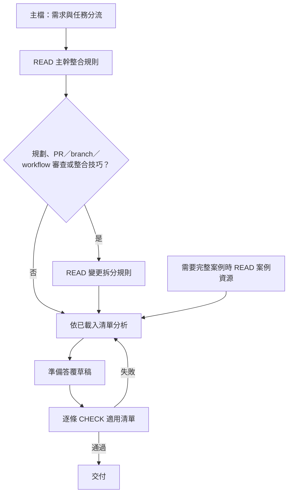

# 工程藍圖：trunk-based-development－SOP 與判斷規則模組化

- 版本：第二版；第一版審查未通過，原檔保存在 [工程藍圖第一版未通過.md](工程藍圖第一版未通過.md)，本次差異見 [藍圖修正紀錄.md](藍圖修正紀錄.md)。
- 模式：優化；只變更目標兩側 Skill 與本次指定紀錄，不 commit／push／安裝。
- 紀錄目錄：`docs/過程/CH2/trunk-based-development/本次執行/`
- 根因報告：[根因分析.md](根因分析.md)
- 確認紀錄：2026-10-17 總指揮已確認根因、驗收條件與情境；同意僅有結構根因，保留既有用途與正確規則。第一版因 workflow 審查漏載 Feature Flag 清理規則而未通過，依 Phase 4 步驟 2 返回 Phase 3 修正；本第二版重新待確認，尚未核准施工。

## 1. 驗收條件

| 編號 | 驗收條件 | 來源 | 適用範圍 |
| ---- | -------- | ---- | -------- |
| E1 | 主檔保留操作順序與完成條件；判斷規則置於按需載入 RuleFile，各 Rule 有規則及適用正反例，不以檔案數量為目標 | 本次 | 通用 |
| E2 | 每個 RuleFile 的 READ 明確標示使用條件、所讀 Rule 範圍並建立具名清單；後續 THINK/WRITE 使用該清單，CHECK 逐條驗證，未通過回到對應步驟 | 本次 | 通用 |
| E3 | 保留需求拆分、branch/PR 審查、workflow 審查及 GitFlow 比較用途；不新增自動 Git 寫入能力或把團隊流程說成 TBD 硬規則 | 既有、本次 | 通用 |
| E4 | 小變更能採單一短期 PR，輸出每個 PR 變更與技巧、main 可工作原因及含 review 等待的 branch 壽命，並保留同步 main、CI/review、merge 後清理的整合順序 | 既有 | 通用 |
| E5 | 未曝光功能可透過關閉 flag 每天整合並安排 flag 清理；相容性遷移先並存再遷 consumer 最後退場舊 API，main 每步可工作 | 既有 | 通用 |
| E6 | 多日重構使用 abstraction 接舊實作、加新實作、逐步切換及清除舊實作，避免長期 migration branch | 既有 | 通用 |
| E7 | 舊版修補維持目標既有 main 修復驗證後 cherry-pick 到 release 的政策；release 只負責維護與發布，不承載下一版新功能 | 既有 | 通用 |
| E8 | 區分官方、DORA 與團隊規則；不把 2 天說成國際硬上限；branch 壽命含 review 等待，紅 main 優先修或 revert，缺 CI/測試等前提時先指出缺口 | 既有 | 通用 |
| E9 | 同模型工具設定、固定輸入與判準，以乾淨隔離實跑保留前後原始產出與限制；分別記錄結構與行為差異，未觀察改善即如實記錄 | 本次 | 個案 |
| E10 | 僅改目標兩側與本次指定紀錄，兩側同步與 audit 無 error、sync check 通過；只給 commit message 草稿、不 commit/push/安裝 | 本次 | 個案 |

### 從預期推導步驟（先於 As-Is 比對）

| To-Be | 目的 | 追溯 |
| ----- | ---- | ---- |
| P1-1 | 取得規劃／審查的輸入 | E3、E4 |
| P1-2 | 決定任務與所需情境資源 | E1–E3 |
| P1-3 | 取得共用來源分級與 workflow 判準 | E2、E3、E8 |
| P1-4 | 規劃、PR／branch 審查及一般 workflow 審查均取得拆分規則；不能以輸入未提技巧名稱略過既有審查項 | E1–E3、E4–E8 |
| P1-5 | 需要完整案例才讀對應情境 | E2、E3；既有案例用途 |
| P1-6 | 使用規則分析，保留既有整合安排順序 | E2–E8 |
| P1-7 | 保留規劃格式，審查／比較依任務回答 | E3、E4 |
| P1-8 | 逐條檢查並分流修正 | E2、E4–E8 |
| P1-9 | 交付檢查通過的結果 | E2、E3 |

## 2. To-Be SOP

以下是完整目標主檔提案；frontmatter 原文保留。這不是已寫入的 Skill。

````markdown
---
name: trunk-based-development
description: 依主幹式開發（Trunk-Based Development，TBD）規劃與審查工作拆分、branch 策略與整合方式。用在：收到需求或 ticket 時規劃要拆成幾個 PR、判斷一個變更該直接走短期 branch 還是需要 Feature Flag／Branch by Abstraction／新舊並存／Release Branch、大型重構或框架遷移（例如 Vuex → Pinia、Axios → Fetch）如何每天安全 merge main、舊版本 hotfix 怎麼修、檢查某個 branch 或 PR 是否活太久或太大、審查團隊的 Git workflow 算不算 TBD，以及比較 TBD 與 GitFlow。
---

# SOP

## Phase 1 -- 分析與交付

1. `READ` 使用者需求；使用者提供既有 PR、branch 或團隊 workflow 資訊時，一併讀取該資訊。
2. `THINK` 確定任務涉及需求規劃、既有變更審查、團隊 workflow 審查或 TBD／GitFlow 比較，以及需要分析的變更與整合技巧範圍。
3. `READ` 判斷或說明 TBD 時，讀取 `rules/主幹整合-格式規範.md` 的所有 Rule，建立「主幹整合檢查清單」。
4. `READ` 任務為需求規劃、既有 PR／branch 審查或團隊 workflow 審查，或涉及 Feature Flag、重構／相容性遷移、舊版維護時，讀取 `rules/變更拆分-格式規範.md` 的所有 Rule，建立「變更拆分檢查清單」。
5. `READ` 需要小 bug、多日功能、大型重構、框架遷移、Feature Flag 或舊版 hotfix 的完整案例協助分析時，讀取 `references/cases.md` 的對應情境，建立「整合案例參考」。
6. `THINK` 依「主幹整合檢查清單」及本次已載入的「變更拆分檢查清單」「整合案例參考」，形成「分析結論」；規劃短期 branch 的整合方案時，依切小、每個小變更開短期 branch、工作期間與 merge 前同步 main、CI 驗證（build → lint → unit test → 必要的 integration test；PR → review → CI green → merge）、merge 後刪 branch 的順序安排工作；審查採短期 branch 流程的現況時，也使用該順序核對整合流程。
7. `WRITE` 依「分析結論」準備「答覆草稿」；規劃結果沿用以下格式，審查與比較任務依需求說明判斷與依據。

   ```text
   PR 1：<變更>  — 使用技巧：<無／Feature Flag／Abstraction／新舊並存>
   PR 2：...
   每個 PR merge 後 main 為什麼仍可工作：<說明>
   預估 branch 壽命（含等 review）：<時間>
   ```

8. `CHECK` 逐條驗證「答覆草稿」是否符合使用者需求、「主幹整合檢查清單」與本次已載入的「變更拆分檢查清單」，核對步驟 6 的適用整合順序與步驟 7 的規劃格式，並核對「整合案例參考」與本次情境的差異（有載入時）；分析未通過時返回步驟 6，草稿未忠實表達分析或規劃格式時返回步驟 7。
9. `WRITE` 向使用者交付通過檢查的答覆。

完成條件：已交付符合本次任務的規劃、審查或比較結果，且適用檢查清單逐條通過。

````

### 分工與邊界



兩份 RuleFile 分別是「方法合規／workflow 判斷」與「具體變更的拆分策略」。規劃、PR／branch 審查及一般 workflow 審查都必須在分析前讀取兩檔；只有純方法／GitFlow 比較且不涉及這些任務或整合技巧時，才只讀主幹檔。四種技巧共同服務同一個策略決策，不按技巧再拆四份。共用規則在每次 TBD 判斷時需要；拆分檔按完整任務用途載入，不依輸入是否提及技巧關鍵字決定是否檢查既有項目。只對與任務相關的規則作判斷，不把載入全部 Rule 誤當每題都必須使用四種技巧；未提供的現況不能自行宣稱已符合。

## 3. 差異表

### 刪除

**無整檔刪除、無既有正確規則刪除。** 下列刪除只移除主檔的舊載體與重複呈現；語義去向均在約束表中。

| 元素 | 位置 | 理由 |
| ---- | ---- | ---- |
| 舊知識型頂層標題與分散章節標題 | 原主檔核心目的、規則分級等標題 | 以唯一 # SOP 及 Phase 組織；E1、R1 |
| 原來源／分級／workflow 與策略內文 | 主檔各對應段 | 搬至唯一 RuleFile 權威位置，主檔只引用清單；C10–C24 |
| 常見錯誤及六問中重述相同判準的文字 | 原常見錯誤、送出前檢查 | 分別合併回相應 Rule，CHECK 使用清單；C11、C13–C15、C19–C23 |

### 修改、合併、改換存放位置與新增

| 元素 | 動作 | 內容 | 追溯 |
| ---- | ---- | ---- | ---- |
| 核心目的、來源分類、branch 標準、規則分級 | 改換位置 | 主幹整合 Rule 1、2；相同語義保留，術語與來源不變 | E3、E8；C10–C15 |
| 原規劃流程步驟 1 切小 | 拆分存放 | 操作順序在 P1-6，判斷邊界在變更拆分 Rule 1 | E4；C7、C19、C20 |
| 原流程步驟 2 短期 branch | 改寫位置 | P1-6；壽命判準只在主幹整合 Rule 1、2 | E4、E8；C7、C11、C13 |
| 原流程步驟 3 同步 main | 改換位置 | P1-6 原順序與語義保留 | E4；C7 |
| 原流程步驟 4 CI 驗證 | 拆分存放 | 驗證順序 P1-6；每 commit／快速回饋判準在主幹整合 Rule 2 | E4、E8；C7、C14 |
| 原流程步驟 5 merge 後刪 branch | 改換位置 | P1-6 | E4；C7 |
| Decision Tree | 改換位置 | 變更拆分 Rule 1；保留短工期／能否切小／原因分流，技巧細節各歸其 Rule | E4–E7；C19、C20 |
| 技巧要點四條 | 改換位置 | 變更拆分 Rule 2–5 | E5–E7；C21–C24 |
| 常見錯誤五項 | 合併 | 長分支、review、多人、freeze→主幹整合 Rule 1、2；Story→拆分 Rule 1；main 破壞→主幹整合 Rule 2／API 相容→拆分 Rule 4 | E3–E8；C11、C13–C15、C19、C23 |
| workflow 六問 | 合併 | 分級、整合健康及導入判斷使用主幹整合 Rule 1–3；flag 清理仍唯一存於拆分 Rule 2，P1-4 無條件涵蓋一般 workflow 審查，P1-6 使用、P1-8 逐條核對；不要求先出現 flag 關鍵字 | E3、E5、E8；C11、C13–C15、C17、C21 |
| 導入前提與適合專案 | 改換位置 | 主幹整合 Rule 3 | E3、E8；C17、C18 |
| TBD／GitFlow 三段 | 改換位置 | 主幹整合 Rule 2 | E3；C16 |
| 送出前六問 | 合併 | 一天切分／明天還在→拆分 Rule 1、主幹整合 Rule 1；main→主幹整合 Rule 2；flag／abstraction→拆分 Rule 2、3；CI→主幹整合 Rule 2 | E2、E4–E8；C11、C13、C14、C19、C21、C22 |
| 原案例引用句 | 改寫 | P1-5 明示情境與具名結果，案例內容不變 | E2、E3；C5 |
| 條件 READ、使用、CHECK 及返回、交付 | 新增／重組流程 | P1-1–9；無新增方法政策或操作能力 | E1、E2；R1；C1–C9 |
| 正反例 | 新增示範載體 | 8 條 Rule 各一對同情境例子；不得以例子新增判準 | E1；C10–C24 |

### 保留

| 元素 | 追溯 | 約束 |
| ---- | ---- | ---- |
| frontmatter name、description 原文 | E3；用途／觸發不變，不施工 frontmatter | 概述 C10–C24，非判準存放位置 |
| 原四行規劃格式原文 | E4；移入 P1-7，不建樣板組 | C8 |
| references/cases.md 全檔原文（目錄、六個案例與來源連結） | E3–E8；作補充案例，不增加第二套權威規則 | 示範 C7、C10–C24，不另規範 |
| 所有既有正確方法政策及強度 | E3–E8 | C7、C10–C24 |

As-Is 沒有正式 Phase、完成條件、RuleFile、樣板組或腳本；不是漏列保留。原五步自然語言流程、六問等均在上述表逐項追溯。原文搬移原則：相同判準保留原文；為符合 RuleFile 固定強度，僅把「盡量少／更好／要」等表述改成與原強度相符的「應／可以／必須／不得」，不得把建議升成硬性限制。字句差異與對應將保存於前後比較。

## 4. 淨增減

| 項目 | As-Is | To-Be | 增減 |
| ---- | ----- | ----- | ---- |
| 正式 Phase | 0 | 1 | +1 |
| 受控動詞 SOP 步驟 | 0 | 9 | +9 |
| RuleFile | 0 | 2 | +2 |
| Rule | 0 | 8 | +8 |
| 樣板組 | 0 | 0 | 0 |
| 腳本 | 0 | 0 | 0 |
| 案例資源 | 1 | 1 | 0 |

原有「規劃流程 5 步」與「送出前 6 問」非受控動詞 SOP，數量另揭露為 5／6；不能把本次 +9 當作淨增加九個新業務動作。新增的是 E1、E2 與 R1 所需的載入／使用／檢查控制；8 條 Rule 是既有內容改換載體，不是八條新政策。僅刪除舊載體不能建立載入鏈，僅改寫主檔不能達 RuleFile 作業要求，因此以重組 SOP 加兩個主題檔解決；無新增腳本或樣板理由。

## 5. 約束分配表

「主幹整合」「變更拆分」分別縮寫兩個目標 RuleFile。規則內容每條只存一處，SOP 不重述。共用完成條件與 description 只概述結果。所有 RuleFile 選址均已排除可程式確定的工作與整份檔案結構要求；C8 為單一步驟短格式，不需要獨立檔案與樣板組。

| 編號 | 約束 | 所屬步驟 | 存放位置 | 理由 |
| ---- | ---- | -------- | -------- | ---- |
| C1 | 讀取需求及已提供的 PR／branch／workflow 資訊 | P1-1 | SOP P1-1 | E3；流程輸入，留在 SOP |
| C2 | 判定任務與所需技巧範圍 | P1-2 | SOP P1-2 | E2、E3；分流決策，留在 SOP |
| C3 | 按需載入主幹規則並命名主幹整合檢查清單 | P1-3 | SOP P1-3 | E1、E2；載入條件與順序屬流程 |
| C4 | 規劃、PR／branch 審查與一般 workflow 審查均在使用前載入拆分規則；純比較按涉及內容決定；命名變更拆分檢查清單 | P1-4 | SOP P1-4 | E1、E2；條件載入屬流程 |
| C5 | 需要完整案例時讀對應情境並命名整合案例參考 | P1-5 | SOP P1-5 | E2、E3；沿用既有案例用途的載入流程 |
| C6 | 依具名清單及案例形成分析結論 | P1-6 | SOP P1-6 | E2、E3；資料使用流程 |
| C7 | 規劃短期 branch 時依切小→分支→同步→CI/review→merge→刪分支安排工作；審查採此流程的現況時核對同一順序 | P1-6 | SOP P1-6 | E4；既有整合行動順序，不抽成判斷規則 |
| C8 | 規劃答覆沿用 PR／技巧、main 可工作原因、含 review 壽命的既有四行格式 | P1-7 | SOP P1-7 | E4；只屬答覆步驟的短小字面格式，非獨立產出檔案，無需樣板組 |
| C9 | 逐條 CHECK 適用清單，核對 P1-6 整合順序與 P1-7 規劃格式；失敗返回分析或草稿步驟，通過才交付 | P1-8、9 | SOP P1-8、9 | E2；驗證與返回分支留 SOP |
| C10 | 區分 TBD 官方、DORA 與團隊規則及其強度 | P1-6、8 | 主幹整合 Rule 1 | E8；須判斷來源，不能由腳本或檔案骨架保證 |
| C11 | 官方約 1～2 天、DORA <1 天，不把 2 天當硬性上限；壽命含 review | P1-6、8 | 主幹整合 Rule 1 | E8；來源語義與情境評估需正反例，非可機械決定或整體檔案結構 |
| C12 | merge 方式、同步用 merge/rebase、命名、reviewer、平台與 direct push 政策屬團隊選擇 | P1-6、8 | 主幹整合 Rule 1 | E3、E8；需辨別團隊政策與方法要求，腳本／樣板不適用 |
| C13 | 單一 main，無長期共同開發分支；至少每天整合、main 可工作可發布 | P1-6、8 | 主幹整合 Rule 2 | E3、E8；方法合規的語義判斷需正反例 |
| C14 | main 紅了先立即修或 revert，不繼續疊加新功能；每 commit build/test、幾分鐘回饋 | P1-6、8 | 主幹整合 Rule 2 | E4、E8；CI 策略評估非實際執行腳本，也非產出檔案骨架 |
| C15 | 維持短 branch、少 active branches，不靠 freeze；辨識長期多人 feature branch 反模式（branch 合併後清理由 C7 的同一流程核對） | P1-6、8 | 主幹整合 Rule 2 | E3、E8；審查需要脈絡，非硬加數字門檻 |
| C16 | TBD 切小持續整合保持可工作，GitFlow 隔離完整後整合；主要改變拆分方式 | P1-6、8 | 主幹整合 Rule 2 | E3；比較工作方式需語義，不能由腳本或骨架判斷 |
| C17 | 導入前指出自動 build/test、快速 CI、小批次、快速 review、gated checks、修 trunk 紀律的缺口 | P1-6、8 | 主幹整合 Rule 3 | E8；需解讀團隊能力，腳本或固定骨架不能判斷 |
| C18 | 保留 SaaS/Web/API/Frontend/Microservice/企業系統等適用情境；變動、協作與頻繁 release 的價值判斷 | P1-6、8 | 主幹整合 Rule 3 | E3；保留既有用途判斷，不新增限制，腳本／樣板不適用 |
| C19 | 先切小到可獨立整合，Story 不等於單支／單 PR；小變更無須特殊技巧 | P1-6、8 | 變更拆分 Rule 1 | E4；拆分邊界需判斷，非可程式化或固定檔案骨架 |
| C20 | 依耗時／能否再切小／不能整合原因判斷；branch 隔離不能替代小批次、flag、抽象與相容性 | P1-6、8 | 變更拆分 Rule 1 | E4–E7；策略選擇需情境與正反例 |
| C21 | 未曝光功能用關閉 flag 持續整合，最後開啟；Deploy ≠ Release，上線後清理 flag | P1-6、8 | 變更拆分 Rule 2 | E5；曝光與整合判斷非腳本／樣板可保證 |
| C22 | abstraction→接舊→加新→逐步切換→刪舊，每步可整合 | P1-6、8 | 變更拆分 Rule 3 | E6；領域遷移策略，非本 Skill 操作順序，需情境正反例 |
| C23 | 舊新 API 並存→consumer 遷移→刪舊 API，避免跨層破壞 | P1-6、8 | 變更拆分 Rule 4 | E5；相容性策略需語義判斷，非本 Skill 執行順序或骨架 |
| C24 | release 很晚才切，只做版本穩定／修補／發布；main 修復驗證再 cherry-pick，不以 release 新功能開發或整包回灌 | P1-6、8 | 變更拆分 Rule 5 | E7；保留既有維護策略，非可機械計算或檔案整體格式 |

## 6. 施工工作項

以下全為待施工。無整檔刪除或 frontmatter 工作項。工程執行者是指定 Skill；除後測隔離子代理外，不另要求施工子代理。

| 順序 | 工作項 | 執行者 | 目標 | 內容 | 約束 | 狀態 |
| ---- | ------ | ------ | ---- | ---- | ---- | ---- |
| 1 | W1 | skill-form-sop | .agents 目標主檔 | 先寫胖 SOP，尚不存在的 RuleFile 不得提名 | C1–C24 | 待施工 |
| 2 | W2 | skill-derive-rule | 胖 SOP 的 THINK 策略分析步驟 | 抽取變更拆分 5 Rules，連動 READ、使用及 CHECK | C4、C19–C24 | 待施工 |
| 3 | W3 | skill-derive-rule | 胖 SOP 的 THINK 方法判斷步驟 | 抽取主幹整合 3 Rules，連動 READ、使用及 CHECK | C3、C10–C18 | 待施工 |
| 4 | W4 | skill-form-sop | 主檔收尾 | 合併分析步驟，與 To-Be 主檔逐字對齊，保留 frontmatter 與案例檔 | C1–C9 | 待施工 |

### 工作項內容

#### W1：胖 SOP

- 目標 `.agents/skills/trunk-based-development/SKILL.md`；僅改 body，frontmatter 原文保留。既有案例內容及來源不改。
- Before：以基線技能主檔.txt 為準，知識型主檔與五步規劃，沒有正式 SOP 與 RuleFile。
- After：`# SOP`／`## Phase 1 -- 分析與交付`，順序為：READ 需求（To-Be P1-1）、THINK 範圍（P1-2）、THINK「方法判斷」（將 C10–C18 既有文字內嵌）、THINK「策略分析」（條件為本第二版 To-Be P1-4，明示需求規劃、PR／branch 審查、一般 workflow 審查均進入；將 C19–C24 文字內嵌）、READ 案例（To-Be P1-5）、THINK「分析結論」（To-Be P1-6 整合順序）、WRITE 草稿（P1-7）、CHECK（按內嵌判準檢查，未通過返回方法判斷／策略分析／草稿）、WRITE 交付，完成條件同 To-Be 的可觀察結果。
- 胖 SOP 的「方法判斷」與「策略分析」為兩個獨立抽取點，不能合在同一動作，不能先加入不存在的 RuleFile 引用；所有候選 Rule 的具體要求就是第 5 節對應 C 編號及本段下方 W2、W3 的清單。兩步先分析，合成步驟再組合輸出；此為施工中間態，不實跑為最終版本。
- 保存胖 SOP 施工基準至本次紀錄（繁體中文檔名），供後續 Before 唯一定位；此工作不改用途或新增 Git 操作。

#### W2：抽取變更拆分主題（由後往前的第一項）

- 以 Phase「分析與交付」、動詞 THINK、關鍵字「策略分析」定位；Before 為 W1 的條件策略分析步驟，內容 C19–C24。
- 使用 skill-derive-rule，由其使用 skill-form-rule 建立 `rules/變更拆分-格式規範.md`，再使用 skill-form-sop 更新該處載入與依賴步驟。
- After：策略分析前新增本第二版 To-Be P1-4 的條件 READ，明示一般 workflow 審查與 PR／branch 審查必定涵蓋，不依技巧關鍵字觸發；所有 Rule→「變更拆分檢查清單」；策略分析只使用具名清單，不重述判準；方法與策略分析都使用已載入結果；草稿 CHECK 增加逐條驗證該清單（載入時），一般 workflow 審查包括 flag 清理是否已檢查／資訊是否足夠；不得默認未提即不存在。失敗返回策略分析，完成條件涵蓋適用清單通過。案例仍在第一個需要案例的分析結論前 READ。
- 必要 Rule 與例子（正反例用同情境，不與固定實測輸入相同）：

| Rule | 核心要求與來源 | Good Example | Bad Example |
| ---- | -------------- | ------------ | ----------- |
| 1 切小與選擇策略 | C19、C20；原規劃第一步、Decision Tree、Story 錯誤、六問切小部分 | 聯絡人搜尋分成可獨立整合小 PR；小文案修改用無特殊技巧 | 一張 Story 強制一個兩週 PR；小修改硬加抽象層 |
| 2 未曝光功能 | C21；原 Feature Flag 要點 | 新設定頁預設 flag 關閉，小步整合，公開穩定後刪 flag | 以一週分支藏未曝光畫面，或上線後永不清理 flag |
| 3 多日重構 | C22；原 Branch by Abstraction 要點 | 儲存層先抽象接舊實作，加新實作逐步切換後清舊，每步可整合 | 一次移除舊實作，等所有模組改完才可用 |
| 4 相容遷移 | C23；原新舊並存與跨層錯誤 | 新舊通知 API 並存，consumer 遷移後移除舊 API | 先刪舊通知 API，下一個 PR 才更新 consumer |
| 5 版本維護 | C24；原 Release Branch 要點 | 在 main 修復驗證地址編碼 bug 後 cherry-pick 至維護分支，只做維護 | release 修完整包回 main，並在 release 寫下一版新功能 |

- 每 Rule 遵循固定結構、明確強度與完整正反例；示範是既有判準的例證，不新增 rollout、監控、owner 等強制要求。

#### W3：抽取主幹整合主題（第二項）

- 以 Phase「分析與交付」、動詞 THINK、關鍵字「方法判斷」定位；Before 為 W1 方法判斷，位於策略分析前；W2 先完成，不靠可能變動的數字定位。
- 使用 skill-derive-rule，由其使用 skill-form-rule 建立 `rules/主幹整合-格式規範.md`，再使用 skill-form-sop 更新載入、使用與 CHECK。
- After：方法判斷前新增 To-Be P1-3 的 READ，所有 Rule→「主幹整合檢查清單」；方法判斷引用具名清單；CHECK 同時逐條核對必用主幹清單與適用拆分清單，失敗回對應分析步驟。與 W2 形成獨立方法／策略兩個分析後，W4 才整併。

| Rule | 核心要求與來源 | Good Example | Bad Example |
| ---- | -------------- | ------------ | ----------- |
| 1 來源與分級 | C10–C12；原來源、壽命與團隊規則 | 審查一天半含 review 的 PR，分別說明官方與 DORA；squash 是團隊選擇 | 宣稱超過兩天必定違法、必須 squash 才是 TBD；只算編碼時間 |
| 2 整合健康與方法比較 | C13–C16；原核心、強烈建議、workflow、GitFlow 與常見錯誤 | 團隊每天小批次回 main，CI 快且紅燈先處理；比較聚焦拆分與整合時機 | 從 main 開三週共享功能分支就算 TBD；紅燈週末再看；只靠改 merge 按鈕 |
| 3 導入前提與適用 | C17、C18；原前提與適合專案 | 頻繁發布的內部系統先補自動測試、快速 review，再改善整合 | 測試不足仍直接保證全面導入會降低錯誤 |

- 規則強度保留原分級；active branches「盡量少」轉為「應維持少量」，不硬加三支上限。DORA 提到的做法必須保留 DORA 歸屬，不升為官方一律強制。
- 不新增主幹不可重現 bug 的例外政策或自動 Git 執行，這些不在本次已確認需求與基準案例。

#### W4：SOP 收尾

- Before：W2、W3 完成後有兩個過渡分析步驟，各自依已載入規則作判斷；不存在未建立資源引用。
- After：合併為 To-Be P1-6「分析結論」，READ 主幹→條件 READ 拆分→條件 READ 案例連續相鄰，第一個依賴者為 P1-6；CHECK 失敗依 To-Be P1-8 返回 P1-6／7。整個主檔與第 2 節 To-Be 逐字相同。
- 清除搬移後主檔的判準重述，保留 C7 整合順序與 C8 格式；審查短期 branch 現況也核對 C7，CHECK 明示核對 C7／C8。原版「branch 一直不刪」審查不再只剩規劃用途可達；不是改規則強度。完成條件同 To-Be。
- 若下游 Skill 因設計不符規則而拒絕，或實際需要新增未列約束，停止施工、記錄已完成／待施工狀態、回到 Phase 3 與第二確認閘門，不自行改藍圖。

### 施工後驗證（skill-engineering Phase 5）

1. 檢查所有工作項狀態後執行 audit（兩個 skills root、目標名稱），退出零且 JSON 無 error 才繼續。
2. 先檢查 Git 範圍，執行 `scripts/sync-skills.sh --from agents` 與 `--check`；預期只同步目標，若發現其他檔案差異先查明，不覆蓋他人修改。保存輸出與「僅目標端」清單（有則逐項記錄，無則寫無）。
3. 核對兩側實體副本、frontmatter 與案例原文、C1–C24 唯一位置、To-Be 主檔一致，再執行下節同題後測。

## 7. 驗收情境

S1–S5 輸入與判準沿用已確認的「測試輸入與判準.md」及 S2 修正紀錄，不改動既有題目。S6 增加本次依賴核對，另提 S7 一般 workflow 回歸題以直接觀察未提示技巧名稱時是否仍保留原六項審查用途；尚未實跑，藍圖核准後、W1 前先完成基線，再用同題後測。以下所列即固定輸入；預先回覆均為無，因目標 Skill 無確認閘門。

| 編號 | 驗證 | 類型 | 輸入 | 預先回覆 | 判斷方式 |
| ---- | ---- | ---- | ---- | -------- | -------- |
| S1 | E2–E4 | 回歸 | 修正報表匯出檔名的日期格式，估計 40 分鐘，現有測試與 CI 正常，review 可在一小時內完成。請依此 Skill 規劃工作拆分與整合，不執行 Git 寫入。 | 無 | 一個短期 PR 即可；不強加特殊技巧；說明 main 可工作、CI/review 與含等待的壽命。 |
| S2 | E2、E5 | 回歸 | 新增訂閱方案比較頁需四天，週五才能公開，後端先提供新 API、舊頁面仍使用舊 API。請依此 Skill 規劃每天整合方式，不執行 Git 寫入。 請涵蓋後續所有 consumer 遷移與舊 API 退場順序。 | 無 | 切成可獨立整合的小 PR；未曝光用 flag 並安排清理；新舊 API 並存、consumer 遷移後才移除；每步 main 可工作。 |
| S3 | E2、E4、E6 | 回歸 | 把專案的日期處理從 Moment.js 遷移到 date-fns，估計六天，多個模組需逐步替換。請依此 Skill 規劃拆分與整合，不執行 Git 寫入。 | 無 | abstraction→接上舊實作→新實作→逐步切換→清除；每天小 PR，main 可工作，不用長期分支隔離。 |
| S4 | E2、E7 | 回歸 | 線上 2.4 有時區 bug，main 已在開發 2.5，問題在 main 也可重現；release/2.4 已存在。有人提議先在 release/2.4 修好，再把整條 release merge 回 main，並在 release 分支新增 2.5 功能。請審查並給整合順序，不執行 Git 寫入。 | 無 | main 修正驗證後 cherry-pick 到 release；release 只做維護，不承載新功能，不整包回灌。 |
| S5 | E2、E3、E8 | 回歸 | 請審查是否符合 TBD：團隊沒有 develop、只從 main 開 branch，但每個功能 branch 活兩週；寫程式半天、review 排三天；CI 紅了晚上才修。主管認為只要強制 squash、rebase 同步、兩位 reviewer 就是 TBD，還說官方規定最多兩天。團隊自動測試不足。也請簡述與 GitFlow 的差異。不執行 Git 寫入。 | 無 | 指出長期分支、review 等待、紅 main、導入前提；區分官方約1–2天與 DORA <1天；merge/rebase/reviewer 為團隊規則；TBD 切小持續整合，GitFlow 隔離完整後整合。 |
| S6 | E1–E3 | 本次結構 | 本次使用者的 SOP／RuleFile 模組化需求（不變更用途、正確規則或硬拆檔案） | 無 | 對照 C1–C24、差異表與各工作項，檢查規則及同情境正反例、所有 READ 條件與具名清單、使用／CHECK／返回；逐用途核對下方跨檔依賴表；特別以未提技巧名稱的一般 workflow、PR／branch 審查驗證 P1-4 必觸發，核對 C7 審查順序；audit 無 error。 |
| S7 | E2、E3、E5、E8 | 補充回歸，尚未實跑 | 請依本 Skill 列出審查團隊 Git workflow 是否符合 TBD 的檢查項目；這次不規劃新功能，也不執行 Git 操作。 | 無 | 保留原 workflow 六項：長期共同分支、每日整合、含 review 壽命及 active branches、CI 回饋／紅 main 處置、code freeze、Feature Flag 清理；不把沒有提供的現況判成已符合。後測須在分析前讀兩份 RuleFile，清單被使用且 CHECK 涵蓋。 |

### 同題前後實跑設定與限制

- S7 藍圖核准後、W1 前先固定輸入／判準並用既有技能完成乾淨基線，保存原始輸出、環境與結果；若基線失敗，依原流程診斷，不暗改已核准判準或將其冒稱通過。S7 前後隔離指令及模型設定相同，限制同下列說明。
- 後測重建 S1–S5、S7 的獨立暫存技能副本，使用全新 `fork_turns=none` 子代理；提供與基線逐字相同的測試指令，只有技能版本及不可避免的副本位置改變。S2 明確固定為修正後輸入，初次結果永久保留。各測試先保存檔案與輸入雜湊，結束再次核對副作用。
- 模型與 reasoning 不覆寫，繼承同一父代理設定；底層 model ID、temperature、seed、服務快照未暴露，無法保證其固定。未取得數值不得填造；這是已揭露限制，不能宣稱完全受控的模型實驗。
- 代理只收到技能路徑、環境、情境輸入與預先回覆，不收到根因、藍圖、判準或預期答案；保存完整回答及讀取資源自述。實測後由主代理依相同判準評分，非獨立盲評。
- 額外核對讀取鏈：S1–S5、S7 均須在分析前讀主幹與拆分兩檔；S5 雖同時比較 GitFlow，仍是 workflow 審查，不能走純比較例外。純比較例外僅由 S6 靜態核對，不冒稱已有實跑證據；案例只在需要完整案例時讀，不把是否讀案例本身當業務正確性。
- 結構與行為結果分開記錄：S6 可證明分工與載入鏈；S1–S5、S7 僅證明固定案例的答覆保持。若前後都通過，記「未觀察到行為改善」。不得用檔案變短宣稱準確率／速度提升。
- 若測試環境不一致，修正環境並保存原結果後重跑；若失敗來自 Skill，返回根因 Phase 2，不能以四題通過代替全數通過。
- 不執行應用程式、真實 Git 寫入或部署；不把計畫中的 main 可工作理由視為已跑過應用測試。

E9、E10 為個案條件，另核對模型／隔離／限制紀錄、檔案範圍、同步與不提交狀態；完成後才提供 commit message 草稿。

## 8. 驗收結果

尚未施工。

修改前五題行為基準經 S2 測試環境修正後通過；結構 S6 不通過（SOP001 與缺載入鏈），詳見「修改前結果.md」。不得將此填為後測成果。

### Phase 3 設計檢查紀錄（第二版）

- 已逐條核對重新設計 Rule 1–6：先從 E 推導、逐項 As-Is 去向、修改落在 R1 主檔流程、先考慮刪改與搬移、揭露淨增減；audit graph 目標無直接呼叫者，故無其他 Skill 回歸需求。
- 第一版僅核對約束歸屬，未完整核對適用用途→READ→使用→CHECK，因此上版設計檢查不足。第二版補上實際觸發與消費路徑檢查，詳見下表與「藍圖修正紀錄.md」。C1–C24 的單一存放位置不變，不靠複製領域判準解決。
- 已逐條核對施工委派 Rule 1–5：SOP→胖 SOP，新增部位走 derive-rule、由後往前、工作項完整且具名定位，拒絕時停止回報；frontmatter／案例不修改，不施工其他 Skill。
- 藍圖與確認紀錄使用本次指定繁體中文檔名，未使用預設 specs 路徑。

### 跨檔依賴核對（使用前的完整路徑）

此表以原有用途檢查可達性，而非只列約束歸屬。P1-3／4／5 連續 READ，第一個使用者是同 Phase 的 P1-6；P1-8 驗證相同清單，失敗返回 P1-6／7。除純比較外，不能因缺少技巧名稱而略過 P1-4。載入包含所有 Rule，不代表每條技巧都適用於已知現況；資訊未提供時不能冒稱該項已通過。

| 原有用途／約束 | 第一版核對 | 第二版載入與使用路徑 | CHECK 實際核對 | 結論／限制 |
| ------------- | ---------- | -------------------- | ---------------- | ----------- |
| workflow 六問中的 Flag 清理（C21） | 一般 workflow 不保證載入拆分檔，缺口成立 | P1-2 任務=workflow→P1-3 主幹全部、P1-4 拆分全部→P1-6 使用拆分 Rule 2 | P1-8 逐條檢查拆分清單；不能以未提 flag 漏掉原清理檢查項 | 修正必要依賴；C21 仍只有拆分 Rule 2 一個來源 |
| 一般 workflow 的其他五問（C11、C13–C15） | 主幹檔原已必讀 | P1-3→P1-6 主幹 Rule 1、2 | P1-8 主幹清單 | 保持每日整合、壽命／review／active branches、CI／紅 main、freeze、長期共同分支 |
| PR／branch 審查的 Story 拆分、未曝光、重構、跨層相容（C19–C23） | 上版只稱具體整合方案，純「審查既有 branch」不保證觸發，屬同類潛在缺口 | P1-2 任務=PR／branch 審查→P1-4 拆分全部→P1-6 判斷相關規則 | P1-8 拆分清單；適用的策略需核對，非強制每個 PR 用全部技巧 | READ 條件直接含完整審查用途 |
| 原常見錯誤「branch 一直不刪」及同步／CI 整合順序（C7） | 上版 C7 只有規劃路徑，雖有歸屬，審查缺少明示使用 | P1-6 明示對採短期 branch 流程的現況核對相同順序 | P1-8 明示核對 P1-6 的整合順序，非只看 RuleFile | 補足 SOP 內跨用途使用，不把相同要求複製到 RuleFile；仍按 C12 團隊政策分級 |
| 規劃／審查的規則強度、官方與 DORA 差異及 direct push 等團隊政策（C10–C12） | 主幹檔原已必讀 | P1-3 主幹 Rule 1→P1-6，拆分規則不會脫離主幹分級使用 | P1-8 主幹清單 | 不把技巧例子或建議升格成方法硬要求 |
| 需求規劃、Decision Tree 與四種技巧（C19–C24） | 規劃原已有拆分 READ | P1-3＋P1-4→P1-6→P1-7 | P1-8 兩清單及規劃格式 | 保留原依賴；小變更仍可無特殊技巧 |
| 舊版 hotfix／release 合規（C24） | 明示舊版維護可達，但一般 workflow／branch 審查中可能遇到 release 而未觸發 | 所有 workflow／branch 審查已由 P1-4 取得 Rule 5；專門維護任務仍同一路徑 | P1-8 主幹分級及拆分 Rule 5 | 不把正常維護分支誤判成長期共同開發；仍保留原 main-first 政策 |
| 導入前提／適用情境（C17、C18） | 主幹檔原已必讀 | P1-3 主幹 Rule 3→P1-6 | P1-8 主幹清單 | 無跨檔缺口 |
| 純 TBD／GitFlow 比較（C10–C18） | 主幹檔足以支持既有兩種工作方式比較 | P1-3→P1-6；同時要求規劃、審查或涉及技巧時 P1-4 亦觸發 | P1-8 主幹清單；兼有其他用途時也核對拆分清單 | 不是讓 workflow＋比較混合任務跳過拆分檔的例外 |
| 案例（C5）與規劃格式（C8） | 案例僅補充，格式留單一步驟 | P1-5→P1-6；P1-7 使用原格式 | P1-8 核對案例差異（有載入時）與 P1-7 格式 | 案例不得承載只有讀案例才取得的必要規則 |

檢查範圍為 C1–C24：C1–C6 是輸入、分流、載入與使用；C7–C9 的輸出／檢查依賴已明示；C10–C24 逐用途可達。以上是藍圖的靜態推演，尚未證明施工後代理實際會遵循，須 S6 結構核對與 S1–S5、S7 實跑。S7 新增測試不改 E1–E10，也不聲稱發現原版行為故障。

### 第二確認閘門

待總指揮重新確認本第二版藍圖（包含修正後 READ、跨檔依賴核對、C7 審查覆蓋、S7 補充回歸設計，其餘 To-Be、所有刪除／改換位置、C1–C24、W1–W4 及限制沿用）。目前沒有施工授權，所有工作項維持待施工。
