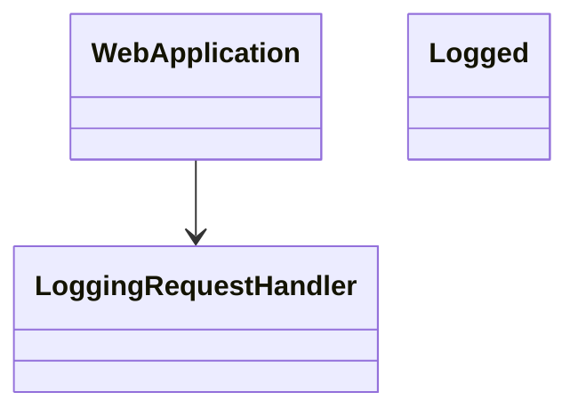

# 對話紀錄（2026-10-15，plan-with-class-diagram，逐步工具紀錄）

說明：產出檔 `plan/logging/class-diagram-proposal.md` 沒有保存；第 7 則訊息完整保留了當時寫入的內容。當時使用的 Skill 為 `.agents/skills/plan-with-class-diagram/`，版本即本專案目前的檔案。

1. 使用者：/plan-with-class-diagram 在 java-web-framework 加入 Request/Response Logging，Controller 掛上 @Logged 即生效。
2. 工具 Read：`.agents/skills/plan-with-class-diagram/SKILL.md`
3. 工具 Read：`java-web-framework/src/main/java/` 下既有類別（WebApplication 等）
4. 工具 Read：`.agents/skills/plan-with-class-diagram/rules/` 下全部 RuleFile
5. 工具 Read：`.agents/skills/plan-with-class-diagram/templates/class-diagram-proposal.md` 與 `class-diagram-proposal.example.md`
6. AI 判斷（對話原文）：「Logged、LoggingRequestHandler 為新增類別；WebApplication 為既有類別，需修改以掛上 handler。」
7. 工具 Write：`plan/logging/class-diagram-proposal.md`，寫入內容全文如下：

````markdown
# 類別圖提案：Request/Response Logging



## 設計說明與實作順序

1. 新增 Logged
2. 新增 LoggingRequestHandler
3. 修改 WebApplication
````

8. AI：已產出類別圖提案：plan/logging/class-diagram-proposal.md。
9. 使用者：好，去開發吧。
