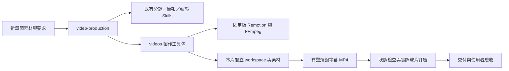

# 工程藍圖：video-production－建立

2026-10-18 本輪實片回饋補充：依使用者要求，新增 E19–E22（核心、動靜、落定與切點），以 [節奏設計及驗收補充](rhythm-addendum.md) 為本輪規範差異；原片不通過的紀錄保留，不能因工程檢查通過而抹去。


- 模式：新建；根因報告：不適用。
- 紀錄目錄：`specs/skill-engineering/14-video-production-建立/`。
- 確認紀錄：2026-10-18 使用者回覆「確認」，已確認本藍圖、E3 推定兩案下限及 A1／A2 關聯工作；本次使用者已接受 CH2 成片為最低完成標準，不重新要求驗收 CH2。
- 目標：`.agents/skills/video-production/`；施工後以實體副本同步至 `.claude/skills/video-production/`。
- 證據與現況：[research.md](research.md)。目前只有設計，以下程式介面與檔案均為提案，尚未建立。

## 1. 驗收條件

| 編號 | 驗收條件 | 來源 | 適用範圍 |
| --- | --- | --- | --- |
| E1 | 從新素材建立觀眾、理解目標、內容來源、可改與不可改範圍；未知事項與問題有明確紀錄 | 本次 | 通用 |
| E2 | 每次記錄實際工具能力與小段實測；直接聽看、ASR、抽幀與播放分別列證據，缺工具不宣稱完成 | 本次 | 通用 |
| E3 | 未定方向時提供至少兩個有實際畫面及有聲片段的方向、內容適配與推薦；已定方向不重問，提案範圍不覆寫正式片 | 推定（兩案下限承接現行 WORKFLOW；方向比較為本次要求） | 通用 |
| E4 | 每段都有理解目標、實際語音時間、觀看對象與起／中／尾畫面；需改動既定稿件、配音或片長時先取得確認 | 本次 | 通用 |
| E5 | 動作逐項對應交棒、拆分、變化、回接或細節目的；刻意停留有觀看對象與理由 | 本次 | 通用 |
| E6 | 焦點契約獨立於動畫實作，覆蓋全片；列舉逐項核對，實際繪圖狀態中的主焦點覆蓋解說區間 | 本次 | 通用 |
| E7 | 移動／形變物件名稱持續可辨識，路徑避字、鏡頭保留重點與脈絡；實際過渡畫格另作視覺檢查 | 本次 | 通用 |
| E8 | 交付預設為燒錄字幕，保留 SRT/VTT；確認編碼畫面有字幕且未遮擋／裁切，播放與下載為同一成片 | 本次 | 通用 |
| E9 | 解碼、規格、影音時間、來源／音訊完整性均按本片設定檢查；過期或建置中變更的來源停止交付 | 本次 | 通用 |
| E10 | 實際成片按每段中途、尾端與關鍵過渡複查，記時間／觀察／修法；修改後重建並更新相應證據 | 本次 | 通用 |
| E11 | 自動檢查、靜態視覺、音訊分析、直接連續聽看、使用者驗收五項各自記狀態；使用者接受不改寫 AI 能力事實 | 本次 | 通用 |
| E12 | 沒有本次對話與舊 MP4 仍能執行；幕數、時間、配色、物件及路徑依新片設定，不繼承 CH2 內容 | 本次 | 通用 |
| E13 | 明列 Skill、專案工具、第三方與個案素材的安裝／載入邊界，缺依賴可定位；第三方來源、版本與授權保留 | 本次 | 通用 |
| E14 | 交付包含可播放／下載成片、可重建來源與命令、逐項檢查結果、未驗證事項與驗收紀錄 | 本次 | 通用 |
| E15 | 故意漏列舉、提前失焦、錯對象、失去名稱、裁切及證據過期各有失敗案例，阻止更新正式交付 | 本次 | 通用 |
| E16 | 新主題代表片段實際編碼，含配音、燒錄字幕、連續移動、形變及服務理解的鏡頭，並完成狀態與成片檢查 | 本次 | 通用 |
| E17 | Skill 的施工後結構診斷無 error，兩側實體同步一致；未實跑的能力明列未驗證 | 本次 | 個案（本次 Skill 工程） |
| E18 | 歷史資料與已交付成片不刪除、不重製；本次不 commit/push | 本次 | 個案（本次 Skill 工程） |

E3 的推定理由：未定方向需要可比較的實際成果，因此承接現行流程的兩案下限，請在本藍圖確認時一併確認；不是每次重製都要求選版。新工具初版支援 macOS，跨平台未驗證，不擴張成此次必要目標。

## 2. To-Be SOP

以下為最終 Skill 全文提案。`工具根目錄` 由專案實況解析；`本片設定` 與 `本片目錄` 在 Phase 1 確定，不使用使用者家目錄的固定路徑。

````markdown
---
name: video-production
description: 將章節或主題素材製作成有旁白、燒錄字幕與動態敘事的影片，並交付成片與檢查紀錄。製作下一章影片、解說影片、video production、整體影片改版或修正聲畫焦點時使用；方向確認後在既有授權內完成製作。只做文字課程筆記改用 course-transcript-notes；只做 HTML 簡報改用 frontend-slides；只做動態美術諮詢改用 motion-art-direction。只重建已定版影片時依該片既有建置說明。
---

# SOP

## Phase 1 -- 確定內容與可用能力

1. `READ` 使用者需求、專案指引、指定章節素材、已有的影片設定與決策；續作時另讀現行交付紀錄。
2. `THINK` 確定本片識別、工具根目錄、本片目錄、本片設定與製作範圍；從授權區分提案、製作、修正與重建。
3. `READ` `rules/輸入與能力-格式規範.md` 的所有 Rule，建立「輸入與能力檢查清單」。
4. `THINK` 依輸入與能力檢查清單判定缺少資料與依賴；無缺漏時進入步驟 7。
5. `WRITE` 只向使用者詢問影響製作且無法從來源取得的缺少資料。
6. `CHECK` 回覆是否補齊資料；補齊後回步驟 4，未回覆則停止依賴該答案的工作，無法提供時列阻擋。
7. `READ` 工具根目錄的 README、第三方來源清單及各實際指令的 help，建立「製作工具介面」。
8. `DELEGATE` 使用製作工具介面初始化本片工作區、安裝鎖定依賴並執行能力小段實測；音訊生成／對齊依輸入與能力檢查清單選定的方法執行。
9. `CHECK` 實測結果；缺少必要工具時回報具體原因並停止依賴步驟，可替代的能力按輸入與能力檢查清單記錄限制。
10. `READ` `templates/製作計畫.md` 與 `templates/製作計畫.example.md`，載入「製作計畫樣板組」。
11. `WRITE` 依製作計畫樣板組及輸入與能力檢查清單建立內容依據、能力結果、依賴清單與既有決策。

完成條件：素材、理解目標、授權與能力均有紀錄，必要依賴可用或已明列阻擋。

## Phase 2 -- 設計方向與代表預覽

1. `READ` 製作計畫與既有方向確認紀錄。
2. `CHECK` 已有確認方向時沿用並進入 Phase 3；尚未定方向時繼續。
3. `READ` `rules/敘事與焦點-格式規範.md` 的所有 Rule，建立「敘事與焦點檢查清單」。
4. `THINK` 依敘事與焦點檢查清單選取能檢驗內容關係與閱讀負荷的代表段落。
5. `DELEGATE` 依 Phase 1 依賴清單的精確路徑載入 storyboard、editorial presentation-design 與 motion-art-direction，提供內容依據與代表段落，取得候選方向及製作 brief。
6. `DELEGATE` 使用製作工具介面及固定版 Remotion Skill，在隔離的候選目錄製作代表預覽。
7. `CHECK` 依敘事與焦點檢查清單檢視實際預覽；有問題回步驟 5 修正。
8. `WRITE` 將比較、推薦、能力限制及預覽連結寫入製作計畫，向使用者展示。
9. `CHECK` 使用者確認方向後記錄並進入 Phase 3；要求調整回步驟 4，未確認則停在候選。

完成條件：有可審閱的代表預覽與方向確認紀錄，或已沿用既有確認方向。

## Phase 3 -- 對齊旁白與逐幕分鏡

1. `READ` 已確認方向、內容來源、既有旁白／音訊、能力結果與製作計畫。
2. `READ` `rules/敘事與焦點-格式規範.md` 的所有 Rule，建立「分鏡檢查清單」。
3. `THINK` 依分鏡檢查清單形成旁白與動態設計，判定是否需要變更既有決策；不需變更時進入步驟 6。
4. `WRITE` 展示須變更的內容、原因、時間影響與替代方案。
5. `CHECK` 取得變更確認後繼續，未確認時停止受影響工作，要求調整時回步驟 3。
6. `DELEGATE` 依製作工具介面及已確認配音方式取得音訊與實際語音對齊；尚未正式配音時先產生明確標示的預覽語音。
7. `READ` `templates/分鏡與焦點.md` 與 `templates/分鏡與焦點.example.md`，載入「分鏡與焦點樣板組」。
8. `WRITE` 依分鏡與焦點樣板組、分鏡檢查清單及實際對齊，建立逐幕設計與獨立焦點契約。
9. `CHECK` 逐條核對分鏡檢查清單；時間負荷不符時回步驟 3 修正，涉及變更時通過對應確認步驟。

完成條件：每段解說都有可執行分鏡與時間契約，配音來源與未驗證事項可追溯。

## Phase 4 -- 製作、編碼與技術守門

1. `CHECK` 本次授權是否涵蓋正式製作；只有提案授權時展示已有預覽並停止正式製作。
2. `READ` 確認後分鏡、實際時間軸、本片設定與工具介面。
3. `DELEGATE` 使用本片 Remotion workspace 與固定版官方 Skill 實作場景、字幕及實際繪圖共用狀態；沿用已通過代表段，其他場景依各自分鏡製作。
4. `DELEGATE` 使用製作工具介面執行本片檢查與候選成片編碼。
5. `CHECK` 技術結果；失敗時保留既有正式交付並回步驟 3 修正；通過才進 Phase 5。

完成條件：候選完整成片及技術證據已產生，尚未以未評審版本取代正式交付。

## Phase 5 -- 成片評審、修正與交付

1. `READ` `rules/成片評審-格式規範.md` 的所有 Rule，建立「成片評審檢查清單」。
2. `CHECK` 依成片評審檢查清單核對實際成片與證據；能力允許時直接聽看，不能直接聽看時採已實測替代檢查並保留限制。
3. `THINK` 依成片評審檢查清單及本片理解目標，從實際畫格與時間點評審內容負荷與溝通問題；已有可用授權證據的診斷版 presentation-design 時才按精確路徑載入輔助。
4. `READ` `templates/評審與交付.md` 與 `templates/評審與交付.example.md`，載入「評審與交付樣板組」。
5. `WRITE` 依評審與交付樣板組記錄各面向結果、問題、修法與未驗證項目。
6. `CHECK` 有可修正缺陷時回 Phase 4，涉及既定決策變動時回 Phase 3；無缺陷時繼續。
7. `DELEGATE` 使用製作工具介面發布已評審成片到本片交付入口，保存來源、重建命令與相同影片雜湊。
8. `WRITE` 提供成片與簡短檢查結果；仍需使用者判斷的項目具體列出，已有使用者接受紀錄時沿用。
9. `CHECK` 使用者接受時記錄驗收與版本，回報問題時回相應製作階段，未回覆時記為待驗收，不重問既有方向與授權。

完成條件：交付入口、來源與證據對應同一版本；AI 檢查及使用者驗收分別有明確狀態。
````

### 檔案與依賴關係



```text
.agents/skills/video-production/
  SKILL.md
  rules/輸入與能力-格式規範.md
  rules/敘事與焦點-格式規範.md
  rules/成片評審-格式規範.md
  templates/製作計畫{,.example}.md
  templates/分鏡與焦點{,.example}.md
  templates/評審與交付{,.example}.md
videos/
  scripts/motion_project.py         新增：依明確 profile 準備／建置／抽幀／交付
  scripts/motion_checks.py          新增：共用狀態、影音、來源證據檢查
  templates/motion-project/         新增：無 CH2 內容的 Remotion 開發骨架
  projects/<片名>/                  各片設定、動畫 workspace、契約與紀錄指向
  build/<片名>/                    各片／候選獨立的衍生檔
```

Skill 不附重複包裝腳本；既有指令能完成的工作直接使用。兩個新增 Python 是可重用的專案工具，屬必要通用化，不假裝是已存在介面。新工具以函式模組實作，本提案不新增類別。

帶到其他 repo 時，需一起提供 Skill、videos 工具包（含版本鎖與來源清單）、可合法攜帶的第三方 Skill 與新片素材。Skill 單一資料夾不能獨自編碼影片；缺依賴要說出位置與安裝方式。第三方未授權再散布原文維持固定版本下載，不打包。先支援現有 macOS 環境，其他平台另驗。

### 工具契約（待實作）

- 入口：從工具根目錄，以 `uv run --frozen python scripts/motion_project.py --config <本片設定> <init|prepare|render|review|deliver>` 執行；另提供 `--source-root`，所有路徑按設定基準解析。正式工具完成後，以實際 help 為準。
- init：從無 CH2 內容的骨架建立本片 workspace、profile 初稿及獨立 public/out，使用該 workspace 的 lockfile 執行 npm ci。需網路或完整 npm 快取；缺少時具體失敗。已存在工作區不覆寫；續作只核對依賴。建立骨架不表示已完成分鏡或動畫。
- 對齊：正式與預覽音訊都經現有 align.py 取得實際語音字元時間；模型由環境指定 model_path，保存模型來源 revision／檔案雜湊。驗收環境預置模型，不靠 CH2 快取偶然存在；缺模型時列出取得方式與大小並停止對齊，不以估時計時標為已驗證。搬移時明確提供模型路徑或獨立模型副本，無須放進 Skill 版控。
- 第三方：必要依賴須有固定 revision、原文雜湊與可用授權證據；可再散布者攜帶原授權，授權不明者不加入可攜包，採可用的自建判準。診斷版 presentation-design 為選用；主代理仍依 C9–C12 評審，不依賴未明授權原文才能完成。既有 Skill 原文及歷史不刪；依賴來源清單補上經查核的授權資料。
- 本片設定必備：內容、音訊與對齊來源；workspace、Remotion entry/composition/state exporter；焦點契約、主焦點與名稱表；紀錄目錄、輸出／候選目錄；尺寸、fps、內容安全區及字幕區。片長／影格數從本片實際時間軸與 fps 推導並核對。缺欄位明確失敗，不回退到 CH2。
- 配音：優先沿用已定音檔；新稿依可用服務或本機 say 生成並標明正式／預覽。付費／上傳依現有授權；無服務或聲音不符時列阻擋，不假設已有正式 TTS。非 AAC 音源先產生本片 canonical AAC，記錄轉碼，後續封裝 copy 此 canonical stream；不得宣稱轉碼前後壓縮位元相同。
- 狀態 exporter：按同一 workspace 的實際繪圖函式匯出 frame、t、scene、active 與可見物件（id、text、opacity、鏡頭後未裁切 bounds、成片 bounds）。與渲染器共用幾何與可見性；期望焦點另外從旁白契約載入，不能由 active 自動產生答案。
- 焦點區間：依每段契約記錄檢查起訖與進場／尾端容許值，不能把 CH2 的 0.24／0.04 秒寫成跨影片定值。預設覆蓋完整解說；需容許進場時按實際動作說明理由，受豁免的過渡必抽實際畫格。
- 安全區按本片設定；名稱除存在外需核對時間、可見性與邊界。遮字、過細或對比不足仍須實際畫格判斷，不能宣稱狀態自動檢查已涵蓋。
- 每片 prepare/public/src/out 與 build lock 隔離，來源完整清單以相對角色及雜湊保存；包含原音、剪接設定、對齊、動畫、字幕、契約、設定、版本鎖與工具。建置前後比對，影像證據綁定影片 SHA；失敗不發布、不清掉上一版。
- review 產生中點／尾端／過渡及週期抽幀、檢查報告；render 不直接標示美術通過。deliver 接收綁定該成片雜湊的評審紀錄，保留各項未驗證與使用者驗收欄位，更新同一成片的播放／下載連結。
- 所有 CLI 失敗為非零退出碼，錯誤定位設定欄位／檔案／場景／時間；輸出機器可讀 JSON 與人可讀摘要。全片動畫仍由 AI 按分鏡製作，不承諾單靠 JSON 自動設計出好影片。

## 3. 差異表

### 刪除

無（新建模式）。所有歷史檔案與既有 Skill 保留。

### 修改、合併、改換存放位置與新增

| 元素 | 動作 | 內容 | 追溯 |
| --- | --- | --- | --- |
| video-production | 新增 | 一個全流程編排 Skill，既有專長 Skills 按需載入 | E1–E14 |
| 通用工具與 workspace 骨架 | 新增 | 從 CH2 實作提煉可設定的工具，CH2 既有專用 renderer 不搬動 | E6–E10、E12–E16 |
| WORKFLOW、README、HANDOFF | 修改 | 流程規範權威入口指向 Skill，保留人讀摘要、工具操作與歷史；避免雙份規則各自演化 | E12–E14 |
| CH2 現行交付摘要 | 修改 | 補記本次使用者已接受；保留 AI 未直接聽看事實；不改影片位元、不重建 | E11、E18 |
| 通用工具測試 | 新增 | 新素材完整路徑與六類故障；不以 CH2 固定物件通過當泛用證據 | E12、E15–E17 |

### 保留

無（新建模式）。既有專案材料是依賴及證據，不列為目標 Skill 的 As-Is 部位。

## 4. 淨增減

| 項目 | As-Is | To-Be | 增減 |
| --- | --- | --- | --- |
| Phase | 0 | 5 | +5 |
| SOP 步驟 | 0 | 43 | +43 |
| RuleFile | 0 | 3 | +3 |
| Rule | 0 | 12 | +12 |
| 樣板組 | 0 | 3 | +3（6 檔） |
| Skill 自帶腳本 | 0 | 0 | 0 |

新建數量均從 E1–E14 的輸入、設計、製作與評審要求推導。Rule 分三個主題、每檔四條，不拆成許多微型 Skill。另有專案工具 Python +2、開發骨架 +1 組與故障測試；其目的為解決 research 列出的硬編碼，非增加 Skill 包裝層。

## 5. 約束分配表

| 編號 | 約束 | 所屬步驟 | 存放位置 | 理由 |
| --- | --- | --- | --- | --- |
| C1 | 來源、理解目標、限制及缺漏的判斷 | P1 THINK 判定缺少資料 | 輸入與能力 Rule 1 | 需語意判斷與正反例，程式／樣板結構不能決定 |
| C2 | 依賴精確路徑、版本與第三方授權邊界 | P1 THINK 判定依賴 | 輸入與能力 Rule 2 | 需依現場安裝狀態判斷，不是單純欄位格式 |
| C3 | 當次能力探測、直接聽看與替代證據區分 | P1 DELEGATE 小段實測 | 輸入與能力 Rule 3 | 能力宣告需依工具與實測判斷，非 ffprobe 能證明 |
| C4 | 新稿、原音、暫定／正式配音與對齊方式選擇 | P1/P3 DELEGATE 音訊 | 輸入與能力 Rule 4 | 需依授權／素材判斷；數值對齊檢查由 C13 負責 |
| C5 | 候選的內容適配、配色／結構比較及推薦 | P2 THINK 選段、CHECK 預覽 | 敘事與焦點 Rule 1 | 美術語意需正反例，樣板只規範記錄結構 |
| C6 | 動作語意、觀看對象及閱讀停留 | P2/P3 設計 | 敘事與焦點 Rule 2 | 無法用元素數量自動判斷理解目的 |
| C7 | 從旁白獨立制定逐項期望、對齊與轉場理由 | P3 WRITE 契約 | 敘事與焦點 Rule 3 | 期望的語意正確性不能由動畫自證 |
| C8 | 名稱、路徑、鏡頭、字幕的可讀性設計 | P3 THINK 設計 | 敘事與焦點 Rule 4 | 需實際觀看判斷，狀態可見性不等於可讀 |
| C9 | 實際成片取樣涵蓋中尾與所有有意義過渡 | P5 CHECK 成片 | 成片評審 Rule 1 | 週期抽幀可自動，語意風險選點需判斷 |
| C10 | 問題、修正、重建與複查的證據標記 | P5 WRITE 評審 | 成片評審 Rule 2 | 哪些畫面受影響需判斷，不能只按檔名 |
| C11 | 五類驗證結果與使用者接受獨立記錄 | P5 WRITE 評審／交付 | 成片評審 Rule 3 | 不同證據能支持什麼需語意判斷 |
| C12 | 阻擋問題與能力限制的交付措辭 | P5 CHECK 結果 | 成片評審 Rule 4 | 不可用布林技術成功代表整體完成 |
| C13 | 逐影格焦點／名稱／裁切、影音規格與時間連續性 | P4 DELEGATE 檢查 | 專案 motion_checks.py | 明確資料可重複程式判斷，優先於規則 |
| C14 | workspace／候選隔離、完整來源指紋、原音處理與發布保護 | P4/P5 DELEGATE 建置／交付 | 專案 motion_project.py | 可程式強制，避免用散文承諾 |
| C15 | 製作計畫整份結構 | P1/P2 WRITE 計畫 | 製作計畫樣板組 | 全份輸出結構，不再做重複結構檢查腳本 |
| C16 | 分鏡與焦點整份結構 | P3 WRITE 分鏡 | 分鏡與焦點樣板組 | 同上；JSON 資料有效性屬 C13 |
| C17 | 評審與交付整份結構 | P5 WRITE 紀錄 | 評審與交付樣板組 | 全份輸出結構，實際判斷屬 C9–C12 |
| C18 | 方向／變動／製作授權與失敗返回位置 | P1–P5 CHECK 分支 | SOP 流程 | 必要控制流程留在 SOP |
| C19 | 本片與工具目錄識別 | P1 THINK 確定目錄 | SOP 該步驟 | 一次性定位一句可表達，不另建腳本 |
| C20 | 精確 Skill 委派與產出交接 | P2/P4/P5 DELEGATE | SOP 對應步驟 | 執行順序與交接；不改第三方內容 |

Rule 名稱為目標規格，尚未存在。規則中不能重複 C13/C14 的數值判斷與工具機制；SOP 僅引用載入結果。模板示例使用「圖書借閱通知」主題，驗收使用不同主題。

## 6. 施工工作項

| 順序 | 工作項 | 執行者 | 目標 | 內容 | 約束 | 狀態 |
| --- | --- | --- | --- | --- | --- | --- |
| 1 | W1 | skill-form-description | 新 Skill frontmatter | 本節所列 description 與觸發驗收 | E12–E14 | 已完成 |
| 2 | W2 | skill-form-sop | 五階段胖 SOP | 依下方胖 SOP 展開方式落地 | C1–C20 | 已完成 |
| 3 | W3 | skill-derive-template | P5 WRITE 評審紀錄 | 抽取評審與交付樣板組 | C17 | 已完成 |
| 4 | W4 | skill-derive-rule | P5 CHECK 成片 | 抽取成片評審四條 Rule | C9–C12 | 已完成 |
| 5 | W5 | skill-derive-template | P3 WRITE 分鏡契約 | 抽取分鏡與焦點樣板組 | C16 | 已完成 |
| 6 | W6 | skill-derive-rule | P2 THINK 選段設計 | 抽取敘事與焦點四條 Rule，接上 P3 重用 | C5–C8 | 已完成 |
| 7 | W7 | skill-derive-template | P1 WRITE 製作計畫 | 抽取製作計畫樣板組 | C15 | 已完成 |
| 8 | W8 | skill-derive-rule | P1 THINK 判定缺漏 | 抽取輸入與能力四條 Rule | C1–C4 | 已完成 |
| 9 | W9 | skill-form-sop | SOP 收尾 | 與 To-Be 逐項一致 | C18–C20 | 已完成 |
| 10 | W10 | skill-engineering | 診斷／同步／情境 | 結構、同步及隔離實跑，回填結果 | E1–E18 | 已完成代理工程驗收 |

### 關聯專案工作（主代理負責，與 Skill 部位施工分開）

| 工作項 | 責任 | 完成門檻 | 時機 |
| --- | --- | --- | --- |
| A1 | 主代理新增通用工具、workspace 骨架及故障測試 | help/init 可用，獨立 fixture 可編碼、六類故障阻擋；必要依賴／模型明確 | 本藍圖確認後先做，通過後才啟動 Skill Phase 5 部位施工 |
| A2 | 主代理更新人讀入口、第三方依賴清單與 CH2 接受紀錄 | 來源／授權證據逐項列明，未明授權不納入可攜包；CH2 成片 SHA 不變 | Skill 部位完成後、最終情境驗收前 |

A1、A2 不屬於 skill-engineering 的 Skill 部位施工工作項；它們是使用者要求可重用工具與文件整合的關聯工作，需一併確認。A1 失敗時記阻擋，不把 Skill 部位完成當作全部完成。

### 工作項內容

- W1：以第 2 節 frontmatter 為確認內容，正例「做下一章有聲影片」「把退款流程做成動態解說影片」「修正影片旁白講解時失焦」；反例「只把逐字稿整理筆記」「只做網頁簡報」「按既有指令重建 CH2」。分流須能只依 description 判斷。
- W2：以第 2 節 SOP 為最終目標。胖 SOP 先移除所有尚不存在的 rules/templates READ 步驟，將 C1–C12 的完整要求展開在各第一個實際決策／評審動作，C15–C17 的結構展開在各 WRITE 動作，不留下未建立部位路徑。C13/C14 先寫成待 A1 完成後使用的工具介面，不偽裝執行成功。Phase 2 選段設計與原素材讀取分步，Phase 3 分鏡與對齊分步，保持抽取動作可唯一定位。各 CHECK 與完成條件先依胖內容驗證，抽取時一起改為載入結果。
- A1：實作第 2 節「工具契約」。從 CH2 專用 Python 與 Remotion 共用狀態讀取方式提煉，新增於上述新路徑；禁止為了通過而改新片幕數、裁掉旁白或放寬契約。骨架提供 composition、字幕與 state exporter 接口，場景內容由該片自行製作，不能附帶 CH2 SCENES／B 色碼／片語。新工具須有 help，能記實際工具版本及每片輸入輸出。先以獨立工具 fixture 檢查 init、編碼、對齊、隔離及六類故障；完整 S1–S10 的 Skill 行為在 W10 才實跑，不以尚未存在的 Skill 作為 A1 完成前提；若實作需要變更本工具契約，先回藍圖確認，不自行擴張。依現有工具可完成的操作直接呼叫，避免額外包一層同名腳本。
- W3：定位 Phase 5 `WRITE`「記錄各面向結果」。Before 為胖 SOP 的 C17；After 在同 Phase 寫入前載入雙檔，WRITE 引用「評審與交付樣板組」。結構依序為版本與影片 SHA、五項驗證狀態、時間點與觀察／修法／複查、交付入口與重建命令、使用者驗收。例子不可假稱 AI 聽過。
- W4：定位 Phase 5 `CHECK`「核對實際成片與證據」。Before 為 C9–C12；After 載入四條 Rule 並依清單核對，修正分支留在 SOP。正反例涵蓋落地完整但形變空白、技術綠但文字被擋、舊證據、使用者接受但 AI 未聽審。調整相關 CHECK 及完成條件，對齊最終 To-Be。
- W5：定位 Phase 3 `WRITE`「建立逐幕設計與獨立焦點契約」。Before 為 C16；After 接入雙檔及命名載入結果。結構依序為場景與來源／理解目標、語音時間與畫面起中尾、動作與名稱／鏡頭／安全區、逐段對象與期望可見／active／識別文字／停留理由、檢查區間與過渡取樣、供工具讀取之資料位置。數量及片長為可變值。
- W6：定位 Phase 2 `THINK`「選取代表段落」。Before 為 C5–C8；After 在同 Phase 首次設計前載入，Phase 3 另在首次設計前載入同檔並命名分鏡檢查清單；刪除胖 SOP 重複判準。四 Rule 主題依約束表。包含深色並非通用、列舉不能只亮群組、動作不能只換色、主焦點講完才移開等正反例。確認欄位屬 C16，不在 RuleFile 再規定整份格式。
- W7：定位 Phase 1 `WRITE`「建立內容依據」。Before 為 C15；After 接入雙檔並讓 Phase 2 的候選與推薦寫入同一份計畫。結構依序為素材與觀眾／目標、授權與限制、當次能力及依賴、候選預覽／比較／推薦、確認與變更紀錄。計畫是整合紀錄，既有資料可引用不複製。
- W8：定位 Phase 1 `THINK`「判定缺少資料與依賴」。Before 為 C1–C4；After 同 Phase 首次決策前載入四 Rule，後續音訊選擇引用已載入結果。正反例涵蓋缺依賴、只帶 Skill 無工具、既有正式配音及只有本機預覽語音、能力無法直接聽看。安裝授權依使用者現有範圍，不額外創造多餘確認。
- W9：按第 2 節逐步比較最終 SOP、載入位置及結果名稱；補回使用者回覆分支，移除胖 SOP 已抽取判準。完成條件只概述結果。
- A2：既有 WORKFLOW 保留人讀摘要與歷史來源指向，規範只保留一處，以新 Skill／部位為準；README 保留實際工具命令。依賴清單補固定版本與經查核的授權證據；不明授權原文不打包、不作必要依賴。CH2 只補接受紀錄與現行摘要，不改配音、影片、歷史評審或原始證據。build 驗證中的技術事實保留，驗收欄位若更新須綁同一影片 SHA、保留原紀錄。
- W10：按 skill-engineering Phase 5 先 audit、sync --from agents、sync --check，再以含未提交修改的暫存複本逐一執行第 7 節。無本次分析上下文的代理只拿 Skill 路徑、環境、輸入與預先回覆。記執行前後 git／素材／CH2 成片 SHA；故障先失敗、修復再通過。工具不足不能以文件演練冒充代表片實跑。所有結果回填本藍圖。

## 7. 驗收情境

全部在暫存複本執行；下列固定輸入不是樣板示例。閘門回覆由驗收者預先提供，不要求使用者再替測試作決策。

| 編號 | 驗證 | 類型 | 輸入 | 預先回覆 | 判斷方式 |
| --- | --- | --- | --- | --- | --- |
| S1 | E1–E14、E16 | 新主題實跑 | 「網購退款」素材，三幕約 24 秒、1280×720／30fps、暖白底，含申請交棒、訂單變退款單及局部細節；macOS 預覽音訊與明確模型路徑可用；只有 Skill 路徑與此素材，無 CH2 MP4 | 接受推薦方向、授權製作；標明預覽語音可以；最終接受 | init 建立 workspace/profile 並 npm ci；實際音訊經模型對齊；新 MP4 有聲有燒錄字幕；三類動作可定位；每段與過渡檢查有證據；不出現 CH2 文字／配色／固定幕數；交付後記接受，AI 聽看限制仍在 |
| S2 | E1、E3、E4、E12 | 延續既定方向 | 四幕「植物澆水」素材＋已確認視覺方向與原音，改畫面保留音訊 | 不提供重選方向回覆；既定片長不變 | 直接沿用方向、不同幕數能編碼與檢查；不重問已授權事項，原音完整性按處理方式核對 |
| S3 | E3、E18 | 授權邊界 | 新主題僅要求兩個方向提案，正式輸出已有檔案 | 「先不要製作」 | 交付隔離候選；正式檔與素材 SHA 未變，未執行正式發布 |
| S4 | E2、E11、E13 | 能力缺失 | 兩個環境變體：移除必要 FFmpeg；保留編碼工具但無直接影音理解 | 不授權上傳／額外付費；允許替代檢查 | 前者具體列缺工具並停止；後者可做替代檢查，但不標直接聽看通過 |
| S5 | E6、E15 | 故障注入 | 從 S1 契約取列舉兩項，分別移除第二項、讓焦點在解說結束前 0.5 秒消失、切成其他物件 | 不允許刪旁白或放寬契約 | 三個變體各非零失敗，報場景／時間／對象，原正式交付未更新 |
| S6 | E7、E15 | 故障注入 | S1 形變期名稱 opacity=0；另一變體將當前對象移到安全區外 | 不放寬名稱與裁切要求 | 兩個變體各失敗；修復後同契約通過，並檢視實際過渡畫格 |
| S7 | E9、E10、E15 | 證據過期 | S1 已產生證據後改字幕／動畫／契約；另一變體在編碼中改來源 | 允許修正與重建 | 舊證據與建置中變更均被阻擋；重建後影片與新抽幀 SHA 對應 |
| S8 | E5、E7、E10 | 視覺缺陷 | 狀態可見但連線壓住名稱、形變只在落地有字、刻意停留無觀看對象的三個片段 | 授權既有範圍內修正 | 成片評審逐項指出時間點、依據與修法；不能以自動綠燈跳過；修後新成片複查 |
| S9 | E4、E8、E9 | 配音／字幕 | S1 改稿未重對齊；另以一份字幕過長且畫面未燒錄的錯誤成片 | 不接受更改既有音訊；可修字幕排版 | 過期對齊阻擋；缺燒錄／遮字幕由實際畫格判不通過；修復後有燒錄且規格符合 |
| S10 | E12、E13、E14 | 搬移／隔離 | 將 Skill、工具包、第三方合法依賴與 S1 素材放到不同路徑；兩個 profile 使用獨立 workspace/public/output；另提供模型路徑與固定版本證據 | 沿用已確認方向 | init/npm ci 在搬移後可用；不讀原 repo 絕對路徑或 CH2 MP4；兩片準備與輸出互不覆寫；少帶依賴則可定位報錯 |
| S11 | E11、E17、E18 | 工程收尾 | 新 Skill 與所有未提交修改、CH2 最後成片與歷史材料清單 | 藍圖確認後施工；CH2 已接受，不重製 | audit 無 error、實體同步一致；記接受與 AI 能力兩回事；CH2 影片與素材 SHA 未改、無刪檔／commit／push |

S1、S2、S10 為無本次分析脈絡的代理實跑。故障測試檢驗工具與流程是否阻擋，不宣稱自動測試能完整驗證美術或教學成效。若無法隔離某情境，可演練但必須明列，不得將 S1 的成片要求改成演練。

## 8. 驗收結果

W1–W10、A1 與 A2 已完成代理工程驗收。使用者追加的節奏要求依 [補充設計](rhythm-addendum.md) 完成 W11–W13；新主題成片、故障阻擋與同機搬移結果見 [驗收紀錄](acceptance.md)。連續聽看、主觀節奏與使用者實際驗證仍未驗證。

- 已讀規則清單：驗收條件四 Rule、重新設計六 Rule、約束分配三 Rule、施工委派五 Rule，以及 SOP／按需載入／description 規格。
- 藍圖自查：驗收條件附來源與範圍；通用 E1–E16 均有情境；新建無刪除／保留；關聯工具先驗證，再 frontmatter→胖 SOP→由後往前抽取→SOP 收尾→文件整合→同步／驗收。
- 已建立 `.agents/skills/video-production/`：1 份 SOP、3 份規則、3 組雙檔樣板；已同步為 `.claude/skills/video-production/` 實體複本。
- Claude Code 討論與最終審查結果補記於 research.md。
