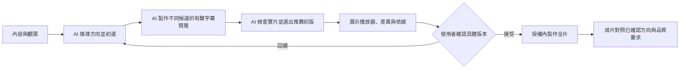

# 工程藍圖：video-production－美術方向選擇與驗收

- 模式：優化；本藍圖尚未施工。
- 根因報告：[rca-report.md](rca-report.md)，使用者已確認 R1～R3。
- 確認紀錄：根因已確認；使用者再回覆「確認，開始執行」，授權本版 W1～W4 施工與實跑驗收。此為 Skill 藍圖確認，沒有任何新影片方向被真人確認，也沒有把測試預設轉成真人決策。

## 1. 驗收條件

| 編號 | 驗收條件 | 來源 | 適用範圍 | 驗收情境 |
| --- | --- | --- | --- | --- |
| E1 | 沒有指定風格時，自行從內容、觀眾、理解目標推導候選，不能要求使用者補美術術語才啟動 | 本次 | 通用 | S1 |
| E2 | 未定方向時，同一內容至少兩個實際有聲／燒錄字幕候選；能指出美術表現與內容關係的差異、推薦理由、取捨；只有色彩或動線不同不能直接推成風格探索已完成 | 本次及既有 Phase 2／Rule 1 | 通用 | S1、S2 |
| E3 | 新內容沿用同類風格時須提供本片適配依據；不為求差異強迫每片換風格 | 既有 Rule 1；本次要求有依據 | 通用 | S3 |
| E4 | 方向沿用須能追溯確認來源與適用範圍；測試預設回覆不能寫成真人確認，也不能拿已定方向情境證明自動選風格已驗證 | 既有確認閘門及驗證狀態分離；本次產出落差 | 通用 | S4 |
| E5 | 候選實際畫面及最後代表片能對照推薦理由；未證明美術適配時明列未驗證，不以結構／技術通過宣稱已完成美術品質驗收 | 本次及既有成片評審 | 通用 | S2、S5 |
| E6 | 保留旁白時間焦點、語意動態與落定節奏、燒錄字幕、播放器、來源一致性與直接聽看限制 | 既有 | 通用 | S5（回歸） |


E4 解讀：必須先實作、自己評審並選出推薦結果，再向使用者展示與確認；確認不是代替 AI 的設計工作。使用者無須先選美術術語。相同風格可有依據採用，不以強迫差異代替適配。

### 從預期推導的責任與順序



本藍圖確認的是 Skill 的修改設計；圖中的 F 確認的是未來實際影片版本。根因確認、藍圖確認、美術版本確認、最終影片驗收各有對象與證據，互不替代。無可播放候選時不得啟動美術確認；如能力或素材受阻則報阻擋，不請使用者確認空白方向。

## 2. To-Be SOP

以下全文是施工目標，非目前已寫入。

````markdown
---
name: video-production
description: 將章節或主題素材製作成有旁白、燒錄字幕與動態敘事的影片，並交付成片與檢查紀錄。製作下一章影片、解說影片、video production、整體影片改版或修正聲畫焦點時使用；方向確認後在既有授權內完成製作。只做文字課程筆記改用 course-transcript-notes；只做 HTML 簡報改用 frontend-slides；只做動態美術諮詢改用 motion-art-direction。只重建已定版影片時依該片既有建置說明。使用者實際驗證：未驗證。
---

# SOP

## Phase 1 -- 確定內容與可用能力

1. `READ` 使用者需求、專案指引、指定章節素材、已有的影片設定與決策；續作時另讀現行交付紀錄。
2. `THINK` 確定本片識別、工具根目錄、本片目錄、本片設定與製作範圍；從授權區分提案、製作、修正與重建。
3. `READ` `rules/輸入與能力-格式規範.md` 的所有 Rule，建立「輸入與能力檢查清單」。
4. `THINK` 依輸入與能力檢查清單判定缺少資料與依賴；無缺漏時進入步驟 7。
5. `WRITE` 只向使用者詢問影響製作且無法從來源取得的缺少資料。
6. `CHECK` 回覆是否補齊資料；補齊後回步驟 4，未回覆則停止依賴該答案的工作，無法提供時列阻擋。
7. `READ` 工具根目錄的 README、第三方來源清單及各實際指令的 help，建立「製作工具介面」。
8. `DELEGATE` 使用製作工具介面初始化本片工作區、安裝鎖定依賴並執行能力小段實測；音訊生成／對齊依輸入與能力檢查清單選定的方法執行。
9. `CHECK` 實測結果；缺少必要工具時回報具體原因並停止依賴步驟，可替代的能力按輸入與能力檢查清單記錄限制。
10. `READ` `templates/製作計畫.md` 與 `templates/製作計畫.example.md`，載入「製作計畫樣板組」。
11. `WRITE` 依製作計畫樣板組及輸入與能力檢查清單建立內容依據、能力結果、依賴清單與既有決策。

完成條件：素材、理解目標、授權與能力均有紀錄，必要依賴可用或已明列阻擋。

## Phase 2 -- 設計方向與代表預覽

1. `READ` 製作計畫與既有方向確認紀錄。
2. `READ` `rules/敘事與焦點-格式規範.md` 的所有 Rule，建立「敘事與焦點檢查清單」。
3. `CHECK` 依製作計畫的方向決策紀錄與敘事與焦點檢查清單判定方向是否可沿用；可沿用時進入 Phase 3，否則繼續。
4. `THINK` 依敘事與焦點檢查清單選取能檢驗內容關係與閱讀負荷的代表段落。
5. `DELEGATE` 依 Phase 1 依賴清單的精確路徑載入 storyboard、editorial presentation-design 與 motion-art-direction，提供內容依據與代表段落，取得候選方向、推薦初選及製作 brief；將實際載入路徑與所得設計決策交接至製作計畫。
6. `DELEGATE` 使用製作工具介面及固定版 Remotion Skill，在隔離的候選目錄製作代表預覽。
7. `CHECK` 依敘事與焦點檢查清單檢視實際預覽；有問題回步驟 5 修正。
8. `WRITE` 將實作後的比較、最終推薦、能力限制及預覽連結寫入製作計畫，向使用者展示推薦初版及替代案。
9. `CHECK` 使用者確認方向後記錄並進入 Phase 3；要求調整回步驟 4，未確認則停在候選。

完成條件：有可審閱的代表預覽與方向確認紀錄，或已沿用既有確認方向。

## Phase 3 -- 對齊旁白與逐幕分鏡

1. `READ` 已確認方向、內容來源、既有旁白／音訊、能力結果與製作計畫。
2. `READ` `rules/敘事與焦點-格式規範.md` 的所有 Rule，建立「分鏡檢查清單」。
3. `THINK` 依分鏡檢查清單形成旁白與動態設計，判定是否需要變更既有決策；不需變更時進入步驟 6。
4. `WRITE` 展示須變更的內容、原因、時間影響與替代方案。
5. `CHECK` 取得變更確認後繼續，未確認時停止受影響工作，要求調整時回步驟 3。
6. `DELEGATE` 依製作工具介面及已確認配音方式取得音訊與實際語音對齊；尚未正式配音時先產生明確標示的預覽語音。
7. `READ` `templates/分鏡與焦點.md` 與 `templates/分鏡與焦點.example.md`，載入「分鏡與焦點樣板組」。
8. `WRITE` 依分鏡與焦點樣板組、分鏡檢查清單及實際對齊，建立逐幕設計與獨立焦點契約。
9. `CHECK` 逐條核對分鏡檢查清單；時間負荷不符時回步驟 3 修正，涉及變更時通過對應確認步驟。

完成條件：每段解說都有可執行分鏡與時間契約，配音來源與未驗證事項可追溯。

## Phase 4 -- 製作、編碼與技術守門

1. `CHECK` 本次授權是否涵蓋正式製作；只有提案授權時展示已有預覽並停止正式製作。
2. `READ` 確認後分鏡、實際時間軸、本片設定與工具介面。
3. `DELEGATE` 使用本片 Remotion workspace 與固定版官方 Skill 實作場景、字幕及實際繪圖共用狀態；沿用已通過代表段，其他場景依各自分鏡製作。
4. `DELEGATE` 使用製作工具介面執行本片檢查與候選成片編碼。
5. `CHECK` 技術結果；失敗時保留既有正式交付並回步驟 3 修正；通過才進 Phase 5。

完成條件：候選完整成片及技術證據已產生，尚未以未評審版本取代正式交付。

## Phase 5 -- 成片評審、修正與交付

1. `READ` `rules/成片評審-格式規範.md` 的所有 Rule，建立「成片評審檢查清單」。
2. `CHECK` 依成片評審檢查清單核對實際成片與證據；能力允許時直接聽看，不能直接聽看時採已實測替代檢查並保留限制。
3. `THINK` 依成片評審檢查清單及本片理解目標，從實際畫格與時間點評審內容負荷與溝通問題；已有可用授權證據的診斷版 presentation-design 時才按精確路徑載入輔助。
4. `READ` `templates/評審與交付.md` 與 `templates/評審與交付.example.md`，載入「評審與交付樣板組」。
5. `WRITE` 依評審與交付樣板組記錄各面向結果、問題、修法與未驗證項目。
6. `CHECK` 有可修正缺陷時回 Phase 4，涉及既定決策變動時回 Phase 3；無缺陷時繼續。
7. `DELEGATE` 使用製作工具介面發布已評審成片到本片交付入口，保存來源、重建命令與相同影片雜湊。
8. `WRITE` 提供成片與簡短檢查結果；仍需使用者判斷的項目具體列出，已有使用者接受紀錄時沿用。
9. `CHECK` 使用者接受時記錄驗收與版本，回報問題時回相應製作階段，未回覆時記為待驗收，不重問既有方向與授權。

完成條件：交付入口、來源與證據對應同一版本；AI 檢查及使用者驗收分別有明確狀態。
````

步驟目的：P1 輸入、能力與決策來源承接 E1/E4/E6；P2 先做選擇與實片再確認承接 E1～E4；P3/P4 旁白契約與製作承接 E6；P5 對照已選方向、成片檢查與交付承接 E5/E6。每個分支與載入步驟是對應輸出所需的必要流程。

## 3. 差異表

### 刪除

不刪任何檔案、Phase、步驟、Rule 或樣板組。改寫既有樣板的無來源「已確認」自由欄位及模糊候選比較欄位；刪除其作為唯一方向證據的用法。移除 P2 在載入敘事檢查清單之前先判定沿用的順序；改為先載入再判定。歷史產物保留，僅補充驗證適用範圍。

### 修改與約束位置

| 元素 | 動作 | 具體改動 | 追溯 |
| --- | --- | --- | --- |
| P2 READ／CHECK | 改寫與重排 | 沿用判斷之前先載入既有規則；引用有來源的方向紀錄 | R1、E4、C18 |
| P2 DELEGATE 候選／WRITE 展示 | 改寫 | 先取得 AI 初選，再製作比較與最終推薦；記實際使用 Skill 的設計決策 | R2、E1/E2、C20 |
| 敘事 Rule 1 | 改寫 | 美術方向要以實際視覺語言與內容對應判斷；只有換色、卡片位置或動線不能自證完成探索；同風格適用須說原因；真人、測試與推定不能混用 | R1/R2、C5 |
| 製作計畫雙檔 | 改寫 | 決策來源表、設計 Skill 使用紀錄、美術候選可比欄位、AI 推薦初版及真實版本確認 | R1/R2、C15 |
| 成片評審 Rule 1／3／4 | 改寫 | 實片對照已選美術方向；工程、美術適配、真人結果分開；美術有已知缺陷不能用技術通過放行 | R3、C9/C11/C12 |
| 評審與交付雙檔 | 改寫 | 美術方向符合性逐項對照表，記確認版本、實片時間／畫格、差異、修正、判定 | R3、C17 |
| 14 號驗收說明／WORKFLOW | 澄清現有狀態 | 工程情境已跑不代表 CH2 美術下限已證明；植物沿用測試不能證明開放選風格能力 | R3、E5 |

### 所有既有元素處置

| 元素 | 動作 | 追溯／約束 |
| --- | --- | --- |
| frontmatter name/description | 保留原文 | E1/E6；用途與未驗證標示仍成立；非約束存放位置 |
| P1 全 11 步／完成條件 | 保留原文 | E1/E4/E6；C1～4、C15、C18～19；格式責任在樣板 |
| P2 全 9 步／完成條件 | 上列 4 處改寫，其餘原文保留 | E1～4；C5/C6/C18/C20；先實作後確認 |
| P3 全 9 步／完成條件 | 保留原文 | E6；C4/C6～8/C16/C18 |
| P4 全 5 步／完成條件 | 保留原文 | E6；C13/C14/C18/C20 |
| P5 全 9 步／完成條件 | 保留原文，原有 CHECK 使用修改後規則 | E5/E6；C9～12/C17/C18/C20 |
| 輸入與能力 Rules 1～4 | 保留原文 | E1/E6；C1～4 |
| 敘事 Rules 2～4 | 保留原文 | E6；C6～8/C21～23 |
| 成片評審 Rule 2 | 保留原文 | E5/E6；C10 |
| 分鏡與焦點雙檔 | 保留原文 | E6；C16/C21～24 |
| Skill 腳本 | 無 | 不新增；專案現有工具 C13/C14 原樣使用 |

刪除／改寫／改換位置／新增的依序評估：R1 以改寫既有樣板提升來源可檢查性；R2 改寫既有規則與候選結構；R3 擴充原本成片評審主題與紀錄。不需要新增檔案、微型 Skill 或自動評分腳本。美術語意不可僅靠欄位非空判定。

## 4. 淨增減

| 項目 | As-Is | To-Be | 增減 |
| --- | --- | --- | --- |
| Phase | 5 | 5 | 0 |
| 步驟 | 43 | 43 | 0 |
| RuleFile | 3 | 3 | 0 |
| Rule | 12 | 12 | 0 |
| 樣板組 | 3 | 3 | 0 |
| Skill 腳本 | 0 | 0 | 0 |

## 5. 約束分配表

沿用原編號，以下完整列既有約束，對應此次 E6 保留與 E1～5 改寫。規則管語意判準，樣板管結果結構，流程管順序，不把同一判準重寫三份。

| 編號 | 約束 | 所屬步驟 | 存放位置 | 理由 |
| --- | --- | --- | --- | --- |
| CH2 現行交付摘要 | 修改 | 補記本次使用者已接受；保留 AI 未直接聽看事實；不改影片位元、不重建 | E11、E18 |
| C1 | 來源、理解目標、限制及缺漏的判斷 | P1 THINK 判定缺少資料 | 輸入與能力 Rule 1 | 需語意判斷與正反例，程式／樣板結構不能決定 |
| C2 | 依賴精確路徑、版本與第三方授權邊界 | P1 THINK 判定依賴 | 輸入與能力 Rule 2 | 需依現場安裝狀態判斷，不是單純欄位格式 |
| C3 | 當次能力探測、直接聽看與替代證據區分 | P1 DELEGATE 小段實測 | 輸入與能力 Rule 3 | 能力宣告需依工具與實測判斷，非 ffprobe 能證明 |
| C4 | 新稿、原音、暫定／正式配音與對齊方式選擇 | P1/P3 DELEGATE 音訊 | 輸入與能力 Rule 4 | 需依授權／素材判斷；數值對齊檢查由 C13 負責 |
| C5 | 候選的內容適配、配色／結構比較及推薦 | P2 THINK 選段、CHECK 預覽 | 敘事與焦點 Rule 1 | 美術語意需正反例，樣板只規範記錄結構 |
| C6 | 動作語意、觀看對象及閱讀停留 | P2/P3 設計 | 敘事與焦點 Rule 2 | 無法用元素數量自動判斷理解目的 |
| C7 | 從旁白獨立制定逐項期望、對齊與轉場理由 | P3 WRITE 契約 | 敘事與焦點 Rule 3 | 期望的語意正確性不能由動畫自證 |
| C8 | 名稱、路徑、鏡頭、字幕的可讀性設計 | P3 THINK 設計 | 敘事與焦點 Rule 4 | 需實際觀看判斷，狀態可見性不等於可讀 |
| C9 | 實際成片取樣涵蓋中尾與所有有意義過渡 | P5 CHECK 成片 | 成片評審 Rule 1 | 週期抽幀可自動，語意風險選點需判斷 |
| C10 | 問題、修正、重建與複查的證據標記 | P5 WRITE 評審 | 成片評審 Rule 2 | 哪些畫面受影響需判斷，不能只按檔名 |
| C11 | 五類驗證結果與使用者接受獨立記錄 | P5 WRITE 評審／交付 | 成片評審 Rule 3 | 不同證據能支持什麼需語意判斷 |
| C12 | 阻擋問題與能力限制的交付措辭 | P5 CHECK 結果 | 成片評審 Rule 4 | 不可用布林技術成功代表整體完成 |
| C13 | 逐影格焦點／名稱／裁切、影音規格與時間連續性 | P4 DELEGATE 檢查 | 專案 motion_checks.py | 明確資料可重複程式判斷，優先於規則 |
| C14 | workspace／候選隔離、完整來源指紋、原音處理與發布保護 | P4/P5 DELEGATE 建置／交付 | 專案 motion_project.py | 可程式強制，避免用散文承諾 |
| C15 | 製作計畫整份結構 | P1/P2 WRITE 計畫 | 製作計畫樣板組 | 全份輸出結構，不再做重複結構檢查腳本 |
| C16 | 分鏡與焦點整份結構 | P3 WRITE 分鏡 | 分鏡與焦點樣板組 | 同上；JSON 資料有效性屬 C13 |
| C17 | 評審與交付整份結構 | P5 WRITE 紀錄 | 評審與交付樣板組 | 全份輸出結構，實際判斷屬 C9–C12 |
| C18 | 方向／變動／製作授權與失敗返回位置 | P1–P5 CHECK 分支 | SOP 流程 | 必要控制流程留在 SOP |
| C19 | 本片與工具目錄識別 | P1 THINK 確定目錄 | SOP 該步驟 | 一次性定位一句可表達，不另建腳本 |
| C20 | 精確 Skill 委派與產出交接 | P2/P4/P5 DELEGATE | SOP 對應步驟 | 執行順序與交接；不改第三方內容 |
| C21 | 每個解說節拍的核心、詞句及落定 | P2/P3 | 敘事 Rule 2 | 語意判斷，非固定表格或數值可保證 |
| C22 | 動靜節奏依語音及閱讀量，壓低干擾 | P2/P3 | 敘事 Rule 2 | 同上 |
| C23 | 切點收束及跨幕動作連續理由 | P2/P3 | 敘事 Rule 2 | 同上 |
| C24 | 每個切點連續編碼序列、逐幀觀察與證據範圍 | P5 | 成片評審 Rule 1 | 語意風險與取樣觀察需判斷 |

C5 本次改寫涵蓋美術適配與差異的可檢查性及已定方向證據資格；C15 格式以來源／類型／版本／範圍及預覽為獨立欄位；C9/C11/C12 涵蓋方向符合性、分項結果及不得過度宣告；C17 格式新增方向符合性表。無新 C 編號，避免將同一既有責任包裝成新增要求。

## 6. 施工工作項

| 順序 | 工作項 | 執行者 | 目標 | 內容 | 約束 | 狀態 |
| --- | --- | --- | --- | --- | --- | --- |
| 1 | W1 | skill-form-sop | SKILL.md P2 | 寫入本藍圖 To-Be 中四處順序／交接改寫，其餘原文保留 | C18/C20 | 已完成 |
| 2 | W2 | skill-form-rule | 敘事 Rule 1、成片 Rule 1/3/4 | 依下列工作內容改寫判準與例子 | C5/C9/C11/C12 | 已完成 |
| 3 | W3 | skill-form-template | 製作計畫、評審交付雙檔 | 依下列工作內容改寫骨架及示意範例 | C15/C17 | 已完成 |
| 4 | W4 | skill-engineering | 證據與狀態 | 澄清 14 號驗證範圍，audit、實體同步、執行情境並回填 | E1～6 | 已完成 |

### 工作項內容

W1：使用 skill-form-sop，修改 Phase 2「設計方向與代表預覽」的 READ／CHECK「判定方向是否可沿用」、DELEGATE「取得候選方向、推薦初選及製作 brief」、WRITE「最終推薦／推薦初版及替代案」，內容逐字依第 2 節 To-Be。既有部位早已存在，不引入待建立部位，不新增抽取；不更動其他 Phase。

W2：使用 skill-form-rule，改寫敘事與焦點 Rule 1：AI 主動從內容、觀眾及目標形成候選，先選出初選並實作，再依實際畫面修正推薦；比較具體的圖像表現（例如插畫／實物／圖解的選擇）、構圖與文字層級、材質／空間、動態語言與內容關係，適用哪些項目由內容決定，並非各片必須全換。至少兩個候選須能證明美術選擇，單改色、卡片位置或動線不足時必須明列、補實作；不能硬要求每片不同或杜撰色彩心理。已有方向僅在有可追溯來源、版本、適用範圍時沿用；AI 推定與測試預設不能替代真人確認。正例為實片比較支持推薦；反例含空白選項先問用戶、同一卡片換位自稱風格探索、測試預設冒稱真人確認。

成片評審 Rule 1：在現有編碼片評審中以實片位置對照已選方向的辨識特徵及內容目的，發現退回套版或偏離推薦時定位修正。Rule 3：原五種證據仍分開，另將美術方向符合性與理解適配的觀察及尚待真人判斷範圍記清楚；抽幀不能證明連續聽感。Rule 4：有已知美術方向落差時先修正，技術成功不能宣告美術品質完成；限定測試的結案須明示範圍。判斷依據不在 SOP 或模板重述。

W3：使用 skill-form-template，製作計畫的既定方向增加一張來源表（事項、來源類型、原話或證據、版本／範圍、狀態）；類型可區分真人、測試、AI 推定，確定如何記錄由 Rule 1 判斷。增加設計 Skills 使用表（實際路徑／版次、讀取證據、採用決策與預覽位置）。候選表改為方向、同內容播放器／縮圖、圖像與構圖特徵、內容與觀眾適配證據、動態與閱讀、取捨；保留推薦與未驗證欄位，增加候選版本識別，最終推薦另指向其中一個具體初版。確認表將確認對象與實際來源分欄，能記根因、Skill 藍圖、美術版本、全片驗收，但不把其他確認轉成美術確認。

評審與交付增加「美術方向與實片符合性」表（方向決策版本、特徵／理解目的、成片位置／證據、觀察與落差、處理結果）；原五種證據與節奏表全部保留。兩組 example 與骨架標題／表頭一致，維持圖書借閱通知的示意標示，不杜撰真實預覽或確認。舊範例的紙張交棒／旅程路徑不足以證明美術差異，改成有具體不同美術語言的示例，但仍全部未驗證。

W4：本工程案補充記錄 14 號的工程情境不等於正式品質驗收；WORKFLOW 狀態避免讓整體工程完成遮掉尚未驗證美術適配。執行兩側 audit 與 sync --from agents／--check，使用含未提交改動的隔離複本、無本次分析脈絡代理實跑 S1～S5。可共用代表內容的音訊與對齊，不能拿舊候選直接改稱新風格已通過。至少 S1 生成實際有配音／燒錄字幕的風格預覽與播放器、AI 推薦後才進真人方向閘門。測試預設回覆只用於隔離驗收，不記成真人已選。若工時／能力未完成則寫未驗證，不發工程完成聲明。只驗證既有不受影響工具的部分逐步演練並標示，不重跑全量無關測試。不改第三方 Skill 原文，不刪任何歷史、不重製 CH2、不 commit/push。

## 7. 驗收情境

| 編號 | 輸入 | 確認閘門預先回覆 | 判斷方式 |
| --- | --- | --- | --- |
| S1 | 使用本次退款內容、觀眾與目標，不提供風格或範例圖 | 展示實際候選後選推薦方向 | 不需額外美術提示即提出內容導向候選、差異及推薦；保留實際載入 Skills 的證據 |
| S2 | 提供只換色／位置／路徑的同一圖解候選，聲稱完成美術探索 | 要求依 Skill 判斷後再繼續 | 能指出證據不足，不能將美術探索列通過；修正後需重新檢查實際預覽 |
| S3 | 不同主題仍推薦同類圖解風格 | 接受有依據的推薦，不要求強行換風格 | 說明該內容結構為何適用、何種訊息不適用及取捨，不以機率或慣例搪塞 |
| S4 | 植物輸入標示測試預設淺綠；另提供沒有任何確認來源的方向 | 測試預設接受；真人未回覆 | 測試與真人分列；無確認來源不能冒稱既定方向；既定方向測試不算選風格通過 |
| S5 | 選定候選後代表段刻意退回統一卡片套版或取消內容關聯，另含焦點／字幕缺陷 | 修正有問題項目，未真人驗收 | 能從實際成片攔下方向落差並保留其他品質閘門；工程／美術／真人驗證分列 |


所有情境的「預先回覆」都是隔離測試預設，非真人確認；每個情境都檢查確認來源記為「測試」，不得出現由該回覆推成「真人已確認方向」的紀錄。S1 是實際有聲候選與播放器驗證；S2/S4 可採獨立缺陷輸入驗證攔截，不冒充完整影片品質驗收；S3 檢查有依據的相似風格推薦；S5 檢查實片退回套版與既有品質回歸。第三方 Skills 的實際載入證據需保存，不能只列安裝路徑。

## 8. 驗收結果

W1～W4 已完成，S1～S5 依各自方式通過；詳見 [acceptance.md](acceptance.md)。S1 為無分析脈絡代理實作、經主代理實片複查修正後的雙候選與播放器；S2～S5 為獨立缺陷輸入與指定實片的判斷／阻擋測試，非完整新片製作。兩側 audit 均 0 error／1 REF003 warning，原因見 implementation.md；實體同步通過，無僅存在目標端未刪除的 Skill。SOP 與 To-Be 一致，5 Phase／43 步，三組樣板配對通過。

本次 Skill 工程驗收與真人影片美術方向分開；真人尚未確認新候選，AI 直接連續聽看仍未驗證。未重製 CH2、未提交或推送 Git。既有 CH2 基準保持。
