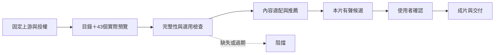

# 固定風格庫整合藍圖

## Before / After

原先：一般設計指引 → AI 自行形成兩案，沒有固定風格資料或缺庫失敗。
現在：固定來源、預覽、目錄完整性 → 依內容選庫內 ID → 同內容有聲候選 → 使用者確認 → 成片與焦點檢查。

## 工程分工與介面

主 Skill 編排既有設計、敘事及評審；固定庫放 videos/style-library，上游原文放 videos/.agents/skills/huashu-art-motion，不修改第三方。style_library.py 提供 check/list/gallery/render；motion_project.py 新設定啟用 style_library_required，prepare/render/review/deliver 檢查 style_selection，來源指紋包含目錄、選用及鎖檔。

庫內選用不需臨時網路搜尋；庫外擴充單獨處理。歷史重建在隔離設定明列豁免與理由，不修改原始歷史設定，不以此規避新片守門。根目錄 MIT 不覆蓋第三方例外。

## 施工與驗收

1. 固定依賴、42 個實際渲染項目及播放目錄。
2. Skill SOP、輸入／敘事規範、雙檔計畫樣板及工具守門。
3. 成功與故障注入、既有工具回歸、Claude 審查、同步。

授權：使用者已要求開始執行並要求實際成果，不再只交提案。未刪除歷史、未重製 CH2、未提交推送；不更動家目錄 Skill 或 submodule。

施工結果：各工作項已完成；實際數量、故障測試、播放器檢查及限制見 acceptance.md。上游角色故事缺素材已停用，沒有為達原先數量假造成功。
